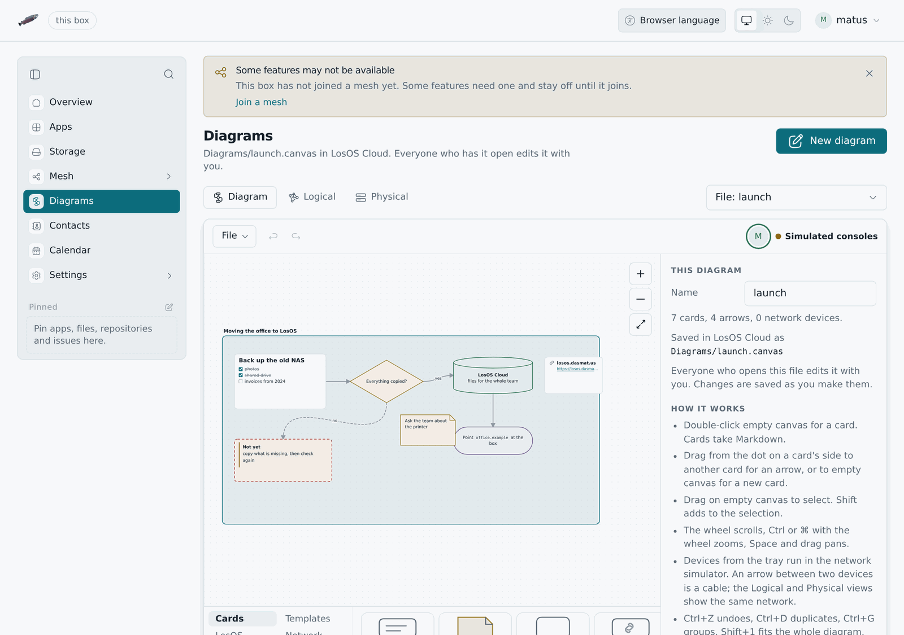

# Diagrams



LosOS Diagrams is a diagram editor: flowcharts, plans, mind maps, boards
and network drawings, written as cards on a canvas. Its files are JSON
Canvas, the format Obsidian Canvas uses, so a `.canvas` file moves between
the two without losing anything. It also knows LosOS. A network you draw
runs its own traffic, and a card can stand for a machine you ordered on the
mesh. It is a screen of the admin UI at `/diagrams`, under **Diagrams** in
the sidebar, laid out the way LosOS Mail is: the heading with **New
diagram** beside it, a row of buttons for the views with the setup picker at
its end, and one card holding the tools, the canvas, the tray and the
inspector. Like the rest of the admin UI it answers only on the local
network. The old address, `/lab/`, sends you on to the new one.

The row under the heading switches between three views of one document:
**Diagram**, the canvas, and **Logical** and **Physical**, the network in it
as the simulator draws it.

## The diagram

- **Cards.** Double-click the canvas for a text card, or pick one from the
  tray: text, a note, a group, a web page, and the shapes pill, diamond,
  circle, parallelogram, hexagon, database, document, process and cloud. A
  card's text is Markdown: headings, lists and task lists, quotes and
  callouts, code, links, `**bold**`, `*italic*`, `~~struck~~` and
  `==marked==`. Double-click a card to edit it; Escape or a click outside
  ends the edit.
- **@ tags.** Type `@` in a card for a list of the people on the box and
  the files in your LosOS Cloud. A person goes in as their sign-in name,
  `@eva`, and the card shows it with their picture. A file goes in as a
  link, `[@plan.canvas](/diagrams?file=…)`, that opens a diagram in
  Diagrams and any other file in its folder in LosOS Cloud. Obsidian reads
  both as plain text and a link.
- **Arrows.** Drag from one of the four handles on a card's sides onto
  another card, or onto empty canvas for a new card there. An arrow takes a
  label, a route (straight, square or around the cards), a dotted or dashed
  line and a head at either end. Between two devices the arrow is a cable,
  unless the tray's **Arrow** is armed.
- **Groups, colours and layout.** A group is a labelled frame; cards inside
  it move with it. Six colours follow the light and dark themes, or pick
  any colour. The inspector orders, aligns, groups, duplicates and deletes
  what is selected, and so does a bar that comes up above the selection
  (see [the bar over a selection](../manual/admin-pages#the-bar-over-a-selection)),
  which also draws an arrow between two picked cards. Undo and redo cover
  every change.
- **Templates.** A flowchart, a service architecture, a mind map, a board
  and a home network, put down where you click.
- **Files.** **File** saves the diagram as a `.canvas` file and opens one.
  With LosOS Cloud on the box, it also opens and saves diagrams there, and
  a `.canvas` file in LosOS Cloud opens in Diagrams. Saving back names the
  version it read, so if the file changed meanwhile, the save is refused
  and nothing is overwritten. Ctrl+S saves to wherever the diagram came
  from. The picture exports as SVG or PNG.
- **Editing together.** A diagram opened from LosOS Cloud is live: open the
  same file in another tab or on another computer and both edit one
  diagram. LosOS Cloud keeps it in the same live room as a text file and
  writes every change to the file a moment later, so there is nothing to
  save. The faces of everyone who has it open are in the tool row above the canvas, and each
  person's pointer, name and selection show on the others' canvas in that
  person's colour. Undo takes back your own changes, not someone else's.
  Share a `.canvas` file with someone on another box and it opens in
  Diagrams from their **Shared with you**, in the same room; a view-only
  share shows the diagram and takes no change. When two people change the
  file at the same moment, both changes are kept.
- **Machines.** The tray's **Machines** lists the virtual machines this box
  ordered on the mesh. Put one down and its card shows each copy and what
  it is doing, read again every 20 seconds. A card can also plan a machine
  from an image; its **Order** link opens the Machines page with the image
  and name filled in. A box that does not share its disk with the mesh is
  offered no machines, and the tray says why.

Shapes, borders, text alignment, line styles and arrow heads are written as
`styleAttributes` with the names the Advanced Canvas plugin for Obsidian
uses. Keys that Diagrams does not know, on the document, a card or an
arrow, are kept as they were when the file is saved again. Older `.llf` files
from the network simulator still open.

## The network

A device from the tray (a box, an edge, a router, a switch, a laptop) is a
card that the simulator runs, and an arrow between two of them is a cable.
The page opens on **This box**: it reads the box's settings and the edges
it found, using the same three admin routes as the other pages, and draws
the box from them: its router, the edges in reach, the official edge when
one is configured, and a laptop. Diagrams guesses the router, the cables
and the laptop, because the box cannot see them. Diagrams never writes to the box.
If nobody is signed in, it says so and opens the built-in setups.

- **Logical and Physical views.** The logical view shows subnets, the edge
  paths and the mesh. The physical view shows racks, desks and the cables
  between them.
- **Realtime and Simulation modes.** Realtime plays traffic as it happens. It
  has a clock you can speed up (1×, 10×, 60×, 10 min/s, 1 h/s) and a button
  that skips to the next timer: the 00:07 reboot, the 03:00 upgrade, the
  04:30 garbage collection, and the start and end of the compute window.
  Simulation holds every packet until you press Play or Step, and lists each
  hop with its protocol.
- **Your own setups.** Start from a new diagram or any built-in setup, drag
  devices up from the tray, and pull copper, fiber or Wi-Fi between their
  ports. The last diagram you changed is kept in the browser and listed as
  "Last diagram" in the picker. An opened file is rebuilt with the same
  tools as the tray, so a device or cable in it the tray could not make is
  left out, and the page says how many parts it dropped.
- **Built-in setups.** Two sites behind one official edge, a single home box,
  a company with its own gateway, a LAN with no internet, and three textbook
  shapes: star, bus and web. They are only starting points, built with the
  same tray.
- **A laptop running LosOS Desktop.** It has the sign-in screen, the
  overview, and the browser you can point at any box or edge in the diagram.
- **Network gear** (routers, switches, Wi-Fi access points and a coax bus)
  runs a small system of its own called Netzgeräte Betriebssystem. Its
  console has `show interfaces`, `show ip route`, `show arp` and
  `show dhcp`.

The network follows the same rules as the real software. Examples: a box
with no edge in reach starts no tunnel; a mesh switch is refused with
`edgeRequired`; the market opens only next to an official edge (one that
passes the gateway checks); a LAN gateway with open enrolment
takes unknown boxes on first use; and the admin routes refuse loopback.

## The two copies

| | On the box (`/diagrams/`) | Hosted |
| --- | --- | --- |
| Built by | `nix build .#losos-admin-ui` (Diagrams is a screen of it) | `admin-ui/lab/engine/build.sh` in `lab.yml` |
| Consoles | simulated, or real guests under libvirt when the box runs the helper | real x86_64 guests under libvirt on your computer, else qemu-wasm |
| Needs | nothing beyond the box | a cross-origin isolated host (COOP + COEP) |

Diagrams is part of the admin UI: `src/lab/app.tsx` is the screen at
`/diagrams`, its own chunk, fetched the first time someone opens it, and
built from the same components, palette, icons and languages as every pane.
Everything that is not drawing
runs in WebAssembly: the model, the simulator, the clock, the consoles and
the pages are a Rust crate, `admin-ui/lab/core` (`losos-lab-core`), which
nix builds for wasm32 before the admin UI's own build. The admin page's
content security policy carries `'wasm-unsafe-eval'` so the browser may
compile the core; that lets a page compile WebAssembly and nothing more, and
script still comes only from the box's own files.

The hosted copy is the same screen on a page of its own
(`admin-ui/app/diagrams/index.html`, built only with `VITE_LAB_HOSTED=1`), plus
[qemu-wasm](https://github.com/ktock/qemu-wasm): QEMU compiled to
WebAssembly, so every console is a real Linux guest in the browser tab.
Boxes and edges boot a busybox stand-in for LosOS, and the network gear
boots Netzgeräte Betriebssystem, built by nix from
`admin-ui/lab/engine/gear/netzgeraete.nix`. The page joins the guests'
network cards into the diagram, so DHCP, ARP, ping and HTTP between guests
travel the cables you drew. A router guest hands out leases with its own
`udhcpd`. A tab runs up to three guests at once. With a fourth, the guests
ran out of cores and stalled, so the page refuses to boot one. qemu-wasm
runs QEMU's threads as Web Workers that share memory, and browsers allow
that only on a page served with `Cross-Origin-Opener-Policy: same-origin`
and `Cross-Origin-Embedder-Policy: require-corp`. `vercel.json` sets both
headers on Vercel, and `serve.json` does the same for `serve` on your own
machine:

```sh
admin-ui/lab/engine/build.sh /tmp/lab     # docker, nix, bun
bunx serve@14.2.4 -l 8080 /tmp/lab        # then open http://localhost:8080/diagrams/
```

`lab.yml` builds the hosted copy for every pull request that touches
`admin-ui/lab/` or the page in `admin-ui/app/` and uploads it as the `losos-lab-hosted` artifact. On a push
to `main` it also deploys the copy to Vercel, if the repository has the
`VERCEL_TOKEN`, `VERCEL_ORG_ID` and `VERCEL_PROJECT_ID` secrets.

## The GPU canvas

The Logical and Physical views have two canvases (the Diagram view is
always drawn by the page itself). The page always starts with the SVG one, so
the setup is on screen as soon as the core is loaded. Then it asks the
browser what it offers. With WebGPU it loads the WebGPU build of
`admin-ui/lab/render` (`losos-lab-render`). Without WebGPU but with WebGL2 it
loads the WebGL2 build. With neither, it stays on SVG.

Each build is Bevy 0.19.1 compiled to WebAssembly together with the page's
core. The page moves the setup into the module's own core by replaying every
change it made to the first one, and goes on only if both then describe the
same setup. The Bevy canvas then takes the SVG canvas's place and keeps the
selection, the tool and the camera.

The scene is 3D. Every room, Wi-Fi range, cable and device is a flat mesh of
its own on a ground plane, and an orthographic camera looks straight down at
it, so both views look as they do in SVG. Names and addresses are text in
screen space over the scene. Clicks are ray casts from the camera into the
scene.

The page goes back to SVG and says so once if the module does not load, if
no frame arrives within 20 seconds, or if the GPU device is lost later. A
lost WebGPU device is remembered in the browser, and the next visit starts
on WebGL2.

Each build is about 16 MB of WebAssembly, 3.4 MB with brotli for WebGPU and
3.6 MB for WebGL2. The browser fetches only the one it uses, after the SVG
canvas is drawn. The page's content security policy needs no change,
because `'wasm-unsafe-eval'` already lets the browser compile the core.

:::tip[Pick the canvas yourself]
To pick a canvas, add `?canvas=svg`, `?canvas=webgpu` or `?canvas=webgl2` to
the address. The local storage key `losos-lab-canvas` takes the same values
and keeps the choice in that browser. The engine badge in the tool row names
the canvas in its tooltip.
:::

## Guests under libvirt

qemu-wasm is slow. It emulates every instruction with no KVM, each guest
costs the tab about 450 MB, and a tab runs three. If the computer Diagrams is open on has libvirt (the thing
virt-manager drives), Diagrams can run its guests there instead, under KVM
when the CPU has it. They boot in a few seconds, and up to eight run at once.

There are three ways a guest can run, in order of preference:

1. **The helper drives libvirt through `virsh`.** The helper is a
   subcommand of the edge registrar, `losos-registrar lab`, running on the
   same computer as libvirt. It needs libvirt, QEMU and the `virsh` command
   there, and the guest images in a folder the helper can read.
2. **The page drives libvirt itself, through the helper's relay.** The
   helper also offers a WebSocket that it copies, byte for byte, to
   libvirt's own socket. The page carries the WebAssembly libvirt
   client (`admin-ui/lab/virt-rpc`, the package `losos-lab-virt`) and
   speaks libvirt's protocol over it, so this path needs the helper and a
   running libvirt daemon but no `virsh` and no libvirt client library on
   the computer. The page uses it when the helper's `virsh` is missing,
   and for any guest the first way could not start.
3. **qemu-wasm in the tab.** Nothing on the computer at all, only the
   hosted copy's engine. This is the slow path, and the fallback for any
   guest the first two cannot start.

### The helper and `virsh`

The helper starts each guest as a transient domain named `losos-lab-...`
with `virsh create`. Transient means libvirt never saves it, so nothing
outlives the helper. Ctrl-C or SIGTERM destroys every guest it started, the
helper destroys a guest no page has watched for a minute, and on start it
removes any `losos-lab-` domain a killed helper left behind. A guest is
on no libvirt network and no bridge. Its serial console and its network
card are connected to the helper on 127.0.0.1, and the helper hands both to
the page over WebSockets. The page is still the switch, so a libvirt guest
and a qemu-wasm guest can share a cable, and DHCP, ARP and ping between
them work as before.

To use it next to virt-manager on your own PC:

1. Install libvirt and QEMU (on most distributions, the packages virt-manager
   already pulled in) and the `losos-registrar` binary
   (`nix build .#losos-registrar`).
2. Put the guest images in a folder named `guest`: `bzImage`, `rootfs.bin`
   and, for routers, switches and access points, `gear.bin`.
   `admin-ui/lab/engine/build.sh` makes all three, and the hosted copy serves
   them under `/diagrams/guest/`, so you can download them from there.
3. Start the helper in the folder above `guest`:

   ```sh
   losos-registrar lab --origin https://your-lab.example.org
   ```

   It listens on `127.0.0.1:8095` and uses `qemu:///session`, which needs no
   root. Pass `--connect qemu:///system` to have the guests show up beside
   your other VMs in virt-manager (your user must be in the `libvirt` group,
   and libvirt's own qemu user must be able to read the images folder).
   `--origin` names the address of the Diagrams page you open; a copy served on
   `localhost:8080`, as above, is allowed without it. The other
   flags are `--images DIR`, `--max-guests N` (8), `--memory MiB` (96),
   `--virt-type auto|kvm|qemu`, `--idle 60s`, `--virsh PATH` and
   `--token-file FILE`. Without a token file the helper refuses to listen on
   anything but loopback, and answers only requests addressed to
   `127.0.0.1` or `localhost`.
4. Open Diagrams. A copy on `localhost` looks for the helper by itself. A
   hosted copy looks only once you open it with `?libvirt` at the end of the
   address, because Chrome asks every visitor of a public page for local
   network access the moment it touches `127.0.0.1`. The page remembers the
   choice; `?libvirt=0` forgets it.

The badge in the tool row then says "KVM via libvirt" (or "QEMU via libvirt
(no KVM)" on a computer without it), and each console says what runs its
guest: libvirt, or "QEMU in this tab". If the helper is not running, or
libvirt refuses a guest, that guest boots under qemu-wasm as before, and the
page says so once. The box's own copy has no qemu-wasm, so there it keeps the
simulated console.

### The WebAssembly client and the relay

A web page cannot open libvirt's socket. Browsers offer no raw TCP and no
unix sockets to a normal page, and libvirt has no WebSocket listener of its
own. So the helper relays. The page asks `POST /lab/v1/virt-ticket` for a
ticket, then opens the WebSocket `/lab/v1/virt` with the subprotocols
`losos-lab` and `ticket.<ticket>`. The ticket is good once, for 30 seconds.
The helper connects to the socket of its `--connect` URI and copies bytes
both ways without reading them. For `qemu:///session` that socket is
`$XDG_RUNTIME_DIR/libvirt/virtqemud-sock`, or `libvirt-sock` beside it for a
monolithic libvirtd. For `qemu:///system` it is
`/run/libvirt/virtqemud-sock`, then `/run/libvirt/libvirt-sock`. A
`?socket=PATH` in the URI names the socket directly, as it does for
`virsh`. The helper keeps at most `--max-guests` relayed sockets open at
once.

`GET /lab/v1/hello` reports this path on its own, as
`virt: {available, socket}`. `available` is true when the socket accepts a
connection right now, so it can be true while `virsh` is missing. The
helper does not start a session daemon the way `virsh` does, so with
`qemu:///session` the daemon must already be running or started by its
systemd socket.

The page uses this path by itself (`engine/virt-rpc.ts`). For each
guest it asks for a ticket, opens one relayed connection, creates the
domain paused, opens its console, and then resumes it, so the console sees
the first byte the guest prints. The domain is the one the helper would
have written for `virsh`, except that the serial port is a pseudo terminal
the client reads as the domain's console. The client's module, about
220 KB, is loaded only when the first guest starts on this path. The
console header says "KVM via libvirt from WebAssembly", or "QEMU via
libvirt from WebAssembly (no KVM)". Without KVM the first domain is refused
and the page asks again for plain QEMU.

Each ticket also comes with a network card: the helper binds the same kind
of UDP tunnel it gives its own guests and answers with its two ports, a
name for the domain (`losos-lab-virt-...`) and a second ticket. The page
writes the tunnel into the domain and opens the card at
`guests/<key>/nic/0`, so these guests are on the diagram's cables like the
others, and a guest of either path can ping one of the other. The card
counts against `--max-guests`; a helper that is full still hands out the
relay ticket but no card, and the guest then boots with no network, which
its console header says.

The client creates its guests with libvirt's autodestroy flag, so they end
when the connection does: when the tab closes, and when the helper stops,
because the helper closes every relayed socket on Ctrl-C or SIGTERM. When
the page powers a guest off, it destroys the domain itself and hands the
card back with `DELETE guests/<key>`. The helper ends a card no page
watches after `--idle`, like a guest of its own, and because the page
names its domain the way the helper does, the helper's sweep and idle
check reach that domain too. `admin-ui/lab/virt-rpc/README.md` shows the
client on its own, through its demo page.

### Security

:::warning[Avoid the system instance on your PC]
Whoever holds a relayed socket has libvirt with the helper's rights.
libvirt identifies a socket's peer by its user id, so it sees the helper and
never the page, and polkit asks about the helper too. With
`qemu:///system` that is as good as root on the computer, because a page can
create a domain that attaches any host file or disk, and the relay cannot
refuse such a domain without parsing libvirt's protocol. Prefer
`qemu:///session` on your own PC. There the worst case is your own user's
files. Diagrams' guests need nothing from the system instance.
:::

The helper therefore admits the relay socket only with a ticket, and a
ticket costs the same as starting a guest: the bearer token when the helper
has `--token-file`, and otherwise a request addressed to `127.0.0.1` or
`localhost` from an allowed page. The `--origin` list matters most here.
A WebSocket is not bound by CORS, so any site open in the same browser can
try to reach `ws://127.0.0.1:8095`, and the helper refuses every request
whose Origin is not on the list or the helper's own address.

### On a box

`losos.lab.libvirt.enable` (off by default) turns on libvirtd and runs the
same helper as a service, with `qemu:///system`. lososd relays the page's
requests to it under `/api/lab/` with the admin key, including
`POST /api/lab/virt-ticket`. The guests' consoles and network cards
(`/api/lab/ws/`) and the libvirt relay (`/api/lab/virt`) go through nginx
straight to the helper, from the local network only, and each needs a
ticket only that key can get. The relay hands out libvirt as the helper's
user, which is in the `libvirtd` group, so it is root-equivalent on the box;
the admin key can already rebuild the whole system, so it gives away nothing
the key did not have. Put the three images in `/var/lib/losos-lab/images`
(`losos.lab.libvirt.images`).

## What is not real

The guests are stand-ins: busybox and a 4 MiB image, not NixOS. The edges,
the tunnel, the mesh and the market are modelled in the Rust core from the
rules above; they are not running code. The laptop's desktop is a picture of
LosOS Desktop, not the desktop itself.

## Changing it

- The page and its parts are in `admin-ui/app/src/lab/`. `bun run lab:core`
  builds the core into `src/lab/core-pkg/` and `bun run lab:virt` the
  libvirt client into `src/lab/virt-pkg/` (both gitignored; they need cargo
  with the `wasm32-unknown-unknown` target and `wasm-bindgen` 0.2.127), and
  then `bun run dev` serves the page at `/diagrams/`. `bun run lab:render` builds
  the GPU canvas's two modules into `src/lab/render-pkg/` the same way, and
  runs `wasm-opt` on them when `WASM_OPT` names it. The page does not
  build without them, and building them takes about 13 minutes. `tests/lab.browser.mjs`
  checks the network views under the page's own policy, the relay path
  against a fake libvirt daemon, and `tests/diagrams.browser.mjs` the
  diagram: cards, arrows, an Obsidian file, the pictures, LosOS Cloud,
  editing together and the machine cards. `nix/tests/diagrams-together.nix`
  boots two boxes, shares a diagram from one to the other and has both
  people draw in it.
- The core's contract is `admin-ui/lab/core/README.md`. Its tests compare
  every built-in setup against the behaviour of the JavaScript simulator it
  replaced. The canvas, its file format and its undo are in
  `admin-ui/lab/core/src/canvas/`, and the diagram's React parts in
  `admin-ui/app/src/lab/canvas/`.
- Guests: `admin-ui/app/src/lab/engine/` tries libvirt through the helper's
  `virsh`, then libvirt through the page's own client and the helper's
  relay, then qemu-wasm, in that order.
