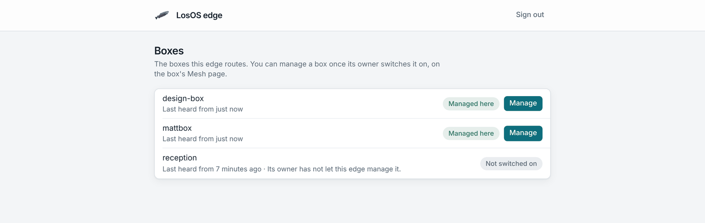
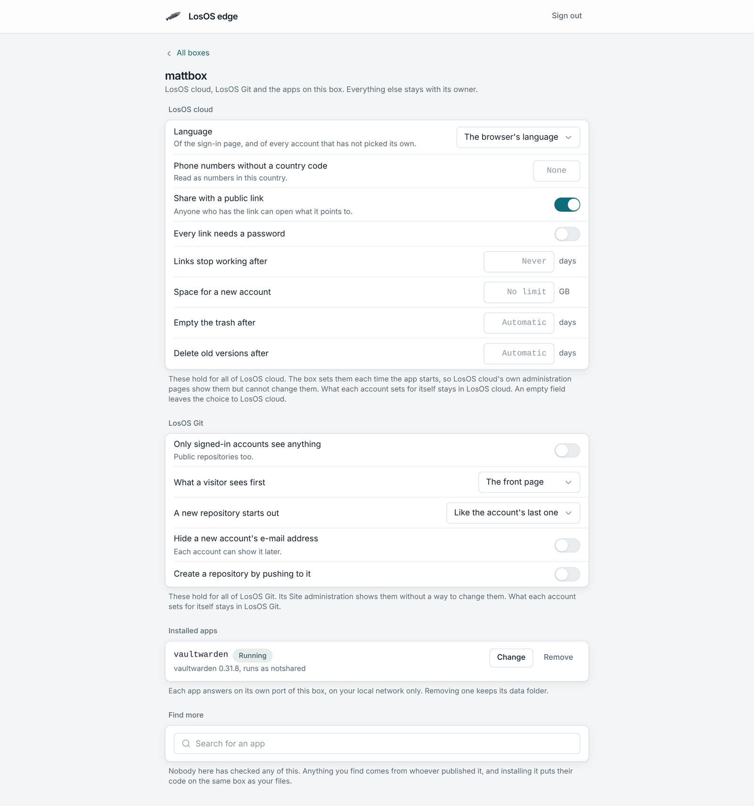

# Edge web page

A company edge has a web page at `/manage/` for the people who run it. It
lists the boxes the edge routes, and for each box whose owner allows it, it
changes the box's LosOS Cloud and LosOS Git settings and installs or removes
apps. The official LosOS edges do not serve this page, and a box refuses to
be managed by one.

The page is the company's tool, not the owner's. An owner still has the box's
own admin pages for everything else, and decides on the box whether the edge
may manage it at all.

## Turning it on

Set `losos.edge.manage.enable` on the edge. An
[edge gateway machine](edge-federation.md) has it on already.

On its first start the edge makes a manage key: 64 characters, `0` to `9`
and `a` to `f`, kept in `/var/lib/losos-registrar/manage-key`. Anyone with the
key can use the page, so keep it with the company's other admin passwords. An
edge gateway machine shows the key and the page's address on its screen; it
has no console login. To change the key on a plain edge, delete the file and
restart the registrar; the edge makes a new one, and the old key stops
working.

The page answers at the edge's address on the local network, the one boxes
find it by, for example `http://<edge>.local:8443/manage/`.

## Signing in

The page asks for the manage key and checks it with the edge before it goes
on. It keeps the key in the browser tab only, so closing the tab signs out.
**Sign out** at the top does the same at once.

If the edge says it does not know the key, the key was mistyped or changed.
If it says the edge does not manage boxes, `losos.edge.manage.enable` is off.

## The list of boxes

**Boxes** lists every box the edge routes, by its name, with when the edge
last heard from it. The list refreshes every 10 seconds.

- **Managed here** means the box's owner turned on **Let the company edge
  manage this box** on the box's Mesh page. **Manage** opens the box.
- **Not switched on** means the owner has not. The edge can route the box but
  not change it. Ask the owner if the company needs to.

A box says on each heartbeat whether its owner allows it, so a change on the
box shows here within one heartbeat. A box that stops sending heartbeats drops
off the list.

## Statistics

The **Statistics** card above the list counts the requests the edge's
Traefik answered in the last hour, the share that were server errors and
what was sent, with a bar per minute. **Open** goes to the Statistics page,
`/manage/statistics`: the same hour in more detail, the answers by class
(2xx, 3xx, 4xx, 5xx), and one row per box and name the edge routes, with
its requests, errors, bytes sent and the 95th percentile answer time.

The registrar reads Traefik's Prometheus counters every 15 seconds on a
loopback port (`losos.edge.traefikMetricsPort`, 8091), which nothing off the
machine can reach, and keeps the last 60 minutes in memory. A restart of
the registrar starts the hour again; the route rows count since Traefik
started, as the page says under them, and take their answer time from the
last hour.

## A box's page

A box's page has three parts, the same ones as the box's own Apps pane:

- **LosOS Cloud and LosOS Git settings.** Default language, phone region, how
  long deleted files and old versions are kept, the default quota, public
  links and their password and expiry, and LosOS Git's sign-in, privacy
  and push settings. LosOS Cloud's federation with other boxes is here too.
  A setting the box fixed in its own configuration does not show.
- **Installed apps.** What runs on the box, with a button to remove each.
- **App search.** The app store search, with an install button per result.

Changed settings collect in a bar at the bottom. **Apply** sends them to the
box, which checks them, saves them in its configuration history and rebuilds,
exactly as when the owner applies a change on the box. The bar shows the
rebuild until it finishes.

## What the edge cannot do

Each call from the page travels through the box's own tunnel to the box, and
the box decides. It answers only when the call carries the box's tunnel
token and the owner's switch names this edge. Then it lets the edge reach the
apps settings and read what any signed-in page reads, nothing else.

So the edge cannot:

- open anyone's files, in LosOS Cloud, LosOS Git or anywhere else;
- add, change or remove people, or reset passwords;
- change storage, backups, the network, sharing or updates;
- turn the switch on, or keep it on after the owner turns it off.

A changed page on the edge gets no further, because the box checks every call
itself. The switch belongs to the edge the box used when the owner turned it
on. If the box later moves to another edge, that edge does not inherit it.
When the owner turns the switch off, the edge's next call is refused, and the
box shows as **Not switched on** after its next heartbeat. A box's page that
is open at that moment says the box refused the edge.
