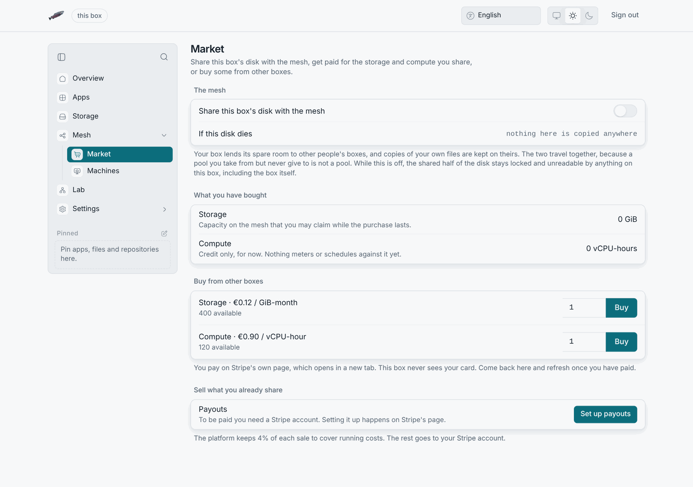
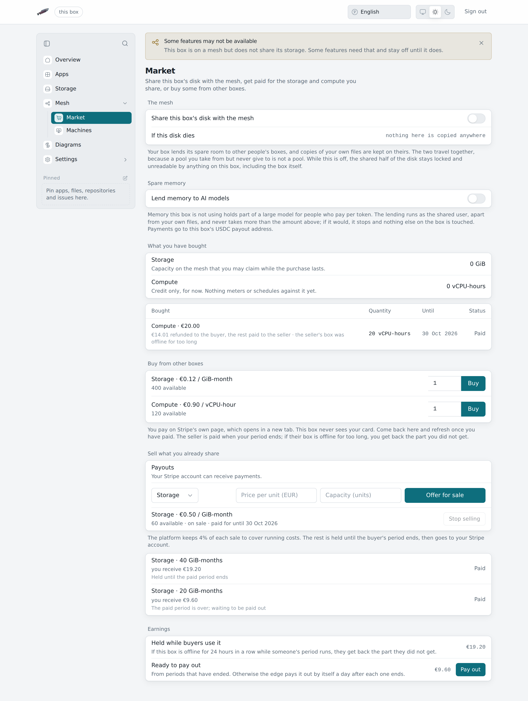

# Market






An optional marketplace where one box sells spare storage or compute and
another buys it. Buyers pay by card through **Stripe Connect** where the edge
takes cards, or in USDC on Solana, Base, Arbitrum or OP. The edge holds each
payment until the period the buyer paid for ends, refunds the buyer when the
seller's box stops delivering, and keeps a 4% cut to cover its running
costs. An edge can also be set to take Bitcoin, Monero and Zcash, which
reach the seller at once and so cannot be refunded.

The **Market** row under Mesh in the sidebar opens the pane, at
`/settings/market`. A box shows the market only when an official LosOS edge
is in reach; otherwise the pane says the market is not available on this
box. The disk-sharing switch (`losos.sharingMyStorage`) lives on this pane
and can be turned on either way, so the Machines page works once sharing is
on. The market is off by default, at three levels.

|                       | Default | Switch                                        |
| --------------------- | ------- | --------------------------------------------- |
| The edge serves it    | off     | `losos.edge.market.enable`                    |
| A box may trade       | off     | `losos.edge.tenants.<id>.market`              |
| A seller may list     | closed  | Stripe reports the connected account ready, or on a coins edge the seller has set a USDC payout address or a coin key |

A box that never trades is unaffected. The market is a feature of the edge's
`losos-registrar`.

**The market sells what you already share, and nothing else.** It pays a
box for the storage and compute it contributes to the mesh. It is not a
separate product. A box can list storage only while its node is enrolled in
the mesh, and compute only while it also shares compute
(`losos.cluster.shareCompute`). Stop sharing and your listings leave the shelf
at once. They return if you resume, and orders already paid are unaffected.

## How the money moves

Money never touches a LosOS box. Buyers pay in one of these ways, as the edge
allows:

- **USDC on Solana, Base, Arbitrum One or OP Mainnet.** The payment goes
  into an escrow: the `losos-escrow` program on Solana, the `LososEscrow`
  contract on the others. The edge checks it (the seller's address, the
  amount, the confirmations) and holds it there until the buyer's period
  ends. Then it releases it to the seller and to the platform treasury,
  which takes the 4% fee. Or it refunds the whole payment to the buyer: when
  the seller's address is wrong or is a contract, when the order was already
  paid, when its units lapsed, or when what was bought could not be set up
  in time. When the seller's box was offline for too long, it splits the
  payment: the buyer gets back the share not delivered and the seller keeps
  the rest. If the edge never acts, the buyer can reclaim the deposit from
  the escrow 33 days after ordering. See
  [Paying with USDC](#paying-with-usdc).
- **Card, through Stripe Connect.** Optional on an edge. The payment stays
  on the platform's Stripe balance until the buyer's period ends, then the
  edge transfers the seller's share, refunds it, or splits it, the same way
  as the escrow. An edge can take USDC only, without card payments, so
  running the market needs no business account with a card processor.

Those two are the only ways to pay on an edge that has not been set to take
direct payments as well. With direct payments on, buyers also see:

- **USDC on Solana, on an edge without the escrow program.** A direct
  transfer, split between the seller and the treasury in the buyer's own
  transaction.
- **Bitcoin, Monero and Zcash.** Straight to the seller's own wallet, at a
  fresh address for each order, derived from the seller's public key: an
  extended public key or descriptor for Bitcoin, the primary address and
  private view key for Monero, the unified viewing key for Zcash. The edge
  only watches and never holds the coins. The 4% fee on these sales is a
  debt the seller settles in USDC, see
  [Platform fees on coin sales](#platform-fees-on-coin-sales).

Nothing paid directly can be held, so a buyer who pays that way cannot get
money back when the seller's box goes offline.

For card payments the edge is the Stripe **platform**:

1. A seller onboards. The edge creates a Stripe Express connected account
   for it, **tags it with the box's UUID** (metadata `losos_box_uuid`), and
   returns Stripe's hosted onboarding link. A box onboarded before tagging
   existed gets tagged the next time its owner opens the page.
2. Stripe tells the edge (`account.updated`) when the account can receive
   transfers. On an edge that takes no coins, only then can the seller list
   anything.
3. A buyer orders units of a listing. The edge reserves them and creates a
   Stripe Checkout Session as a charge on the platform, with the order as
   its `transfer_group` and the seller's account and the fee in its
   metadata. Nothing reaches the seller yet.
4. Stripe tells the edge (`checkout.session.completed`) that the payment
   cleared. The order becomes `paid` and its period starts.
5. When the period is over, the edge transfers the seller's share out of
   that charge (`source_transaction`), refunds the buyer, or does part of
   each. The platform keeps the fee on whatever the seller is paid.

The fee is `feeBps` basis points of the gross amount, rounded half up. At the
default 400, a 20.00 EUR sale pays the platform 0.80 and the seller 19.20. The
configured value is capped at 2000 (20%).

## Paid periods and refunds

A paid order buys a period: a month of storage, compute or a machine. The
edge holds the buyer's money for that period and watches the seller's box
while it runs, so neither side can walk away with the other's share.

- **The seller cannot pull the listing.** While someone's period runs on a
  listing, Stop selling is greyed and says until when. The edge refuses to
  close it before then.
- **The edge checks that the box is there.** It asks the mesh every
  reconcile pass whether the seller's node is `Ready`, and falls back to the
  box's heartbeat where it has no mesh to ask. Time the edge itself was down
  or too busy to look never counts against the seller.
- **An offline box refunds its buyer.** If the seller's box is offline for
  24 hours in a row while the period runs, or for 48 hours in all, the
  period ends there. The buyer gets back the share of the period not
  delivered, rounded up to the cent, and the seller is paid for the rest,
  less the fee on that part. A box offline from the start refunds the whole
  payment.
- **Nothing set up, nothing paid.** If what was bought is not set up within
  23 hours of payment, the buyer gets everything back.
- **The seller is paid when the period ends.** The Market pane's Earnings
  group shows what is held, what is ready and what is on its way. Pay out
  sends what is ready at once and is greyed until a period ends. The edge
  also pays out by itself a day after each period ends, and always early
  enough that a USDC buyer cannot reclaim a deposit for a period that was
  delivered.
- **The buyer cannot cancel a period that is being delivered**, and cannot
  start a refund. Only the edge's checks do.

The edge leaves a card payment someone disputes with their bank to Stripe,
and neither pays it out nor refunds it while the dispute is open.

## What is for sale

| Kind      | Unit        | Meaning                                              |
| --------- | ----------- | ---------------------------------------------------- |
| `storage` | GiB-month   | Capacity in the mesh's Longhorn pool                 |
| `compute` | vCPU-hour   | Scheduling on the seller's node, inside its window   |
| `vm`      | replica-month | A virtual machine replica on the seller's box, split 50/50 |

Machines have their own page, [Virtual machines](virtual-machines.md), and their
own pane in the admin UI.

Prices are in the minor unit (cents) of one currency per edge
(`losos.edge.market.currency`). A single order must total at least 50 minor
units, which is Stripe's floor.

## Fulfilment

A paid order is a **30 day entitlement** (`expires_at`). Compute units return
to the listing when it lapses. Storage units return only once the claim is
gone, because the claim still holds Longhorn capacity after the month ends.

- **Storage.** The edge creates the namespace `market-<buyer id>` in the
  mesh cluster and a `PersistentVolumeClaim` of the purchased size, named
  after the order (`ord-...`), from `losos.edge.market.storageClass` (default
  `longhorn`). This runs after every reconcile pass and straight after a paid
  webhook. It is idempotent, since an `AlreadyExists` answer counts as done,
  and it retries every reconcile interval if the apiserver refuses. The order
  counts as fulfilled only once the claim is `Bound`. The edge checks a claim
  left `Pending` (no such storage class, or no capacity) again on every pass.
  That assumes an `Immediate`-binding class, which Longhorn's default is. A
  `WaitForFirstConsumer` class never binds, because nothing mounts the claim
  yet. The account view reports a bound claim as
  `volume: "<namespace>/<claim>"`. The edge writes the claim's name down
  before it asks for it, so a claim that never binds, or one created just
  before the edge stopped, still keeps its units sold after the month ends.
- **Backups on bought storage.** The buyer's box can keep its backups on a
  bound storage order (Settings, Backup). The box encrypts with restic
  before anything leaves it, as for a bucket, and talks to the edge's
  `/market/storage/<order>/`, which serves restic's REST protocol. The
  edge starts one `rest-server` per order beside the claim on first use,
  from an image it carries (`losos.edge.market.backups.enable`, on by
  default) and never pulls. The server's one account is the edge's, with a
  password made for that order, so the mesh boxes that can reach its
  cluster address cannot open it. The edge opens that path only to a key it
  stores as a SHA-256 hash, which the buyer's box sets with
  `POST /market/storage-door` and derives from its recovery code and the
  order id. A new box with the same recovery code therefore reaches the
  same volume. The boxes that hold Longhorn's replicas and the edge see
  restic's ciphertext only.
- **Compute.** A credit in vCPU-hours, listed under `entitlements`. Nothing
  meters or schedules against it yet.

:::note[Limits not enforced yet]
Limits to know about, none of which are enforced yet:

- The claim is not pinned to the seller's node. Longhorn places replicas
  across the pool, so the seller is paid for contributing to it, not for
  hosting that particular volume.
- The only way to the claim is the backup path above. Nothing else mounts
  it.
- Nothing is ever deleted. A lapsed entitlement stops being reported, but
  the volume holds the buyer's data, and removing it is the operator's call.
  Until the operator deletes the claim, its GiB stay sold, so the same
  capacity is never sold twice. That holds for a claim still `Pending` too,
  since it may yet bind. The reconcile pass checks each lapsed claim and puts
  its units back on sale once the apiserver answers 404 for it.
- The registrar's ServiceAccount gains cluster-wide `get`/`create` on
  namespaces and PersistentVolumeClaims when the market is enabled, and on
  Deployments and Services (and `create` on Secrets) when backups on bought
  storage are on.
  Kubernetes RBAC cannot scope any of them to `market-*` names.
:::

## Admin UI

The **Market** row sits under Mesh in the sidebar, and `/settings/market` opens
it. The pane starts with the disk-sharing switch. It moved here from
Storage because lending disk to other boxes and being paid for it are one
decision. Below it come what the owner has bought, with expiry and volume,
and the shelf to buy from. For selling there is payout setup (a USDC
address, a Bitcoin or Monero key, and Stripe where the edge takes cards),
the platform fees owed on coin sales, a listing form, and the owner's own
listings and sales. The switch shows
whether or not the edge offers the market to this box, because it is a
setting of the box, not of the edge.

- The listing form offers only what is already shared: storage once the box
  has joined the mesh, compute once it also shares compute. Anything else is
  greyed with the reason. The edge enforces the same rule, and the pane only
  explains it.
- A listing someone has paid for says "paid for until" with the date, and
  its Stop selling button stays greyed until then. Every order says where
  its money stands: held, on its way to the seller, refunded, or split, with
  the amount refunded and why.
- The Earnings group appears once any sale is held: what is held for
  running periods, what is ready, and what is on its way, with a Pay out
  button that is greyed until a period ends.
- Card payment and Stripe onboarding open Stripe's own pages in a new tab.
  Nothing in the admin UI sees a card. lososd, and then the page again, check
  that the link is a `https://checkout.stripe.com` or
  `https://connect.stripe.com` page, so a compromised edge cannot send the
  owner to a look-alike card form. Custom Checkout domains are not
  supported.
- The pages cannot call the edge themselves, since the admin UI's CSP is
  `connect-src 'self'`. `lososd` relays instead: `GET /api/market` and
  `POST /api/market/{onboard,listings,listings/close,orders,release}`. The relay uses
  the registrar's URL, the appliance id and the proxy token that
  `losos.proxy.enable` already provides. It requires https and sends the
  token to `curl` on stdin rather than on the command line.
- Where the market is off (no proxy, the edge has it disabled, or this
  tenant is not opted in), `GET /api/market` answers `{"available": false}`
  with a 200 and the pane says so. It is not a 404 on purpose. The admin UI
  treats a 404 as "this box does not serve the route" for the rest of the
  session.

## API

All routes live on the registrar's public API (`register.<publicDomain>`).
Authenticated routes take the same `appliance_id` and `token` as `/register`.
Bodies are JSON.

| Route                          | Auth       | Purpose                                         |
| ------------------------------ | ---------- | ----------------------------------------------- |
| `GET /market/listings`         | none       | What can be bought now. Names no seller         |
| `POST /market/account`         | token      | Your listings, purchases, sales, entitlements   |
| `POST /market/seller/onboard`  | token      | Start or resume Stripe onboarding               |
| `POST /market/listings`        | token      | `kind`, `unit_price`, `capacity`                |
| `POST /market/listings/close`  | token      | `listing_id`; paid orders keep their units; 409 while a paid period runs |
| `POST /market/orders`          | token      | `listing_id`, `quantity`; returns a Checkout URL |
| `POST /market/sales/release`   | token      | Pay out the sales whose periods are over; 409 while none are |
| `POST /market/fees/pay`        | token      | `tx`, `network`; counts a USDC transfer against coin fees owed |
| `POST /market/webhook`         | signature  | Stripe events                                   |

Every route answers 503 when the market is off. On the token routes, a
tenant without the `market` bit gets 403. The public listing view and the
webhook belong to no tenant, so they never do. `POST /market/account` returns the 100
most recent purchases and sales on each side, live ones first. The edge
deletes a closed listing nobody ordered from; one with orders stays as long
as they do. Neither party learns the other's appliance id, and the public
listing view never shows one.

The edge reserves capacity when it creates the Checkout Session and holds it
until Stripe says how the session ended: paid (`checkout.session.completed`)
or abandoned (`checkout.session.expired`, sent as the session's 31 minutes
run out). An `expired` event counts only if it names the session the order
recorded. If Stripe cannot be reached to create the session, the edge
releases the capacity at once, unless a payment for it has already landed.
If neither event ever arrives, the hold lapses after Stripe's three-day retry
window, so a payment delayed by an edge outage still finds its units unsold.
The next reconcile pass then records the order as `expired`. A payment that
arrives even later is honoured if the units are still free. Otherwise the
edge logs it with its session id so the operator can refund it. Two buyers
racing for the last units cannot both get a session.

## Operator setup

These steps set up card payments. An edge that takes coins only skips them;
the operator notes kept with the source (`docs/ci-and-releases.md`) cover
that case.

1. In the Stripe dashboard, enable **Connect** on the platform account.
2. Seal the secret key (a restricted key works) with `systemd-creds`, reading
   it from stdin so the plaintext never touches the disk:

   ```sh
   systemd-creds encrypt --name=stripe-secret-key - \
     /var/secrets/losos-stripe-secret-key.cred
   ```

   The blob's path is `losos.edge.market.stripeSecretKeySealed`, and only
   the gate unit ever decrypts it. The name must be exactly
   `stripe-secret-key`, because a blob decrypts only under the name it was
   sealed with.
3. Add two webhook endpoints, both at
   `https://register.<publicDomain>/market/webhook`: one for events on your
   account (`checkout.session.completed`, `checkout.session.expired`) and
   one that listens to **events on Connected accounts** (`account.updated`).
   Stripe signs each with its own secret, so seal both `whsec_...` secrets,
   one per line, under the name `stripe-webhook-secret` into
   `losos.edge.market.webhookSecretSealed` (default
   `/var/secrets/losos-stripe-webhook-secret.cred`). The edge accepts either.
4. Set `losos.edge.market.enable = true` and `losos.edge.market.returnUrl`,
   an absolute http(s) URL with no credentials and no `#fragment` (the edge
   appends the order and status as query parameters).
5. Set `losos.edge.tenants.<id>.market = true` for each box allowed to trade.

:::tip[Start in Stripe test mode]
Start in Stripe **test mode**. The edge's tests run against a stand-in for
Stripe. That checks what the edge sends and how it reacts, but cannot say
whether Stripe accepts it. The first test-mode run settles that.
:::

### Test mode and live mode

The edge reads the mode off the key. `sk_test_` and `rk_test_` keys run the
market in test mode, `sk_live_` and `rk_live_` keys in live mode, and there is
no separate setting that could disagree with the key. The gate logs the mode
when it starts and refuses to start on a key whose mode it cannot read. Every
market answer (`/market/listings`, `/market/account`, onboarding and
checkout) carries `"mode": "test"` or `"mode": "live"`.

Each mode keeps its own ledger: `market.json` for live and `market-test.json`
beside it for test. Going live is sealing a live key and restarting the gate.
The test sellers, listings and orders stay in the test ledger, the live shelf
starts empty, and each seller onboards again with a live Stripe account. A
test key brings the test ledger back as it was. The edge reads a `market.json`
written before it kept the two apart as the live ledger. Volumes claimed by
test orders stay on the mesh until the operator removes them.

Webhook secrets carry no mode, but every Stripe event does (`livemode`). A
signed event from the other mode means the sealed webhook secret and key come
from different modes, so the gate refuses it and logs which is which. Stripe
retries a refused event for three days, so sealing the matching pair within
that time loses nothing.

## Safety properties

- Stripe's HMAC signature over the raw body authenticates the webhook, with
  a five minute replay window and a larger body cap than other routes.
- Stripe may deliver an event twice or out of order. The edge drops an event
  it has already applied by its id, and ignores an `account.updated` older
  than the account state it holds, so a late event cannot take a ready
  seller off the shelf.
- A payment only counts when the session id, amount and currency equal what
  the edge recorded for the order. The edge logs a mismatch and does not
  fulfil it. If the edge stopped before it wrote the session id down, it
  adopts the signed event's id, since only this edge's gate can have named
  the order in it.
- **The registrar never holds the Stripe key.** A separate unit,
  `losos-stripe-gate` (`losos-registrar stripe-gate`), is the only process
  that has it. The registrar talks to the gate over a Unix socket
  (`/run/losos-stripe-gate/gate.sock`, 0600) and may ask only to create an
  account, tag an account, check an account, make an onboarding link, start a
  Checkout Session, verify a webhook signature, or settle a held market
  payment. The gate refuses a checkout whose destination is not an `acct_...`
  id, whose currency differs from the configured one, whose fee exceeds the
  20% ceiling or the whole amount, whose return URL is not a plain http(s)
  URL, or whose session lifetime is more than a day. It also refuses a
  non-`https` Stripe endpoint. To settle, the gate reads the payment back
  from Stripe itself and splits only a charge it made for the market,
  between its buyer and the seller named at checkout: never more back than
  was paid, nothing back once the seller has been paid, nothing while the
  payment is disputed, and each refund and transfer at most once. There is
  no "forward this to Stripe" operation. A compromised registrar therefore
  cannot read the key, cannot send money anywhere but a connected account
  within the gate's fee limits or back to the buyer who paid it, and cannot
  move the platform's own money. It can still ask for checkouts and
  settlements, because that is its job. Both units run as
  processes on the same machine, and root on the edge can still reach both.
  As a second layer, the registrar's unit marks the sealed blobs and the
  gate's credential directory inaccessible.
- The edge never stores the Stripe secrets in plaintext. They live as
  `systemd-creds` blobs, sealed with TPM2 where the edge has one and the host
  key otherwise, and reach the gate through `LoadCredentialEncrypted=`. They
  are plaintext only in that unit's private credential tmpfs, and a copy of
  `/var` carries ciphertext only. Rotating a secret means sealing a new blob
  and restarting `losos-stripe-gate`. A missing blob skips the gate, which
  turns the market off (503) and nothing else. The gate is its own unit, so
  the master proxy in the registrar never notices.
- **The Stripe account carries the box's UUID, not its recovery code.** The
  recovery code is a credential and stays on the box. The box sends a one-way
  value derived from it, the first 16 bytes of
  `SHA-256("losos-box-id-v1:" + code)` formatted as a UUID. It is stable for
  the life of the installation and reveals nothing the code could be
  recovered from. The registrar checks that it is a canonical UUID. The
  browser cannot choose it, because lososd adds it itself.
- Secret files are shape-checked (`sk_`/`rk_`, `whsec_`) before use.
- `market.json` is 0600 and written atomically. A file that does not parse
  stops the edge from starting. Treating it as empty would forget who has
  paid for what.
- Stripe's error text and endpoints stay in the journal; callers get a fixed
  message.

## Paying with USDC

An edge can settle storage, compute and machine orders in USDC instead of
Stripe. Hardware stays on Stripe. The edge chooses which networks it accepts:

| Network      | For a test edge  |
| ------------ | ---------------- |
| Base         | Base Sepolia     |
| Arbitrum One | Arbitrum Sepolia |
| OP Mainnet   | OP Sepolia       |
| Solana       | Solana Devnet    |

On Solana the payment is held by the `losos-escrow` program where the edge
names one. Solana settles in seconds for a fraction of a cent, so the pane
offers it first. An edge without the program offers Solana only when it also
takes direct payments, since nothing paid there could be held.

An edge runs on live networks or on test networks, never both. On an edge
that takes cards the mode follows its Stripe key: live networks with a
`sk_live_` key, test networks with a `sk_test_` key. An edge that takes coins
only runs in the mode of its networks. The registrar refuses a mix, so a test
payment cannot land in the live ledger. Each network has its own RPC
endpoint, sealed with systemd-creds and read only by the registrar. The operator notes kept with
the source (`docs/ci-and-releases.md`) cover setting it up.

### How you pay

1. On the Market pane, create a wallet, import a 12 or 24 word phrase, or
   connect a wallet already in the browser: MetaMask, Rabby, Rainbow or
   Coinbase Wallet for the Ethereum networks, Phantom, Solflare or Backpack
   for Solana. One phrase gives an address on every network the edge
   accepts, derived the way those wallets derive it (`m/44'/60'/0'/0/0` for
   Ethereum, `m/44'/501'/0'/0'` for Solana), so a phrase made here imports
   into them and the other way around. The phrase is encrypted in the
   browser. The box never receives it.
2. The pane lists the wallet's USDC on each network, next to the coin that
   pays that network's fees: ETH, or SOL on Solana.
3. Order from the shelf. There is no Stripe page. The pane shows the USDC
   amount and asks which network to pay on. It offers Solana's escrow first,
   unless the wallet holds the USDC only on another network; then the
   network where the wallet holds enough at the lowest fee.
4. Pay. On an Ethereum network the wallet approves USDC for `LososEscrow`
   and calls `pay`. The contract holds the payment and records the seller,
   the fee and a refund deadline; nothing reaches the seller yet. On Solana
   one transaction calls the escrow program's `pay`, which opens a deposit
   for the order, moves the USDC into it and records the same three things.
   The deposit holds about 0.0043 SOL of rent from the wallet, which goes
   back to it when the deposit closes. Without the escrow program, one
   transaction pays the platform fee to the treasury and the rest to the
   seller, and names the order in a memo; the first payment to a seller or
   to the treasury also opens their USDC account, which costs a little SOL.
5. The edge reads the transaction through its endpoint for that network and
   marks the order paid. A transaction can pay only one order. The order
   then names its network and links the transaction on that network's
   explorer, for the buyer and the seller alike.
6. On an Ethereum network the edge checks the seller's address on that
   network. If it cannot receive USDC there, the edge refunds the whole
   payment to the buyer and the order is not fulfilled. Otherwise, and on
   Solana, the deposit stays in the escrow while the period runs, and the
   edge settles
   it as [Paid periods and refunds](#paid-periods-and-refunds) describes:
   the fee to the treasury and the rest to the seller, all of it back to the
   buyer, or a split. The order shows which of these happened.

Before it counts a payment on an Ethereum network, the edge checks that the
RPC endpoint answers for that network's chain, that `LososEscrow` pulls
Circle's USDC for that chain, pays the configured treasury and takes orders
from the edge's own key, and that a block sits on top of the payment.
`LososEscrow` takes at most half of a payment, the fixed split of a machine
order; the edge checks the exact fee and refund deadline of every order.

A seller's address can receive USDC when it holds no contract code on that
network, or holds only an EIP-7702 delegation, which keeps it an account
someone has the key to. The payout signature already showed that someone
does. The treasury, the USDC contract, the escrow and the zero address never
count. The edge's key can release a deposit only to the seller and the
treasury recorded at payment, refund it to the buyer, or split it between
the two (`settle`); it cannot send a deposit anywhere else. If the edge has
not settled a deposit 33 days after the order was placed, the buyer can take
it back from the contract directly. The edge pays out at least two days
before that.

On Solana the edge checks that the endpoint reports the network's genesis
hash, and that the escrow program's config for the treasury names Circle's
USDC and the edge's own key. It then reads the deposit the confirmed
transaction made, and counts it only when it belongs to that config and
names the order, the seller, and the exact amount, fee and refund deadline.
The program keeps the same rules as `LososEscrow`: at most half as the fee,
a release only to the recorded seller and treasury, a refund only to the
buyer, and the buyer's own refund only after the deadline. A deposit closes
when it is paid out, and its rent goes back to the buyer. The edge pays the
small fee of its own transactions in SOL, and opens the seller's and the
treasury's USDC accounts when they have none. Without the escrow program it
checks that the transaction succeeded and is confirmed, that its memo names
the order, and that the seller's and the treasury's USDC grew by exactly
their shares.

An order holds its units for a quarter of an hour. The pane starts no payment
in the last two minutes of that, and it keeps the transaction of a payment it
sent until the edge has counted it, so checking again never pays twice. A
payment that lands after the hold is still honoured while its units are free.
If they were sold in the meantime, or another payment already paid the order,
the edge refunds the payment from the escrow and the pane says so. A direct
payment on Solana, without the escrow program, stays with the seller, and
the refund has to be settled outside the market.

:::tip[Test coins come from faucets]
For a test edge, test USDC comes from
[Circle's faucet](https://faucet.circle.com), which serves all four. Test ETH
comes from each network's own faucet and test SOL from the Solana faucet.
None of it has value.
:::

### Buying USDC with euros

A wallet with an address on Base can buy USDC there with euros at
[Binance](https://www.binance.com), with your own Binance account. The Market
pane shows the row only when the edge is a Binance Connect partner and settles
on Base mainnet. Binance sells USDC on Base only, so Bitcoin and Monero are
still paid from a wallet of your own.

1. Choose Buy. The pane says that Binance, not LosOS, sells the USDC, and
   lists Binance's Terms of Use, Product Terms, Privacy Notice and Risk
   Warning. Each one opens in a new tab, and the box to accept them stays
   locked until you have opened all four. Then enter an amount from 1 to
   100,000 euros. The browser keeps which version of the terms you accepted
   and when.
2. Create the order. The box sends the edge the amount and the wallet's
   address and nothing else. The edge signs the order with its partner key,
   and Binance answers with a link to its checkout.
3. Open Binance. You sign in there, Binance checks who you are, shows its
   rate and fee, and takes the payment. LosOS never sees your identity or
   payment details.
4. While the pane is open it asks the edge about the order every 15 seconds,
   and it picks the order up again after a reload for up to seven days. It
   says when Binance is taking the payment, when it is sending the USDC, and
   when the USDC has been sent, with a link to the transaction on Basescan.
   If Binance keeps the USDC in your Binance account instead, or the
   purchase does not go through, the pane says that too.

Binance decides which countries it sells to. At the time of writing
(October 2026) Binance has no licence under the EU's MiCA regulation and
does not take new purchases from EU residents, so a buyer in the EU is
refused on Binance's page.

The purchase is between you and Binance. A refund or a dispute goes to
Binance, not to the edge.

### ENS names and sending USDC

The pane can send USDC from the wallet to an address on any of the edge's
networks. Where the edge has an ENS endpoint, the pane also shows an Ethereum
address's primary name beside it and takes a name in place of an address when
you send on an Ethereum network. Names are looked up on Ethereum mainnet, or on
Sepolia for a test edge. Only names whose records are on chain resolve. The
admin page reaches nothing but the box, so it does not look up names served
through an offchain gateway.

### How you get paid

Sign with the wallet that should receive USDC. The Ethereum address takes
sales paid on Base, Arbitrum and OP; they reach it once the buyer's period
ends and the edge releases the payment from the escrow. The same click
signs a Solana address, which takes sales paid on Solana the same way, or
directly on an edge without the escrow program. The edge checks each signature and stores
only the addresses. A seller with only one of the two set is offered to
buyers on that kind of network only. Import
the same phrase into MetaMask, Rabby, Rainbow, Trust Wallet or Phantom when
you want to spend it. There is no Stripe connected account for these sales.

:::warning[A wallet made here stays in one browser]
A wallet created on the Market pane lives only in that browser, so the pane
asks where its sales should go before you list. Sign with it as above, or
choose "Use another wallet's address": paste the address of a wallet you keep
elsewhere, sign the message the pane shows with that wallet, and paste the
signature. The edge checks it the same way.
:::

## Paying with Bitcoin

An edge that settles in USDC and takes direct payments can also take
Bitcoin for storage, compute and machine orders. It runs its own pruned Bitcoin node: on mainnet for a live
edge, on testnet4, signet or regtest for a test edge. The registrar refuses
any other pairing, so a live edge never counts test coins. The node holds a
watch-only wallet and no private key.

### Selling for Bitcoin

On the Market pane, paste your wallet's extended public key into the Bitcoin
row: the zpub, xpub or ypub that Sparrow, Electrum or BlueWallet export (a
vpub, tpub or upub on a test edge), or a ranged output descriptor. The key
can make addresses but cannot spend, and the edge refuses a private key.
Each order then gets a receive address from that key that no other order has
used, so the coins go straight to your wallet and show up there like any
other payment. Use an account you keep for these sales. Anything paid to
its addresses after an order was given one counts toward that order.
Wallets look about 20 unused addresses ahead; if more than 20
orders in a row go unpaid, raise the gap limit in your wallet to see the
payments after them.

The platform fee is not taken out of a Bitcoin payment. The whole amount
reaches the seller, and the edge keeps a running total of the fee on those
sales, which the seller owes the platform and sees on the pane
([Platform fees on coin sales](#platform-fees-on-coin-sales) says how it is
settled). A seller with a Bitcoin
key and no USDC address can still list; buyers then pay in Bitcoin only.

### Paying in Bitcoin

On the order, choose Bitcoin under "Pay with". The pane shows the amount in
BTC, the address, a QR code and a link that opens a wallet on the computer.
Pay from any wallet; there is nothing to report back. The edge's node sees
the payment arrive, and the pane follows it from seen to confirmed.

The BTC amount is a quote from price sources that agree with each other,
good for a quarter of an hour. One confirmation counts an order up to $50,
two up to $500, three up to $5,000 and six above that. A payment that falls
short says how much is still due, and anything over the amount stays with
the seller. A payment sent after the quote lapsed is measured against the
price at that moment: within 1% the order completes, otherwise the pane asks
for the difference. The order then names Bitcoin as its network and links
the transaction on mempool.space.

## Paying with Monero

An edge that settles in USDC and takes direct payments can also take
Monero for the same orders. It runs its own pruned Monero node and a wallet service beside it: on mainnet
for a live edge, on stagenet or testnet for a test edge. The registrar
refuses any other pairing, and refuses an address made for another network
than the node's.

### Selling for Monero

On the Market pane, paste two things into the Monero row: your wallet's
primary address, the one starting with 4 (5 or 9 for a test edge), and
its private view key. Feather, Cake Wallet and the official wallets show the
view key next to the seed, under the wallet's keys. The view key lets the
edge see what arrives at your addresses and nothing more. It cannot spend.
The box checks the pair before sending it and refuses the spend key by name,
so a spend key pasted by mistake never leaves the box. Never paste the seed.

The edge keeps a view-only wallet for you and gives each order the next
subaddress of your wallet's first account, so the coins go straight to your
wallet. Your own wallet finds them too: it looks ahead for subaddresses it
has not shown yet. If more than about 200 orders in a row go unpaid, raise
the subaddress lookahead in your wallet to see the payments after them.

As with Bitcoin, the seller owes the platform fee separately, and the
whole payment reaches the seller.

### Paying in Monero

On the order, choose Monero under "Pay with". The pane shows the amount in
XMR, the subaddress, a QR code and a link that opens a wallet. Pay from any
wallet. Ten confirmations count an order up to $5,000 and twenty above that;
a short payment, an overpayment and a late one are handled as for Bitcoin. A
payment locked for later blocks does not count. Monero hides who paid what,
so a paid order names Monero as its network without a link to an explorer.

## Paying with Zcash

An edge that settles in USDC and takes direct payments can also take
shielded Zcash for the same orders. It runs no Zcash node. It asks public lightwalletd servers for
compact blocks, by default four mainnet servers run by different operators,
and decrypts them itself, so your viewing key never leaves the edge. A
payment counts only when servers of two different operators show it in a
block of the same hash; one server that shows something nobody else does is
outvoted. A live edge settles on mainnet only and asks no server that says
it follows another network; testnet and regtest are for a test edge.

### Selling for Zcash

On the Market pane, paste your wallet's unified viewing key into the Zcash
row: the full one, starting `uview1`, or better the incoming one, starting
`uivk1`, which sees payments arrive and nothing you send. The key needs an
Orchard part, which every wallet made since 2022 has. The edge keeps only
that part's incoming viewing key, which can see what arrives and cannot
spend. The box and the edge refuse a spending key and a seed phrase by name,
so one pasted by mistake never leaves the box. The pane shows your wallet's
first address back so you can tell which wallet orders pay; the key itself
is never shown again.

Each order gets a fresh shielded address of your wallet: an Orchard-only
unified address at a diversifier index far above the ones your wallet hands
out. Your wallet finds payments to it on its own, because it decrypts what
arrives for every address of its key. Since NU6.3 a payment to an Orchard
address lands in the Ironwood pool, which uses the same keys; the edge reads
both.

As with Bitcoin, the seller owes the platform fee separately, and the
whole payment reaches the seller.

### Paying in Zcash

On the order, choose Zcash under "Pay with". The pane shows the amount in
ZEC, the address, a QR code and a `zcash:` payment link (ZIP 321) that
opens a wallet. Pay from any wallet that can send to a unified address.
Only payments in blocks after the address was given to the order count, and
a payment waiting in the mempool shows as seen once two operators show it.
Three confirmations count an order up to $50, six up to $500, ten up to
$5,000 and 24 above that; a short payment, an overpayment and a late one are
handled as for Bitcoin. The payment is shielded, so a paid order names Zcash
as its network without a link to an explorer.

## Platform fees on coin sales

A Bitcoin, Monero or Zcash payment reaches the seller's wallet whole, so the
platform's 4% of those sales is a debt the edge records against the seller.
The Market pane shows it in its own row under the coin keys, with the limits
below. The seller settles it in USDC, in two ways.

**From USDC sales.** While a seller owes coin fees, the edge raises the fee
on that seller's next USDC orders by what is owed, on the Ethereum networks
and on Solana alike. The buyer still pays the listed price. Only the
seller's share is smaller, and the sale on the pane says how much of it went
to fees owed. The fee never exceeds half the order's price, the most the
escrow contract takes. The debt goes down only once the money reaches the
treasury: when the escrow releases the payment, or when a direct Solana
payment is confirmed. An order that is refunded or lapses collects nothing. When
several USDC orders are open at once, each takes only what the others have
not already taken. If a sale collects more than is still owed, because a
direct payment settled the debt in the meantime, the rest is kept as credit
and pays the fees of the next coin sales first.

**Directly.** The fees row has a button that sends the amount owed in USDC
from the wallet on the pane to the platform's treasury, on any Ethereum
network the edge settles on, and hands the transaction to the edge. The edge
reads it from its own node and counts it once it has as many confirmations
as an order payment. It counts only a USDC transfer to the treasury from the
seller's payout address, each transaction once, and never more than is
owed. Anything paid above the debt is not refunded. Fees are not paid on
Solana.

**When coin payments stop.** While a seller owes more than the edge's limit,
US$10 unless its operator set another, or has owed anything for more than
30 days, buyers cannot pay that seller in Bitcoin, Monero or Zcash. A new
order offers USDC only, and a new coin payment is refused with the reason. A
coin payment already under way is still followed to the end. USDC keeps
working and pays toward the debt with every sale, so coin payments come back
once the debt is settled. A seller who takes only coins cannot be ordered
from until then.

## Not covered

- **Disputes, and refunds the edge did not make.** The operator handles a
  card dispute in the Stripe dashboard. A refund for any other reason after the
  seller was paid is the operator's call, with `reverse_transfer` so the
  seller's share comes back too.
- **Proof that the storage is healthy.** A box counts as online while its
  node is `Ready` in the mesh. The edge does not check that the buyer's
  volume answers.
- **Enforcing the entitlement.** Fulfilment creates the claim; it does not
  stop a buyer using more than they bought, meter compute, or revoke access at
  expiry.
- **Tax, invoicing and seller verification** beyond what Stripe's onboarding
  does. Running a marketplace has legal duties that depend on where you
  operate. This is an experiment, not advice.
