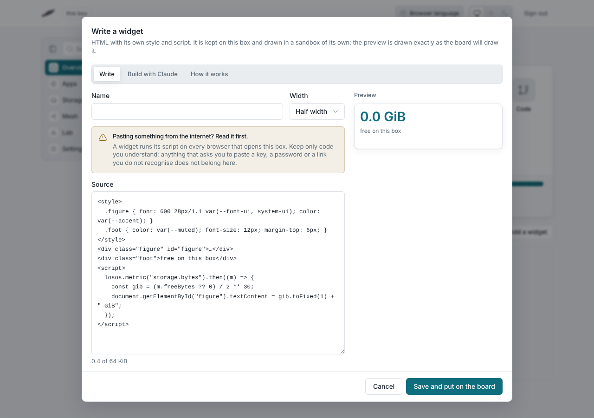

# Build with AI

You describe a widget or an app in plain words and a language model on the
box writes it. Two places have a **Build with AI** tab:

- the widget editor (**Add a widget**, then **Write one**), next to
  **Write**;
- **Your apps** on the Apps page, under **Make an app**.

What the model writes lands in the editor and the preview, where you can
read it, use it and change it. Nothing is saved until you press Save. A
widget the model wrote runs in the same sandboxed frame as one written by
hand (see [Administration](administration.md#widgets-written-by-hand)), and
an app runs in its own sandboxed frame in your browser, never on the box.

## How a build goes

A build is a short loop that the box runs and the tab shows step by step:

1. **Write.** The model writes the widget or app.
2. **Check.** The box reads the code for the mistakes a small model makes
   most: a name that is used but never defined, a name used before the line
   that makes it, a script that looks for an element the widget does not
   have, code that does not compile, or an example from its instructions
   sent back instead of what you asked for.
3. **Try** (apps only). The preview in your browser runs the app the way a
   person would: it fills in every field, presses the first button and
   looks at what the app kept. When nothing was kept and the app has a
   list to pick from, it picks another entry and presses again. It also
   notes anything the app threw on start or on the press.
4. **Fix.** When the check or the try found something, the box tells the
   model what, in words, and the model writes the whole thing again. An app
   gets up to three fixes, a widget one.

Each step shows what it found. You can stop a build at any step. When the
loop ends, the best version lands in the editor: one that compiles and has
the fewest problems left. If problems remain, the tab lists them, so you
know what to look at in the preview.

The try needs the page open. If you close the window, the build carries on
and the steps say the app was not tried.

## It runs on the box

The model is Qwen2.5-Coder 1.5B Instruct, from the Qwen team at Alibaba
Cloud, served by [Ollama](https://ollama.com) on the box itself. What you
type and the widget or app you ask to change never leave the box, and a
build costs nothing.

The box downloads the model, about 1 GB, once, the first time it is online
after the install. Until then the tab says the model is still downloading.
The model is kept on the encrypted disk, so a reboot does not download it
again.

### Why a model this small

The model is sized for the smallest box LosOS supports: 4 GiB of memory,
two processor cores, no graphics card, with LosOS Cloud and LosOS Git
running beside it. A larger model would not fit there, or would take most
of an hour per app.

A small model makes more mistakes, and that is what the loop is for. Most
of what it gets wrong is caught by the check or the try and fixed in the
next turn.

On a box with 8 GiB of memory or more to spare, a larger Qwen2.5-Coder
writes better apps on the first try. Set `losos.builder.model` to
`qwen2.5-coder:7b` in **Settings, Advanced**. It needs about 5 GiB while it
writes and takes several times as long.

## What to expect

A build runs on the box's processor. On two processor cores an app takes about
two minutes, a widget a little over one, and each fix about as long again.
An older or busier processor can take twice that.
The tab shows how many lines the model has written so far.

:::tip[Ask for one thing]
The model is small. It does best with one clear thing: a shopping list, a
notes page, a habit tracker, a clock, the disk as a bar. Say what goes in,
in a sentence or two. Then use the result in the preview before you save
it. When something is off, build again, ask for a change, or edit the
code by hand.
:::

## Memory

While it writes, the model takes about 1.5 GiB of memory on top of what the
box uses anyway. It gives the memory back five minutes after the last build.
If the box is short of memory, a build can fail, and the tab says so.

:::note[Turning the builder off]
**Settings, Advanced** has `losos.builder.enable`. Turn it off and the box
neither downloads nor runs the model, and the tab says the builder is off.
:::

## Qwen's terms

Qwen2.5-Coder 1.5B Instruct is licensed under the
[Apache License 2.0](https://huggingface.co/Qwen/Qwen2.5-Coder-1.5B-Instruct/blob/main/LICENSE).
The tab names the model under the Build button and links its licence and
its page.

## Good to know

- A build carries on if you close the window, without the try.
- A box runs one build at a time.
- To change a widget or an app, keep it in the editor and tick the box that
  asks for a change. The model gets what is there and sends back the whole
  thing changed.
- A widget the model wrote can read the box's readings like any widget. An
  app keeps its data on the box through the page. Neither can change the
  box.
