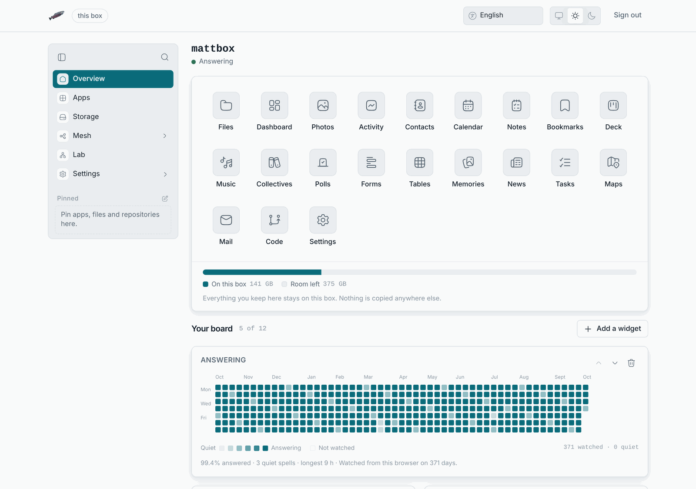
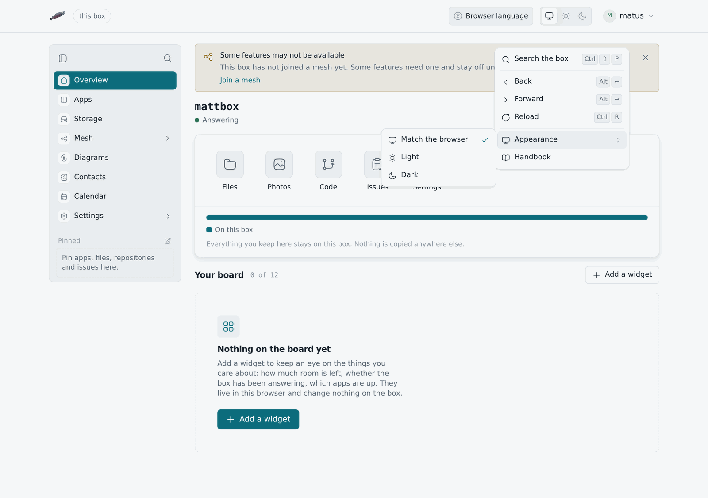
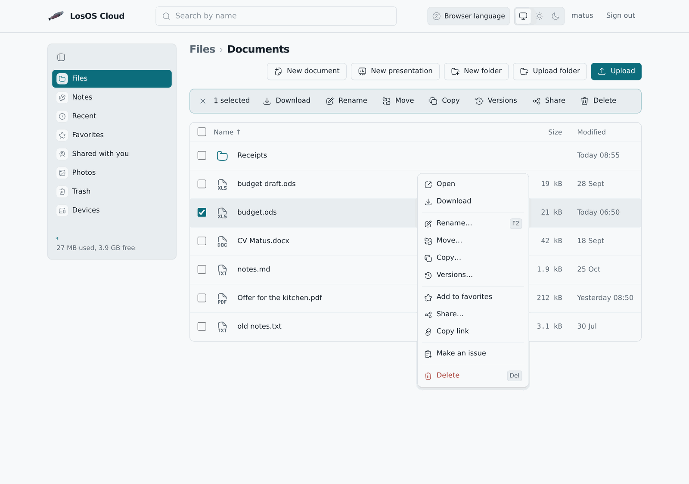
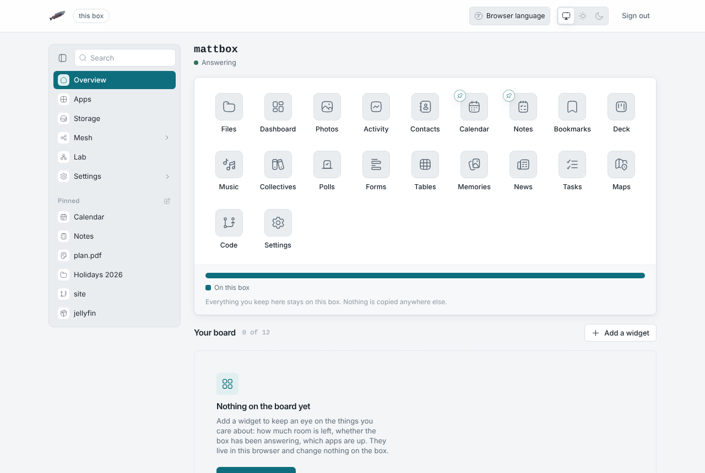
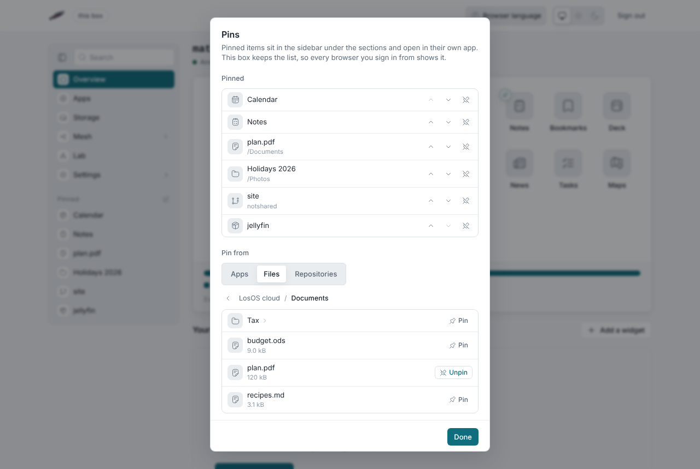
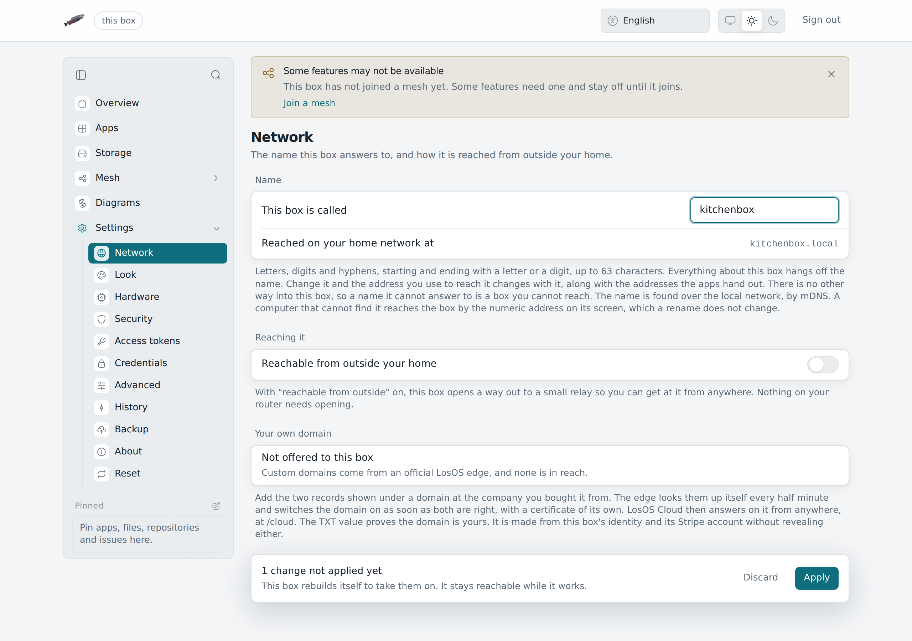
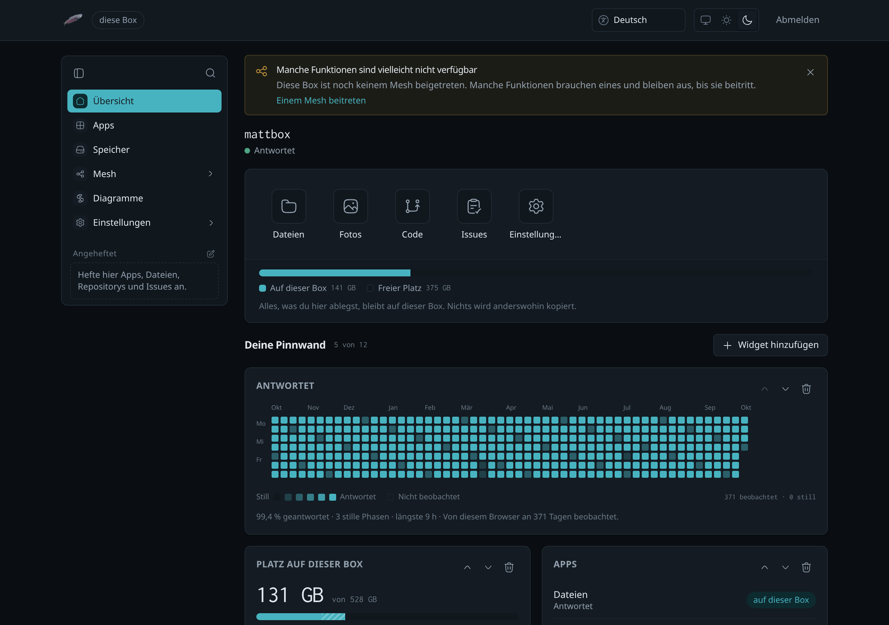

# The admin pages

The admin pages are the box's own web page at `http://<address>/`. The box
serves them to your local network only, even when an edge publishes the box.
Every tab asks you to sign in with your own name and password on LosOS
Login, the box's sign-in page at `https://<address>/auth/`, before it shows
anything you can change.

## The sections

The sidebar on the left has six sections, and under them the things you
pinned. Collapsed, it shrinks to a rail of icons. On a phone the sidebar
gives way to a bar along the bottom of the screen, within reach of your
thumb: the main sections, then **More**, which brings the whole sidebar up
from the bottom. Flick it down to close it. If the box runs LosOS Chat and
LosOS Mail, they take two of the places in the bar.

| Section      | What is there                                                                                              |
| ------------ | ---------------------------------------------------------------------------------------------------------- |
| **Overview** | Whether the box is answering and for how long, the storage card, the app tiles and your board of widgets.  |
| **Apps**     | The apps on this box with their settings, a search of Artifact Hub, and the apps installed from it.            |
| **Storage**  | How full the disk is, what is holding the room, and the reserve to claim.                                   |
| **Mesh**     | Joining other boxes, the hours this one lends its spare time, **Market** with disk sharing, and **Machines**. |
| **Diagrams** | LosOS Diagrams: diagrams, plans and boards as cards, and this box's network drawn and simulated.          |
| **Settings** | Network, Look, Hardware, Security, Users, Access tokens, Credentials, Advanced, History, Backup, About and Reset, each a pane.  |

 

## Search

The magnifier at the top of the sidebar opens one list that finds pages,
apps, files, repositories and issues. Ctrl+Shift+P on any admin page opens it too
(Cmd+Shift+P on a Mac), and so does typing a colon anywhere outside a text
field. It finds:

- the sections and settings panes, by name or by a word such as "gpu" or
  "hostname", in the language on screen or in English
- the apps in LosOS Cloud, and LosOS Git
- files and folders in LosOS Cloud, by name
- repositories in LosOS Git
- issues in LosOS Git, by their words or their key such as `BT-12`; with
  nothing typed, the open issues given to you
- text inside files, once you type three letters: in your LosOS Cloud files,
  and on the main branch of every repository in LosOS Git
- your pins
- apps to install from Artifact Hub; picking one opens the Apps pane with
  its install dialog
- a few actions: the light or dark theme, the language, the tour, this
  handbook and signing out

The arrow keys move through the list, Enter opens the highlighted entry and
Escape closes the list. Files and repositories open in their own app, and
Ctrl+Enter or Cmd+Enter opens one in a new tab.

:::note[File search needs the box's app password]
File search uses an app password the box gets from LosOS Cloud when the
owner's password is set, which the wizard does. Without it, the list says so
in place of the files; see [How the box lists your files](#pins) below.
:::

To search inside your LosOS Cloud files, the box keeps an index of their
text. It checks for new and changed files every two minutes and reads only
those. It reads plain text and code, Markdown, CSV, JSON and HTML,
OpenDocument files, Word, Excel and PowerPoint files in their current
formats (.docx, .xlsx, .pptx), and PDFs. Pictures, audio, video and archives
are skipped, and only the first megabyte of text in each file is kept.
Right after the first start the list says the box is still reading your
files. The index stays on the box, a factory erase deletes it, and
`losos.search.enable` on the Advanced pane turns it off. LosOS Git needs no index. Each search reads the repositories
directly.

## The right-click menu

Right-click on the admin pages, in LosOS Cloud, Mail or Contacts, and a
menu lists what you can do with the thing under the pointer. On a touch
screen, press and hold. From the keyboard, Shift+F10 or the Menu key opens
it for whatever has the focus, and the arrow keys move through it.

- **Empty space**: Back, Forward, Reload, the search, the light or dark
  theme, and this handbook.
- **Picked text**: Copy, and a search for the words.
- **A link**: open it in a new tab, or copy its address.
- **An app tile or a pin**: open it in a new tab, pin it or unpin it.
- **A file or folder in LosOS Cloud**: open, download, rename, move, copy,
  earlier versions, star, share, copy its link, delete. With several files ticked,
  the menu works on all of them. The space around the list offers a new
  folder and uploads, and a file in the trash offers restore or delete for
  good.
- **A message in Mail**: open, reply, reply all, forward, mark as read or
  unread, flag, archive, move to another folder, delete.
- **A person in Contacts**: mail, chat, call or video, edit, export as
  `.vcf`, delete. Someone listed under **On this box** offers **Add to
  contacts** instead of the last three.

The keys shown beside an item work without the menu too. In LosOS Cloud,
F2 renames the ticked file and Delete moves it to the trash (Cmd+Backspace
on a Mac). Text fields keep the browser's own menu, for spelling and paste.
The menu lists only what this box can do. It leaves out an item for a
feature the box does not have, rather than greying it.

## The bar over a selection

Select words in a LosOS Office Markdown document or presentation, or in a
note, and a small bar comes up above them once you let go of the mouse.
Pick cards or arrows in Diagrams and it comes up above those. It offers
what you would most likely do next, so you do not have to look for it in
the toolbar.

- **Text you can edit** (LosOS Office, and Notes in **Edit**): **Ask AI**,
  bold, italic, strikethrough, highlight and code, a link to a web page, a
  link to another note, a mention of a person or a file, and Copy. A
  pressed button shows the mark is already there; press it again to take
  it off. A link asks for its address in the bar itself, and a link to a
  note or a mention offers names as you type.
- **A note you are reading**: **Ask AI**, Copy, and a copy of the link to
  the section the words are in.
- **Cards and arrows in Diagrams**: **Ask AI** when the cards have text, a
  colour, editing the text of one card, aligning several, an arrow between
  two cards, grouping, duplicating and deleting. Each one does the same as
  the inspector's button, so one undo takes it back.

With Mail or Chat on the box, the bar over text also sends the words by
mail or in a chat. **Ask AI** shows only while the box's AI is turned on;
on text you can edit, **Replace selection** puts the answer in place of the
words.

From the keyboard, Alt+F10 moves into the bar, the arrow keys move along
it, and Enter or Space presses a button. Escape goes back to the text or
the diagram and hides the bar until you select something else. Typing over
the selection hides it too.

## Pins

Pin the apps, files, repositories and issues you open most, and they sit under
**Pinned** in the sidebar. A pin opens in its own app: a file or folder in
LosOS Cloud, a repository on LosOS Git, an issue or a project in LosOS Git's
[issues](./issues.md), an app on the Overview, or an app
you installed from the search on its own port. The box keeps the list, so
every browser you sign in from shows the same pins.

- On the Overview, point at an app tile and click the pin at its corner. A
  pinned tile keeps the pin, in colour.
- On the Apps page, **Pin** sits beside each installed app.
- The pencil beside **Pinned** opens the full list. There you move a pin up
  or down, unpin it, and pin from four tabs: **Apps**, **Files**, which
  walks the folders of LosOS Cloud, **Repositories**, and **Issues**, which
  finds an issue by its words or its key.
- On an issue or a project in LosOS Git, the pin at the top pins it. An
  issue shows its title in the sidebar.
- Point at a pin in the sidebar and click the crossed-out pin to unpin it.
  The [search](#search) finds pins too.
- Right-click a file, folder, repository or issue in the search, an issue
  in a list or on a board of LosOS Git, an app tile on
  the Overview, or a pin in the sidebar, and choose **Pin to sidebar** or
  **Unpin from sidebar**. On a touch screen, press and hold instead.

:::note[How the box lists your files]
The box lists your files with an app password it asks LosOS Cloud for when
the owner's password is set, which the wizard does. The app password shows
up in LosOS Cloud's security settings as "LosOS admin page". Revoking it
there stops the listing, and file search, until the owner's password is set
again, through the spare-key route in
[Forgot the password](../troubleshooting/forgot-password#you-have-the-spare-admin-key). The sidebar holds 24 pins.
:::

## The tour

The first time you reach these pages after setup, a short tour opens over
the Overview: six steps on every box, and one more for each feature this
box has ([The first run](../start/first-run) lists them). **Take the tour** under Settings, About opens it
again. With "reduce motion" set in your system, each step shows a still
picture instead of a moving one.

## The mesh banner

Some features run only on a box that shares its storage and has joined a
mesh. Until both are true, a banner over every page says that some features
may not be available, with a link to **Mesh** to join one, or to **Market**
to share the disk. **Dismiss** hides it in that browser. It goes away by
itself once the box has joined, and comes back if the box leaves the mesh.

## Notifications

Short status messages appear at the top right: a change being applied, a
change that took, a widget added. A question that needs your answer, such as
resetting the box or using the reserve, opens a dialog instead. The safe
choice comes first.

## A game while you wait

Some things take minutes: applying a change, LosOS Cloud setting itself up
on the first start, LosOS Login starting, an app being installed. While one
of them runs, **Play while you wait** beside its progress opens a small game
under it, one of five picked at random: Upstream, Eel, Merge, Bricks and
Pairs. The progress stays on screen above the game. Nothing starts until you
press a key or tap, there is no sound, and the game pauses when you switch
to another tab. When the wait is over the game stops and says so, and
**Close game** puts it away. With "reduce motion" set in your system only
Merge and Pairs come up, since nothing in them moves between turns. This
browser keeps your best score for each game.

## Theme and language

Your menu at the top right, under your name, has **Appearance** ("match the
browser", light or dark) and **Language** (the browser's, English, Slovak or
German). It is the same menu on every page of the box: the admin pages,
LosOS Cloud, Office, Mail, Chat and LosOS Git. A page you have not signed in
to keeps both behind one button in its bar. This browser remembers both.

## Sign out

**Sign out** ends your sign-in on LosOS Login too, so the next visit asks
for your name and password again. If you opened the pages with the spare
key, it forgets the key in this tab instead, and closing the tab does the
same. See [Sign-in and the spare key](sign-in-and-spare-key).

## What the admin pages cannot do

There is no file browser, no terminal and no log viewer. Your files live in
LosOS Cloud; the **Files** tab of the pins list shows folders only so you can
pin from them. The box has no shell, so neither do the pages. The box reports
on itself through the Overview, the Storage pane and the About pane. When
those are not enough, [When something goes wrong](../troubleshooting) says
what else there is.
