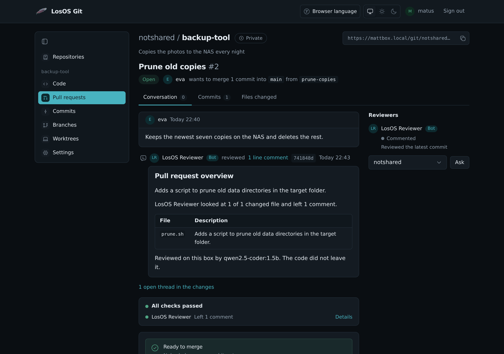

# AI review in LosOS Git

LosOS Reviewer reads the pull requests of a repository in LosOS Git and
leaves a review, the way a code review bot does on a hosted forge. It runs
on the box, with the same language model as Build with AI, so the code
never leaves the box and the review costs nothing.

It is off for every repository until someone turns it on.

## Turning it on

Open the repository in LosOS Git, then **Settings**, and turn on **AI
review**. Only the repository's administrators see the switch.

The switch can't be turned on while Build with AI is off on the box
(`losos.builder.enable`), because that setting installs the model. A new box
downloads the model once, the first time it is online. Until the download
finishes, reviews wait in the queue and the pull request says so.

## What it does

When a pull request is opened or reopened, LosOS Reviewer reviews all of
it. When new commits are pushed to it, it reviews what those commits
changed since its last review. It posts one review per run, as the account
**LosOS Reviewer** (`losos-reviewer`), marked as a bot:

- an overview of what the pull request does;
- a table of the changed files, each with one sentence on what changed;
- comments on single lines, where it found a problem. When one changed line
  fixes it, the comment carries the line as a suggestion.

It only comments. It never approves, asks for changes, pushes or merges.

You answer its comments and resolve them like anyone else's. To have it
look again, pick **LosOS Reviewer** under **Reviewers** on the pull request,
even after it has reviewed once. Anyone who may ask for reviews on the pull
request can do this.

While it works, the pull request's checks show a **LosOS Reviewer** row
with its progress, for example "Reviewing: 2 of 5 files done", and the
number of comments when it is finished.

## What it can find

Each changed file is read in pieces of up to 80 lines. For each piece, two
things happen:

- The box checks the new lines for a short list of mistakes it can be sure
  of: SQL put together from values, shell variables without quotes in
  commands that change files, keys and tokens written into the code, a
  shared default list in Python, a range one step past the end in Rust,
  `==` in JavaScript and TypeScript, a React effect without a dependency
  list, and a file name that no longer has its folders taken off.
- The model is asked whether the new lines have a bug. A comment from the
  model is kept only if it names a line the pull request adds and quotes
  the code on that line. Everything else it says is dropped.

How much the model adds depends on its size. The default model,
Qwen2.5-Coder 1.5B, fits a box with 4 GiB of memory. It describes changes
well but rarely finds a bug by itself, so on such a box most comments come
from the checks. Qwen2.5-Coder 7B finds bugs of its own and needs about
8 GiB. To use it, set `losos.builder.model` to `qwen2.5-coder:7b` on the
Advanced pane. Build with AI then uses it too.

A review is no proof that the code is right. Read the code yourself before
you merge.

## What it leaves out

- Files tools write and nobody reads line by line: lock files, minified and
  generated code, pictures and other files that are not text.
- Deleted files and lines that are only removed.
- Anything beyond the first 24 pieces of a large pull request. The table
  says which files were left out.

## The box stays usable

Reviews run one at a time, one question at a time, in the order they were
asked for. A new push replaces a review that hasn't finished for the same
pull request, and turning the switch off drops the reviews still waiting.
On two cores, a piece takes about 10 to 20 seconds, so a pull request of a
few files is reviewed in a few minutes. A build in Build with AI and a
review share the model, and each waits for the other's current question.

LosOS Git can reach only addresses on the box itself. The reviewer does not
use the mesh's shared computers, because that would send your code to
other people's boxes.
