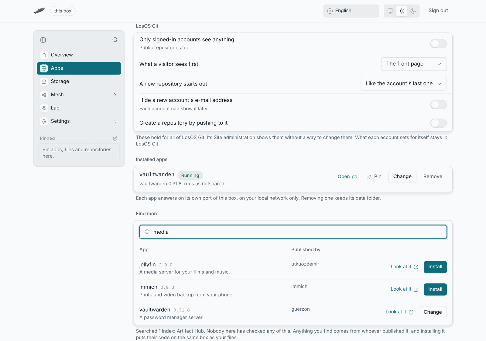
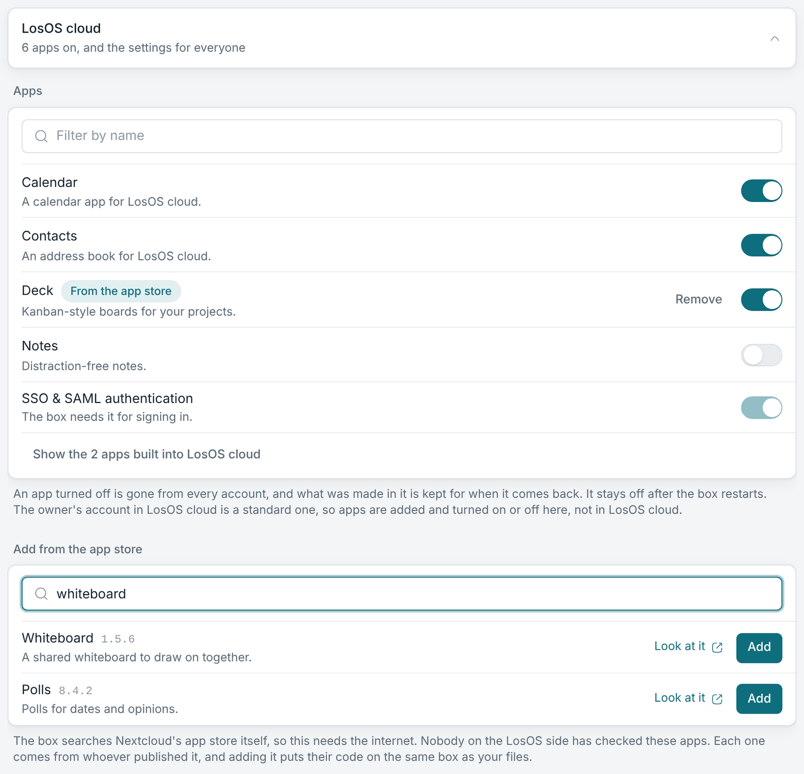
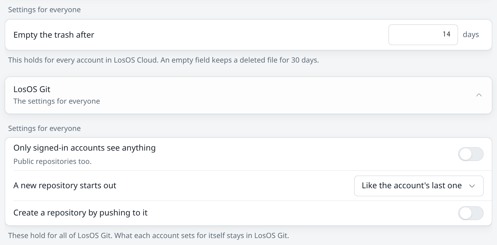
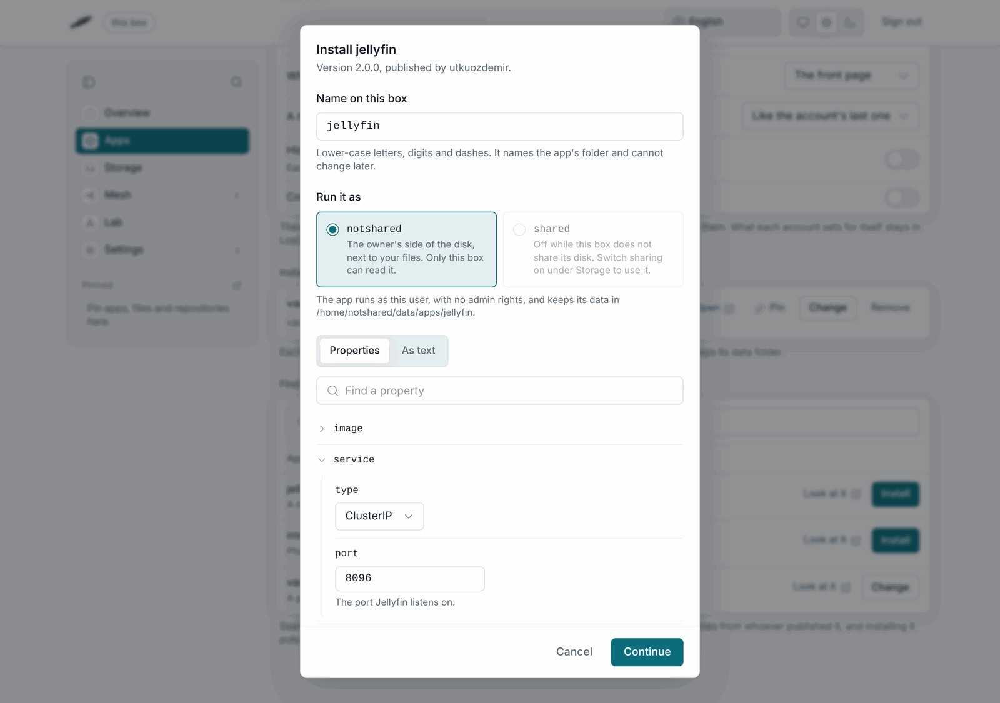

# The apps

## LosOS cloud

Your files, photos, calendar, contacts, notes, tasks, music and the rest of
the apps below, at `http://<address>/nextcloud`. It is Nextcloud with the box's colours and
name. Sign in with the owner's password. LosOS cloud does everything
Nextcloud does. The desktop client syncs a folder on your computer, the phone
apps upload photos, and calendars and contacts sync over CalDAV and CardDAV.

The Overview has a tile for each app in LosOS cloud's own menu, in the same
order: Files, Dashboard, Photos, Activity, Contacts, Calendar, Notes,
Bookmarks, Deck, Music, Collectives, Polls, Forms, Tables, Memories, News,
Tasks and Maps. The box turns all of them on at every start, except the
ones you turned off on the **Apps** pane. Mail is not among them, because
the box runs no mail server for it to read. If you add Mail from the app
store anyway, its tile appears on the Overview the next time the page loads. The links go through `index.php` on purpose,
because every configuration answers that path.

Family or colleagues get an account in LosOS cloud the first time they
open it, signed in with LosOS Login ([Signing in](sign-in-and-spare-key)).
The owner's account is a standard one too, not LosOS cloud's administrator.
Which apps run and the settings for everyone are on the **Apps** pane
instead, in the LosOS cloud fold.

## LosOS Git

Your repositories, at `http://<address>/git/<account>/<repository>.git`.
LosOS Git is the box's own Git server. A person LosOS Login knows has an
account in it from their first visit, under the same name. A computer clones
and pushes with a token of its own, which git asks for as the password:
`losos git setup` makes one ([The terminal client](terminal)). The box's own
configuration is the private repository `notshared/losos-config`
([Administration](../in-depth/administration)). Clone addresses follow the
address you reached the box by. Turn it off in the **Apps** pane if the box is not for code.

### Federation

LosOS cloud federates: you can share files and calendars with people
whose accounts are on other Nextcloud servers, by their `user@server`
address. The owner of another box is `notshared@otherbox.local/nextcloud`.
**Share with other Nextcloud servers** in the LosOS cloud fold turns that
off. While it is on, LosOS cloud may reach names that end in `.local` and
addresses on your local network, and accepts the certificate each box makes
for itself, which Nextcloud refuses on its own. That is how it reaches
other boxes on the same network.

:::note[Federation needs disk sharing]
Federation works only while the box shares its disk
(`losos.sharingMyStorage`), because that is when the shared part of the
disk is unlocked. With sharing off, the box talks to no other server, and
the **Apps** pane greys the federation switch out.
:::

## The Apps pane

For each app the pane shows whether it is on, which
[mode](../types/app-modes) it runs in, and a link. Under them, LosOS cloud
and LosOS Git each have a fold of their own, closed until you open it.
Below that, **Find more**
searches [Artifact Hub](https://artifacthub.io) for Helm charts. The box
fetches the results, so the search needs the internet. Every row names who
published the chart. Nobody on the LosOS side has checked any of them.

## LosOS cloud's apps

The LosOS cloud fold lists the apps inside LosOS cloud, each with a switch.
An app turned off is gone from every account, and what people made in it
is kept for when it comes back. It stays off after the box restarts. The
apps built into LosOS cloud wait behind a **Show** button, since you rarely
need them; the filter finds them too. A few switches cannot move, and the
row says why: LosOS cloud does not run without them, the box needs them
for signing in, or they follow disk sharing.

**Add from the app store** searches Nextcloud's app store and adds an app
with **Add**. The box does the search, so it needs the internet. Nobody on
the LosOS side has checked these apps. An app added from the store has a
**Remove** button, which asks first. Removing it takes its code off the
box and keeps what accounts made in it, so adding it again finds that.
The apps the box ships can be turned off but not removed.

## Settings for everyone

In the LosOS cloud and LosOS Git folds, the Apps pane has the settings that
hold for every account in each app. You would otherwise find them on each
app's own administration pages. The LosOS cloud fold starts with its
federation switch ([Federation](#federation)).

For LosOS cloud: the language of the sign-in page and of accounts that have
not picked one, the country a phone number without a country code belongs
to, whether files can be shared by public link, whether every link needs a
password, after how many days links stop working, how much space a new
account gets, and how long the trash and old versions are kept. An empty
field leaves the choice to LosOS cloud.

For LosOS Git: whether only signed-in accounts see anything, whether a new
repository starts private or public or like the account's last one, and
whether pushing to a repository that does not exist yet creates it.

Press **Apply** to use them, like every other setting. The box sets them
again each time the app starts, so a change made inside an app does not
last. Each account's own settings stay in the app.

## Installing an app from the search

A row the box can fetch has an **Install** button. It opens a dialog in
two steps.

The first step reads the chart and shows three things.

- **Name on this box.** It starts as the chart's name. It also names the
  app's folder, so it cannot change later.
- **Run it as.** `notshared` or `shared`, the box's two users. A
  `notshared` app keeps its data on the owner's side of the disk, next to
  your files. A `shared` app keeps it on the side the box lends to the
  mesh. The dialog greys `shared` out while the box does not share its disk.
- **Properties.** Every setting in the chart's values file, with its
  default, folded by section. When the chart ships a schema, each setting
  also gets its description and its choices. **As text** shows the whole
  values file to edit instead. A property you change on the form wins over
  the same line in the text.

The second step asks once more. It says that the box will download and run
code the publisher wrote, as the user you chose, with no admin rights. The
box gets nothing until you press **Install** there.

What runs the app follows from the user. A `notshared` app runs on
rootless Podman, as `notshared` itself, and needs no cluster. A `shared`
app runs in the box's own cluster, because that is the side of the box the
mesh touches. Either way the box changes the chart to run the way LosOS
cloud and LosOS Git do.

- Every part of the app runs as the chosen user, never as root, with no
  extra privileges and no access to a cluster.
- The storage the chart asks for becomes folders under
  `/home/<user>/data/apps/<name>`.
- The app gets one port of its own from `losos.apps.ports`, 30000 to 30099
  by default, and only your local network can reach it.

:::note[Charts the box refuses]
The box refuses a chart that needs more than that and says why. Typical
reasons are admin rights, a port below 1024, a port another app already
uses, or a folder of the system. A `notshared` app's services reach each
other by name, on the box itself, so they have to listen on different
ports. A `shared` app built from several services that call each other by
name may not start, because the box's own cluster has no internal network.
A scheduled job (a CronJob) runs only as `shared`.
:::

**Installed apps**, above the search, lists each app with its state.
**Open** goes to the app's port on the address you are using. **Change**
opens the same dialog on the app's current properties. **Remove** asks
first, then takes the app off the box. Its data folder stays, so an install
under the same name finds the data again.

:::note[Running as shared needs workload mode]
A `notshared` app installs on any box. `shared` needs the box's own
cluster, which runs only while Files or Code is set to **Kept separate**
([workload mode](../types/app-modes)), and the box has to share its disk.
To turn installing off, set `losos.apps.enable` to false on the
**Advanced** pane.
:::

## Your apps

Small apps of your own, a shopping list, a chore chart, a reading list,
that you describe and the AI on the box writes
([Build with AI](../in-depth/widget-builder)). They are under **Your
apps** on the Apps page. **Make an app** opens the editor: describe the app
on the **Build with AI** tab, or write its code on the **Code** tab. The
preview beside it is the real app, so you can use it before you save it.
It forgets what you enter; the saved app keeps its data on the box.

Each saved app has its own page. An app is one React component built from
the LosOS components, which the box checks and compiles when you save. It
runs only in your browser, in a sandboxed frame with no access to the box
beyond its own data. **Change** opens it in the editor again, and
**Delete** removes it with everything entered into it.

## Apps made for the box

Apps can also come as a Compose file in the
[LosOS app format](../in-depth/app-format), one you write or one a program
sends for you. They run as `notshared`, show in
**Installed apps** with the line "made for this box", and have **Open**
and **Remove** but no **Change**, since they have no properties.

## Trusted addresses

LosOS cloud answers on the box's name and on whichever address the request
arrived at. The box passes that address along with each request. LosOS cloud
never answers on a wildcard. That is why a box reached by its IP address
shows no "untrusted domain" page. If you ever see one, [Untrusted domain](../troubleshooting/app-tile-404#access-through-untrusted-domain)
says why.
