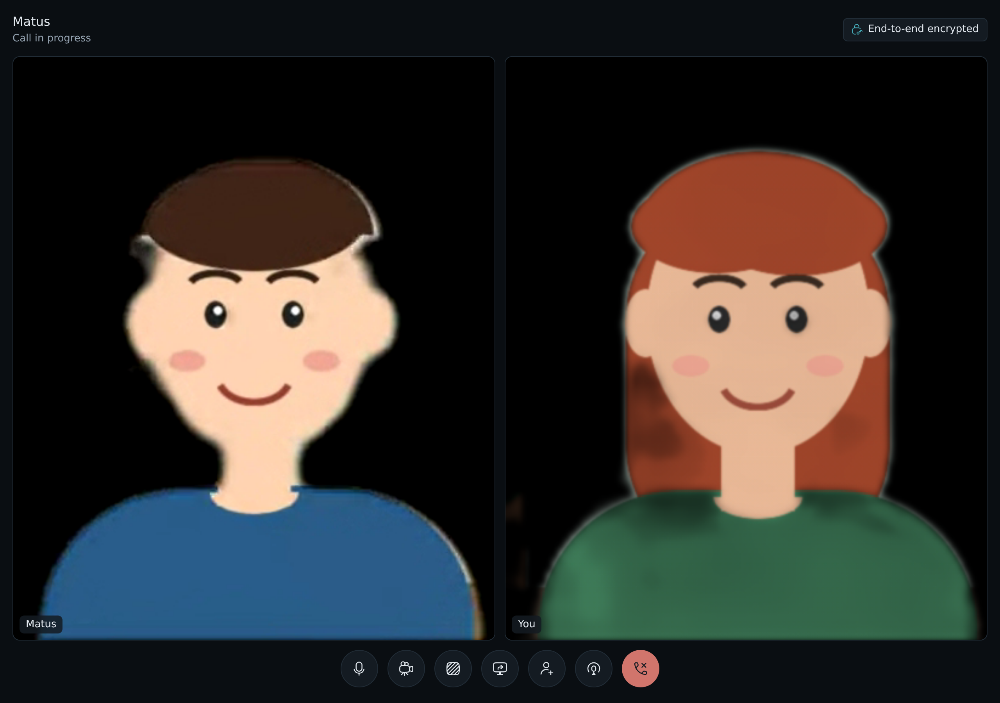

# Calls

People on the box can call each other from LosOS chat, by voice or with
video, in a direct message or in a room of up to eight people. The call
goes through the box, and the box cannot see or hear it. Every frame of
picture and sound is encrypted in the browser that sends it and decrypted
in the browsers that receive it.

MatrixRTC coordinates room-call membership, membership expiry and ringing
notifications. Each membership advertises LosOS's own SFU transport, not
LiveKit. Audio and video still travel through `losos-calls`, and the
browser's frame-level encryption and Olm key exchange remain LosOS-specific.

## When calls are there

Calls are part of chat, so they need what chat needs: the box shares its
storage and has joined a mesh. They also need
**Settings → Advanced → `losos.calls.enable`**, which is on unless you turn
it off. With any of these off, rooms have no call buttons and the box runs
nothing for calls. Turning one back on brings them back after the next
Apply.

## Starting a call

Open a room or a direct message. The header has two buttons, **Voice call**
and **Video call**. Your browser asks once for the microphone, and for the
camera when you start with video.

A call does not need a camera. If the browser opens none, because there is
none or because you did not allow it, you join with your camera off and a
message says so; the others hear you as usual. Without a microphone you
join listening only, and the microphone button asks for it again.

Everyone in the room gets a card in the corner of their chat page that
rings for a minute. **Answer** joins the way the call was started. On a
video call, **Answer without video** joins with the microphone only.
**Decline** only hides the card.

The room's timeline says that a call started. While it lasts, the line has
a **Join** button, so someone who missed the ring, or who left, can come
back. When the last person leaves, the timeline says the call ended.

## During a call

Each person has a tile. A tile shows their camera, or their picture while
their camera is off. The buttons at the bottom turn your microphone and
your camera off and on, share your screen, switch your background, invite
a guest, open podcast mode, and leave the call. Turning the camera off
stops it, so its light goes out, and sends nothing until you turn it on
again.

Your voice goes out at 128 kb/s over the full range of hearing, with the
browser's echo cancellation and noise suppression on. Your camera sends a
steady 30 frames a second. When the connection is short, it lowers the
sharpness first and keeps the movement smooth; a shared screen does the
opposite and keeps its text sharp.

The **End-to-end encrypted** label at the top says how many frames your
browser has sent encrypted, and how many it has received and opened.

## Your background

When your camera is on, the room behind you is black. Your browser finds
you in each picture and blacks out everything else before the picture is
encrypted, so the box and the others never get your room. The button
**Show your room behind you** sends the camera as it is, and
**Black out your background** turns the black back on. The browser
remembers your choice for the next call.

If the browser cannot black out the background, your camera sends nothing
rather than your room, and a message says so.

## Sharing your screen

**Share your screen** asks your browser which screen, window or tab to
share. While someone shares, their screen fills the middle of the call and
the people move to a strip beside it. **Stop sharing**, or the browser's own
stop button, ends it. The screen is encrypted with the same keys as the
camera.

## Podcast mode

Podcast mode streams the call to an RTMP address, such as the one YouTube
or Twitch gives you with a stream key. **Podcast mode** opens a panel with:

- the RTMP address, starting with `rtmp://` or `rtmps://`;
- a title and a subtitle, drawn under the picture;
- an overlay, a PNG drawn on top, for a logo or a frame.

The stream shows the people in a grid, or a shared screen in the middle
with the people beside it, as the call does. **Go live** starts it and
**End the stream** stops it. One person streams a call at a time, and
everyone in the call sees a **Live** badge while the stream runs.

A live stream is public, so it is the one part of a call that is not end
to end encrypted. Your browser puts the picture and the sound together
from the call it has already decrypted and sends them to your box, which
passes them to the RTMP address. The stream key stays in your browser and
the box: it is never written to the box's logs.

## Guests

Someone with no account on the box can join one call with a guest link.
**Invite a guest** makes the link and shows it with a **Copy link**
button. Send it to the person you invite. They open it in a browser, give
a name, and join. The others see them as *name (guest)*.

A guest link:

- opens this call only, for 12 hours;
- lets in one guest at a time;
- gives no account, no chat and no access to anything else on the box;
- stops working for the guest once everyone from the room has left.

Guest links come from an official LosOS edge, on the box's public name, so
a box without one cannot make them. The edge makes the link but cannot
listen in. The part after `#` is a secret your browser makes, and a
browser never sends that part to a server. Your browser gives it to the
others in the call in chat's encrypted messages. The guest's browser and
each person's browser use it to check each other, then agree on a key for
the two of them with keys made for this call only, and only then hand
over the call's keys. Someone with the link but without the part after
`#` gets into the call and sees and hears nothing.

## What the box sees

The box forwards each frame to the others in the call without opening it.
It knows who is in which call and when, how large the frames are and how
often they come. It never has the picture or the sound, apart from a
podcast stream that someone sends it to pass on.

Each person's browser makes its own key for the call. Browsers hand their
keys to each other in chat's encrypted messages between devices, which
the box carries but cannot read. The keys change while the call runs:

- When someone joins, everyone moves to the next key, which the new person
  gets. They cannot open anything sent before they came.
- When someone leaves, everyone makes a new random key and gives it only to
  the people who stayed. The person who left cannot open anything sent
  after.
- Every five minutes, everyone moves to the next key anyway.

Keys live in the browser's memory only and are gone when the call ends.
Nothing is saved, so a key found later opens nothing from the call.

One limit is worth knowing. A browser sends its key to the devices the
box's chat server lists for each person in the call. Someone who had taken
over the box's software could list a device of their own. Verify each
other's devices in chat (**Secure messages**, then **Verify**) to know that a
device is really the other person's.

## Browsers

A browser needs to be able to encrypt frames to join a call. Current
Firefox, Chrome, Edge and Safari can. A browser that cannot shows no call
buttons, and it never sends a frame without encryption.

## Where calls work

On a box that is on its own network, calls work between computers that
reach the box there. The box takes the media on UDP port 7882
(**Settings → Advanced → `losos.calls.udpPort`**), which is open on its
firewall while calls are on.

On a box that goes through an edge, the media goes through the edge too.
The box keeps one QUIC connection to the edge and opens no port of its
own, and people and guests send their media to a port on the edge. The
frames are as encrypted there as on the box.
