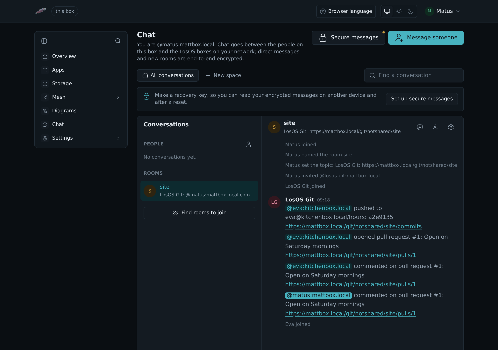
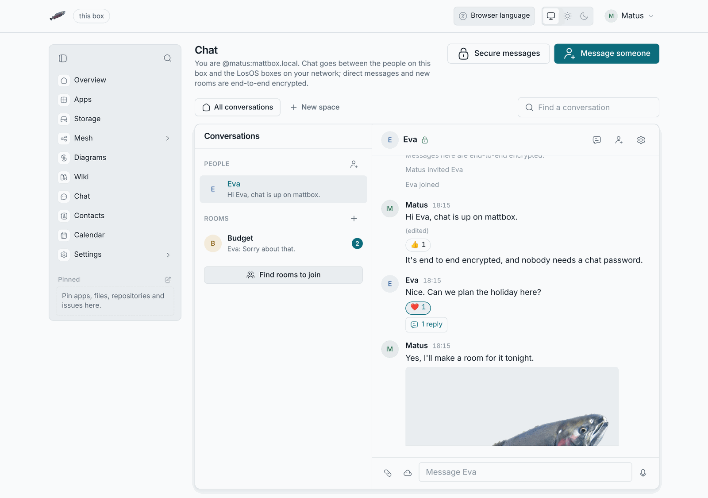
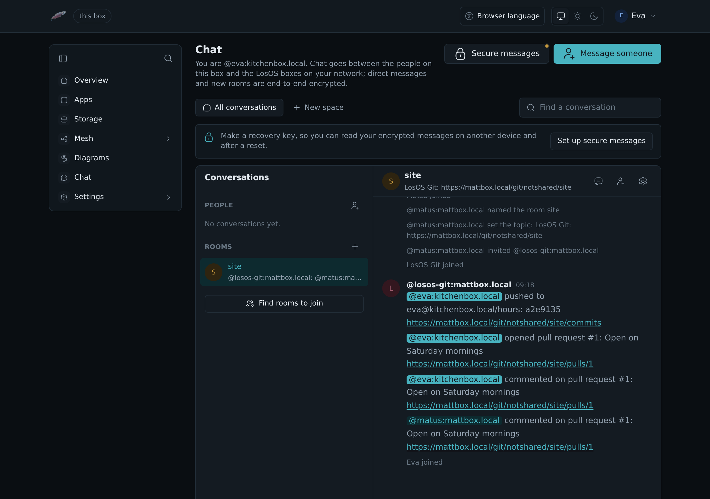

# Chat

LosOS Chat is a messenger on the box for everyone with a LosOS Login account.
People write to each other in direct messages and in rooms, share pictures
and files, reply in threads and react to messages. Direct messages and new
rooms are end-to-end encrypted, so the box stores only what it cannot read.

Chat uses Matrix, an open standard for messaging, and runs on the box
itself. Nothing goes to an outside service. The Matrix server on the box is
Synapse. A box that had chat before it moved to Synapse starts with an empty
chat: the old conversations stay in the shared storage, but chat no longer
reads them.

## When chat is there

Chat belongs to the part of the box you share with the mesh, and it keeps
everything in that part's storage. It runs only while the box shares its
storage and has joined a mesh. Then **Chat** appears in the sidebar of the
admin pages.

When you stop sharing, chat stops with it. The sidebar entry goes, and the
chat address leads back to the admin pages. The messages stay in the shared
storage and come back when you share again.

## Signing in

Open **Chat** in the sidebar, or go to `https://<name>.local/chat/`. Chat is
one of the [admin pages](admin-pages), with the same top bar and sidebar, the conversations
on the left and the open one beside them. It uses your LosOS Login sign-in. There is no separate chat password.

When you sign out of LosOS Login, chat signs out too. When an administrator
removes someone in **Settings** > **Users**, that person's chat devices are
signed out at once.

Everyone's chat address is `@<sign-in name>:<name>.local`, for example
`@eva:mattbox.local`.

## Secure messages

The first time you open chat, it asks you to set up secure messages.
Click **Set up secure messages**, then **Make my recovery key**. Chat shows
a recovery key of twelve groups of letters and numbers. Copy it or download
it, keep it somewhere safe apart from this computer, and click **I saved
it**. Chat does not show the key again.

The key lets your other devices read your encrypted messages. When you open
chat in another browser or on another computer, it shows **Unlock this
device to read encrypted messages**. Click it and type the recovery key, or
confirm the new device from one you already use by comparing the emoji both
show.

Without the key or another device, a new device cannot read messages sent
before it signed in. Nobody can recover them for you, and that includes the
box's administrator.

The lock button in the bar at the top opens **Secure messages** at any time. It lists your devices, and you can verify or sign out each one.

## Writing to people

- **A direct message:** click **Message someone** and pick a person. Everyone
  with a LosOS Login account on the box is in the list, and so is everyone in
  your [contacts](contacts) with a chat address. A contact's **Chat** button
  opens the same conversation.
- **A room:** click **New room**, give it a name, and choose whether it is
  public on the box or by invitation only. Invite people from the room's
  header.
- **Spaces** group rooms. They are the row of buttons above the
  conversations, beside the search; make one with **New space** and add rooms
  to it in each room's settings.
- **Find rooms to join** lists the public rooms on the box.

## In a conversation

Hover over a message to reply, reply in a thread, edit or delete it. The
quick reactions show in a pill under it. Press one to add it, and press it
again to take it back. Right-click a message for the same and to copy its text
([the right-click menu](admin-pages#the-right-click-menu)). The thread button
in the room's header lists the room's threads.

Attach pictures, videos and files with the paper clip, by pasting or by
dragging them in. In an encrypted room they are encrypted before they leave
your browser. The microphone records a voice message.

With LosOS Cloud on the box, the cloud button next to the paper clip sends
files straight from your Cloud. A file someone sends you has a cloud button
on its card, and **Save to LosOS Cloud** in its right-click menu. Either saves it,
decrypted, in the **Chat** folder of your Cloud, and the button then
opens it there. From LosOS Cloud, sending a file in chat asks which
conversation it goes to.

A small row of faces under a message shows who has read up to there.

## Other Matrix apps

Other Matrix apps, such as Element, cannot sign in to the box's chat,
because chat has no passwords and signs in only through LosOS Login. Use
the chat page in a browser on any device on the box's network.

## Other LosOS boxes

Chat reaches the LosOS boxes on your network. Write to `@eva:kitchenbox.local`
from `mattbox.local` and the message goes from one box to the other, without
leaving the network. A box named `.local` answers other chat servers only
from the network it is on.

To talk to Matrix servers on the internet as well, the box needs a domain of
your own that they can reach. `losos.chat.federation.enable` in **Settings**
> **Advanced** turns talking to other servers off altogether.

A repository in [LosOS Git](losos-git#a-chat-room-for-a-repository) can have
a room here, where LosOS Git posts what happens in it. People of other boxes
also sign in to LosOS Git with their chat address.
