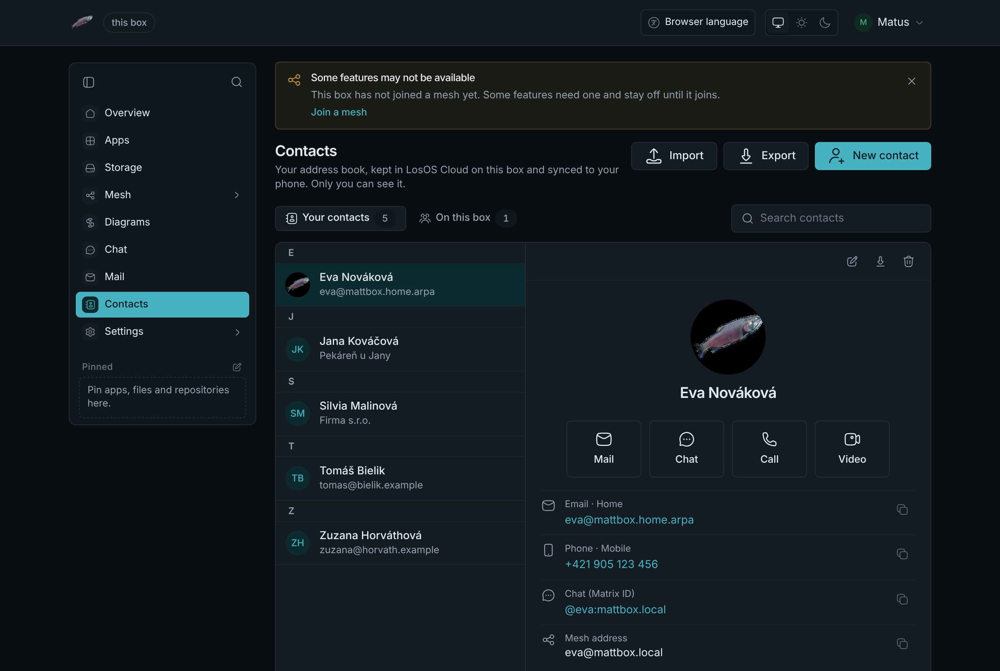
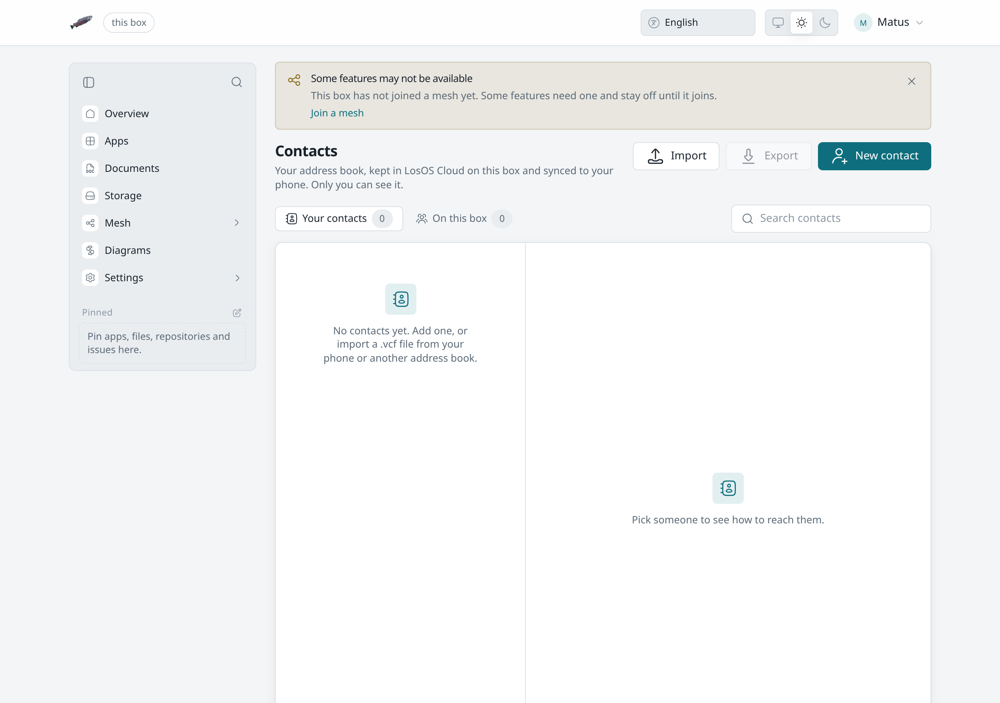

# Contacts

LosOS Contacts is an address book for each person on the box. **Contacts**
in the sidebar opens it at `/contacts`. Your book is yours alone. Other
people on the box, administrators included, cannot read it through the
admin pages or through LosOS Cloud.

## When Contacts is there

Contacts keeps your contacts in [LosOS Cloud](losos-cloud), so it is there
on every box that runs LosOS Cloud, whether or not the box shares its
storage. [Mail](mail) and [Chat](chat) run only while the box shares with a
mesh it has joined. With sharing off, a person's page has no **Mail**,
**Chat**, **Call** or **Video** button, and the book itself stays as it is.

The spare key opens the admin pages but has no address book, so Contacts
asks you to sign in with your own account.

## Where the book is kept

Your contacts are the address books of your LosOS Cloud account, one vCard
per contact. Contacts lists the people in every address book you have,
including one a phone or Thunderbird made. A contact you add here goes into
your first book, **Contacts**. When you edit a contact, Contacts changes the
fields it shows and keeps the rest of the card as your phone wrote it, such
as groups, ringtones and related names. Photos stay in the card, and the
page shows them as a small square picture.

## The book

- **Your contacts** lists the people you added or imported, by name, with
  the first letter as a heading. **Search** matches names, nicknames,
  organisations, email addresses, phone numbers and chat addresses, with or
  without accents.
- **On this box** lists everyone else with an account on the box, so you
  can reach them without adding them first. **Add to contacts** copies one
  into your book.
- Click a person to open their page: their email addresses, phone numbers,
  chat address, mesh address, postal addresses, birthday, websites and
  notes. Each line has a **Copy** button.
- Right-click a person in the list for the same actions without opening
  the page; see [the right-click menu](admin-pages#the-right-click-menu).

## Reaching someone

A person's page has a button for each way to reach them:

- **Mail** opens a new message to their first address. It is there when
  the box runs [Mail](mail) and the contact has an email address.
- **Chat** opens your direct conversation with them, or starts one.
- **Call** and **Video** open that conversation and start a
  [call](calls).

Chat, Call and Video are there when the box runs Chat, and need the contact's chat address, such as
`@eva:mattbox.local`. Everyone on this box has one; for a contact, put it in
**Chat (Matrix ID)**.

The other apps use the book too. Mail's **To** and **Cc** fields and Chat's
**Message someone** suggest your contacts as you type, beside the people on
the box. Someone who is on the box and also in your book shows up once, as
your contact.

## Adding and editing

**New contact** opens the editor. Only the name is required. **More fields**
adds a nickname, a job title, postal addresses, websites, a birthday, a mesh
address (`name@box`, for sharing files with someone on another box) and a
note. Each email address and phone number can be marked as home, work,
mobile and so on. **Add a photo** takes a picture from your computer.

## Importing and exporting

**Import** takes a `.vcf` file from your phone or from another address book:
vCard 4.0, 3.0 or 2.1, with one contact or many. Photos inside the file come
along. A contact that is already in your book is updated rather than added a
second time. The file's own identifier decides when it has one, otherwise
the name together with the first email address or phone number.

**Export** downloads your whole book as one `.vcf` file, in vCard 3.0 (which
every phone reads) or 4.0. A person's page and the right-click menu also
export one contact on its own.

## On your phone and computer

Phones and desktop address books sync with the same address books over
CardDAV. Set them up as in
[Calendars and contacts](losos-cloud#calendars-and-contacts). A contact you
add on the phone shows up in Contacts, and one you change in Contacts
reaches the phone on its next sync. Import and export are still there for a
one-off move from somewhere else.
