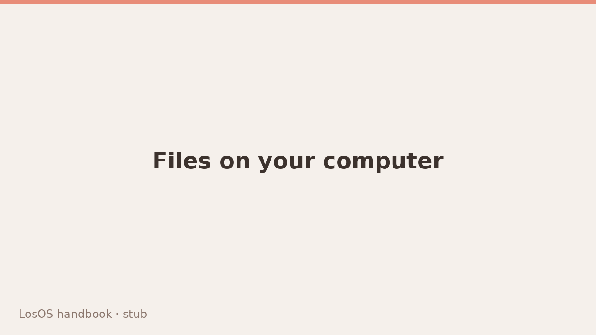

# Files on your computer



Your LosOS Cloud files are also a network folder. Any computer on the box's
network can open it in its file manager, drag files in and out, and open
them in place, without installing anything. There are two ways in:

- **The network share.** On the box's network, Windows, macOS and Linux
  list the box under **Network** by themselves, with your files inside as
  a folder named after you.
- **The WebDAV address.** It works on the box's network and through the
  internet, and is the way in while the network share is off.

`<name>` below is the box's name, as on the box's screen. Both hold the same
files as Files in LosOS Cloud.

## The network share

Your folder on the share is:

```text
\\<name>\<your name>
```

Sign in with the name and password you use on LosOS Login. Each person sees
only their own folder; the person who set up the box gets the owner's
files. Your **Account** page shows the address too.

The share answers computers on the box's own network only, never through
the internet. An administrator turns it on and off under **Settings** >
**Network** > **Windows, Mac and Linux**. It is on by default.

### Windows

1. Open File Explorer and click **Network**. If a bar says that network
   discovery is turned off, click it and turn it on for a private network.
2. Double-click `<name>`, then the folder with your name.
3. Type your LosOS name and password, tick **Remember my credentials**, and
   click **OK**.

To give the folder a drive letter, right-click it and choose **Map network
drive**.

### macOS

1. In the Finder's sidebar, under **Locations**, click **Network**, then
   `<name>`.
2. Click **Connect As**, choose **Registered User**, type your LosOS name
   and password, and tick **Remember this password in my keychain**.

**Go** > **Connect to Server** with `smb://<name>.local/<your name>` opens
the same folder.

### Linux

- **GNOME Files:** open **Other Locations**. Under **Networks**, click
  `<name>`, then the folder with your name, and type your name and
  password.
- **Dolphin:** open **Network** in the places panel, then `<name>`.

The address `smb://<name>.local/<your name>` works in both location bars.

### If your password is refused

Windows, and the network share with it, checks a password its own way, so
the box has to see yours once before the share takes it. It sees it when
you set up the box, when your account is made, when you change your
password, and when you sign in to the WebDAV address. If none of those
happened since the share was turned on, open your **Account** page in
LosOS, find **Your files on Windows, Mac and Linux**, type your password
under **Let Windows take your password**, and click **Allow**.

### What the share does differently

Files you change on the share change in LosOS Cloud at once, in the
browser and in the desktop and phone apps. A file you delete there is gone
for good: it skips LosOS Cloud's trash, and a file you overwrite there
keeps no earlier version.

## The WebDAV address

```text
https://<name>.local/remote.php/webdav/
```

### Before you start

Install the box's certificate on the computer, as in
[first run, step 1](../start/first-run#step-1-trust-this-box). Without it,
the file manager says it cannot verify the box and asks whether to go on,
and Windows refuses to connect at all.

### Which name and password

On the box's network, type the sign-in name and password you use on LosOS
Login. The person who set up the box gets the owner's files. Anyone else
gets their own, and the first time they open the share LosOS Cloud makes
their account.

Through the internet, LosOS Login does not answer, so the share asks for an
app password instead: one a desktop or phone app got when you signed it in,
or one `losos cloud setup` made (below). An app password works on the box's
network too, and **Devices** in LosOS Cloud signs it out on its own.

### Linux \{#webdav-linux}

While the network share is off, GNOME Files and KDE Dolphin list **LosOS
Cloud on `<name>`** under **Network** in its place. To type the address,
use `davs://<name>.local/remote.php/webdav/` in GNOME Files' **Connect to
Server** field, or `webdavs://<name>.local/remote.php/webdav/` in Dolphin's
location bar.

Choose to remember the password and the folder opens without asking next
time. GNOME Files can also add it to the sidebar as a bookmark.

### Windows \{#webdav-windows}

1. Open **This PC**, then **Map network drive** (under the **...** menu on
   Windows 11).
2. Pick a drive letter. In **Folder**, type
   `https://<name>.local/remote.php/webdav/`.
3. Tick **Connect using different credentials** and **Reconnect at
   sign-in**, then **Finish**.
4. Type your name and password, and tick **Remember my credentials**.

The share then appears under **This PC** with its own drive letter.

:::note[Large files on Windows]
Windows' own WebDAV client refuses files larger than about 50 MB unless
its limit is raised. On the box's network, use the network share instead;
elsewhere, use the desktop app below.
:::

### macOS \{#webdav-macos}

1. In the Finder, choose **Go** > **Connect to Server** (Command-K).
2. Type `https://<name>.local/remote.php/webdav/` and click
   **Connect**.
3. Choose **Registered User**, type your name and password, and tick
   **Remember this password in my keychain**.

Click **+** before **Connect** to keep the address in the list of favourite
servers.

## The desktop and phone apps

The share is for opening files where they are. To keep a copy of a folder
in sync, or to upload photos from a phone, use the Nextcloud desktop client
and the Nextcloud phone apps, which sync with LosOS Cloud. Give them the
address `https://<name>.local`. They open LosOS Login in a browser to sign
you in, then keep an app password of their own.

On a Linux computer with the `losos` terminal client, `losos cloud setup`
sets up the file manager for you; see [The terminal client](terminal).
