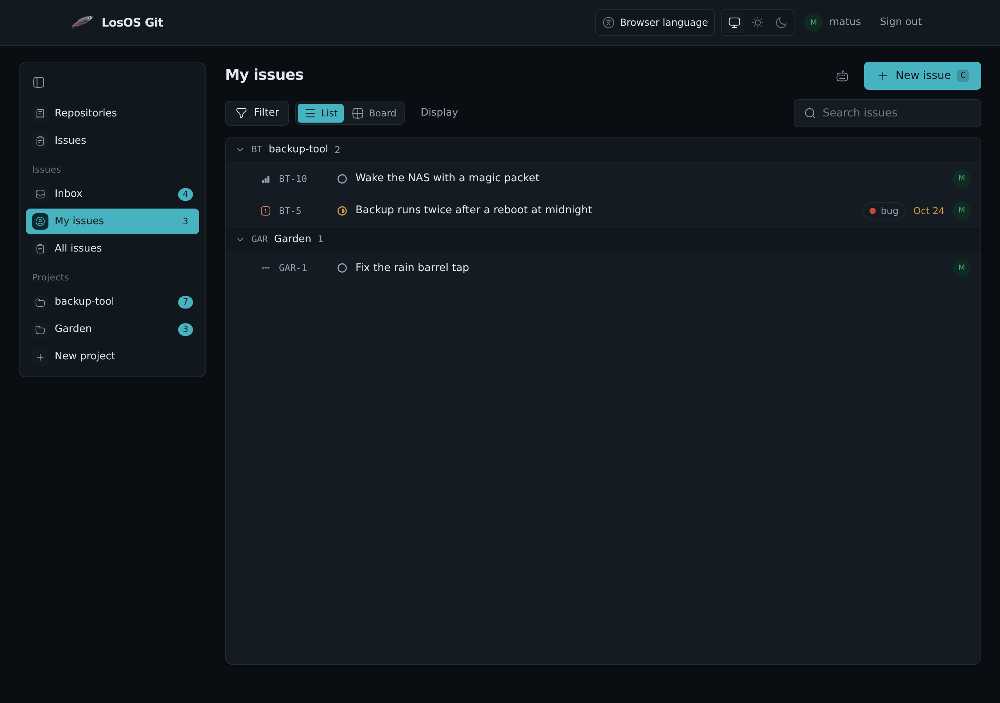
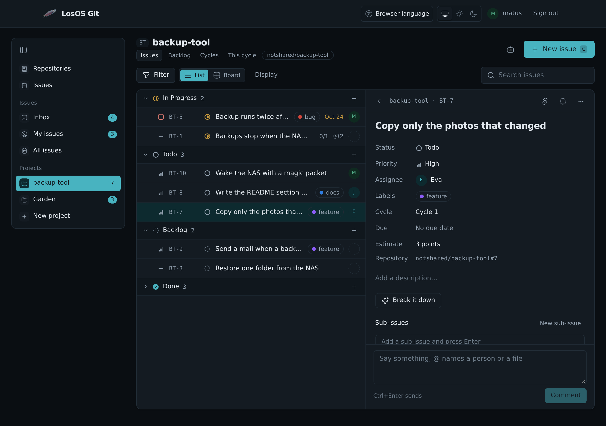

# Issues in LosOS Git

LosOS Git keeps the box's issues: bugs, tasks and ideas, for code and for
anything else. They live at **Issues** in LosOS Git's sidebar, at
`https://<box>.local/git/issues`, in one list for every project on the box.

## Projects and keys

Every issue belongs to a project, and every project has a short key. An
issue is named by the key and a number: `BT-12` is issue 12 of the project
with the key `BT`. The name stays the same for the issue's whole life, so it
is safe to write it in a commit, a chat or a mail.

A repository gets its own project the first time someone opens its
**Issues**. The key is made from the repository's name, and the project's
issue numbers are the repository's: `BT-12` and `backup-tool#12` are the same
issue. A project can also stand alone, without a repository, for work that
is not code. **New project** in the sidebar makes one. A project is either
private, open only to the people added to it and to whoever may see its
repository, or open to everyone with an account on the box, who may then
also change its issues.

## Status, priority and the rest

An issue moves through the project's workflow. A new project has six
states: Backlog, Todo, In Progress, In Review, Done and Canceled. Each state
is one of five kinds: backlog, not started, started, done and canceled. The
lists, the board and the closing words below go by the kind, so a project
can rename its states or add its own.

Besides its status an issue has:

- a priority: Urgent, High, Medium, Low or none;
- one person it is given to;
- labels, made on the spot by typing a new name;
- an estimate in points (1, 2, 3, 5, 8, 13 or 21);
- a due date;
- a cycle (see below);
- a parent issue, which makes it a sub-issue. The parent shows how many of
  its sub-issues are finished.

Two issues can be related: one blocks the other, one duplicates the other,
which cancels the duplicate, or they are simply related.

Each issue keeps its history: who made it, every change of status,
priority, person, label or cycle, every comment, and the commits and pull
requests that named it.

## Lists, the board and views

**My issues** shows what is given to you, across all projects. **All issues**
shows everything you may see. A project has its issues, its **Backlog**
of issues nobody has started, and its **Cycles**.

Every list can be shown as a list, grouped by status, or as a board with a
column for each state. On the board, drag a card to another column to
change its status, or up and down to change its order. **Filter** narrows a
list by status, priority, person, label, cycle and more, and **Display**
picks how it is grouped and sorted. **Save view** keeps the filter and the
layout under a name in the sidebar; a view can be kept for yourself or
shared with everyone who may see the project.

Selecting issues with their check boxes, or with `X`, opens a bar to change
the status, priority, person or labels of all of them at once.

## Cycles

A cycle is a stretch of time, usually one or two weeks, with the issues
meant for it. **Cycles** on a project lists them with how many of their
issues are done, and **This cycle** shows the issues of the cycle that runs
today.

## The inbox

**Inbox** lists what happened to the issues you follow: one was given to
you, someone named you with `@`, a comment, a change of status, a commit or
pull request that named it. You follow an issue you made, one given to you,
one you commented on or were named in, and any issue you follow with the
bell on its page. The number beside **Inbox** counts what you have not
read.

## The keyboard

Everything works without the mouse. Press `?` on the issue pages for the
list. The ones used most:

| Key | Does |
| --- | --- |
| `C` | a new issue |
| `J`, `K` | move down and up the list |
| `Enter` | open the issue |
| `X` | select it |
| `S`, `P`, `A`, `L` | change its status, priority, person or labels |
| `0` to `4` | set its priority |
| `B` | switch between list and board |
| `/` | search the list |
| `Ctrl+K` | find any issue, project or view by name |

## Commits and pull requests

An issue's name in a commit message or a pull request links the two: the
issue lists the commit or pull request, and the inbox tells the people who
follow it. `BT-12`, `#12` and `owner/repo#12` all work.

A closing word before the name also finishes the issue: `close`, `closes`,
`closed`, `fix`, `fixes`, `fixed`, `fixing`, `resolve`, `resolves` or
`resolved`. A commit with `Fixes BT-12` moves BT-12 to Done when it reaches
the repository's main branch. A pull request that names an issue moves it to
In Review if nobody had started it, and when the pull request is merged, the
issues it says it closes move to Done. A branch named after an issue, such
as `bt-12-free-space`, names it too.

Only people who may change an issue can close it this way.

## With the other apps

From the **⋯** menu at the top of an issue:

- **Send by mail** opens LosOS Mail with the issue's name and link;
- **Share in chat** opens LosOS Chat with it;
- **Add the due day to a calendar** gives the due date as a calendar file;
- **Assignee's contact card** opens the person it is given to in Contacts.

Right-click an issue in a list or on the board for **Open in new tab**,
**Copy link**, **Copy key and title**, **Pin to sidebar** and the same Mail
and Chat items.

**Make an issue** starts an issue from another app. It opens a new tab with
the title and the words already filled in, to change before you make it:

- in LosOS Mail, the button at the top of a message quotes the message;
- in LosOS Chat, the menu of a message quotes it;
- in LosOS Cloud, the right-click menu of a file links to the file;
- in Office and Notes, the bar over picked words quotes them.

An administrator can pin an issue or a project to the admin pages' sidebar
with the pin at its top, and the [search](./admin-pages.md#search) on the
admin pages finds issues by their words or their key. The **Issues** tile
on the Overview counts the open issues given to you. Typing `@` in a
description, a comment or a card in LosOS Diagrams offers issues next to
people and files, and so does the link button over picked words in Office
and Notes.

Mail, Chat and Contacts are there when the box shares and is in a mesh.
Every issue with a due date that is given to you is also in a calendar
feed, at `https://<box>.local/git/api/v1/tracker/calendar.ics`. A calendar
app subscribes to it with your name and a LosOS Git access token with the
issue scope as the password.

When Build with AI is on, **The box's AI** on an issue can **Break it
down** into steps, which you tick to make them sub-issues, or **Sum up**
what was said. The model runs on the box, and nothing changes until you
pick what to keep.

## Who may do what

Whoever may see a project's repository may see its issues, comment on them
and open new ones; a new issue from someone who may only read the
repository keeps its title and description and nothing else. Changing an
issue needs write access to the repository or the project. A project's
administrators change its workflow, labels, cycles and members.

## A box that had Forgejo or LosOS Cloud boards

Issues carried over from Forgejo become the issues of their repository's
project, with the same numbers, comments and labels.

The boards of LosOS Cloud are taken in once, on the first start with issues:
each board becomes a project with its columns as the workflow, its cards as
issues with their labels, people, due dates and comments, and its members
as the project's members. A board that belonged to a repository fills that
repository's project, and a card that pointed at one of its issues moves
that issue instead of making a second one. LosOS Cloud's own copy is left as
it was. What came over is listed in
`/var/lib/losos-git/boards/import.json`.
