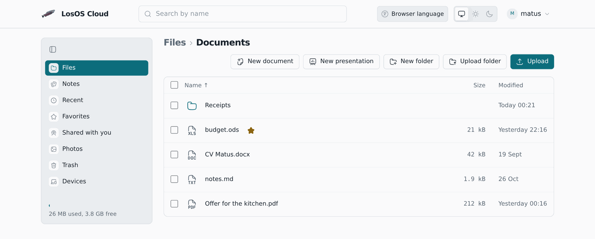
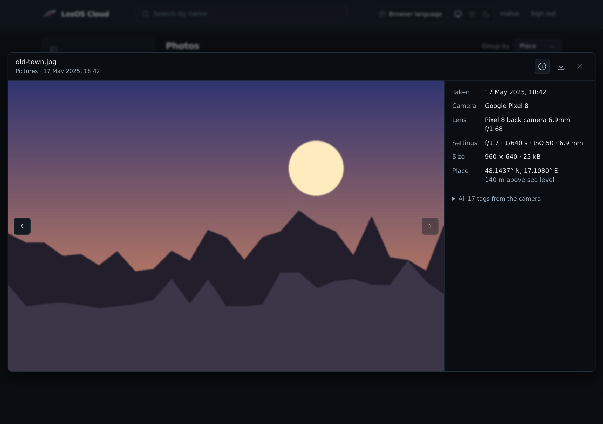
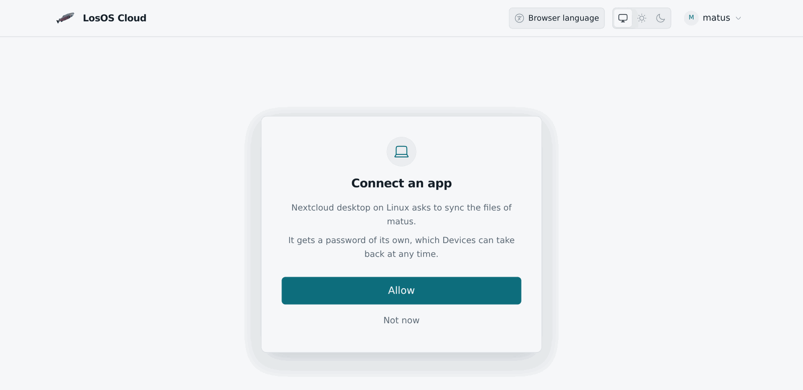

# LosOS Cloud




LosOS Cloud is the box's own file service: your files in a browser, a
network folder for the file manager, a server the Nextcloud desktop and
phone apps sync with, and your calendars and contacts for any calendar app.

Open it at `https://<name>.local/cloud/`. `<name>` is the box's name, as on
the box's screen. You sign in with LosOS Login, and everyone who can sign in
gets their own files. The person who set up the box gets the owner's.

## In the browser

LosOS Cloud sits in the same frame as the box's other pages: the same bar
across the top and the same sidebar, with its places under **Cloud**.

- **Files** lists your folders. Drop files or whole folders on the page to
  upload them, or use **Upload**. A file added any other way, over the
  network share or from the desktop app, shows up in the open folder by
  itself within a few seconds. Tick files to download, rename, move,
  copy or delete them, or to see their earlier versions.
- **Recent** shows what changed lately, **Favorites** what you starred.
- **Photos** shows every picture by when it was taken, and the people in
  them. See [Photos](#photos).
- **Trash** keeps deleted files for 30 days, or as long as the **Apps**
  pane says. Restore one, or delete it for good. Files deleted through
  the [network share](files-on-your-computer#the-network-share) skip it.
- **Devices** lists the computers and phones that sync, and signs one out.
- <kbd>Ctrl</kbd>+<kbd>Shift</kbd>+<kbd>P</kbd>, a colon typed outside a
  text field, or the magnifier at the top of the sidebar opens the search,
  which finds files by name and by the text in them, on every page of the
  box and inside an open document too.
- Text files open in an editor several people can type in at once, and
  **Shared with you** holds what people on other boxes shared with you.
  See [Sharing and editing together](sharing-and-editing-together).
- **Notes** reads a folder of Markdown notes the way Obsidian does, with
  links, tags and a graph, and can publish one as a knowledge base. See
  [Notes and knowledge bases](notes-and-knowledge-bases).
- Right-click a file, a folder or the space around them for what you can
  do there; see [the right-click menu](admin-pages#the-right-click-menu).
- A file's right-click menu also hands it to the other apps: **Send by
  mail** and **Send in chat** while the box has Mail and Chat, and **Ask AI
  about this** for a text file on a box that runs a language model. The AI
  runs on the box and reads only the file you picked.

## Photos

**Photos** shows every picture in any folder, newest first, by the month
the camera says it was taken. **Group by** sorts them by person, by camera
or by place instead. Click a picture to see it large, use the arrow keys
to go through them, and press **Details** (or <kbd>i</kbd>) for what the
camera wrote: when, which camera and lens, the exposure, the size, where it
was taken, who is in it, and every other tag the camera saved.



The box finds the faces in your pictures and puts the ones that look alike
together as one person. **People** above the photos shows everyone seen in
more than one picture; click a face to see all of that person's photos and
give them a name. Give two people the same name and they become one.

All of it happens on the box, in the background and at the lowest priority,
a few minutes after a picture arrives. Two small models find and compare
faces on the box's own processor, and nothing about a picture, a face or a
place is sent anywhere. Only you see your photos' faces, names and places;
other people on the box see none of them.

## Desktop and phone apps

The Nextcloud desktop client and the Nextcloud apps for Android and iOS
work with LosOS Cloud. Give them the box's address without a path:

```text
https://<name>.local
```

The app opens LosOS Login in a browser. Sign in, press **Allow** on the
page that follows, and the app gets a password of its own. It then shows up
under **Devices**, where you can sign it out without touching your LosOS
Login password.



## Calendars and contacts

Calendar and contact apps (Thunderbird, GNOME Calendar, DAVx⁵ on Android,
the iPhone's own accounts) find your calendars and address books from the
box's address:

```text
https://<name>.local
```

Sign in with your LosOS Login name and an app password from the desktop or
phone app's sign-in, or, on the box's network, with your LosOS Login
password. A calendar app that asks for the full address takes
`https://<name>.local/remote.php/dav/`.

In the browser, the same calendars are in [Calendar](calendar), and the
address books in [Contacts](contacts).

## In the file manager

The same files are a WebDAV share at this address:

```text
https://<name>.local/remote.php/webdav/
```

On the box's network, GNOME Files and Dolphin list it under the network as
**LosOS Cloud on `<name>`**. Windows and macOS add it by address, as in
[Files on your computer](files-on-your-computer). Install the box's certificate first, as in
[first run, step 1](../start/first-run#step-1-trust-this-box).

On the box's network the share takes your LosOS Login name and password.
Through the internet it takes only an app's own password, so use the
desktop or phone app there.

## A box that ran Nextcloud

Before LosOS Cloud, a box kept your files in Nextcloud. On the first start
without it, the box moves everything over by itself, before LosOS Cloud
opens: every account's files with their trash, calendars, contacts and
tasks, Deck's boards, and the passwords the desktop and phone apps already
had, so they keep syncing without a new sign-in. Apps set up with the old
address ending in `/nextcloud` keep working too.

The files are moved, not copied, so the move needs no extra space. What
Nextcloud kept beside them stays where it was; only an
[erase](backup-and-erase) clears it, with everything else. If the move fails, LosOS Cloud does not open on an empty folder. The
box tries again on the next start.

## Settings

The **Apps** pane's LosOS Cloud fold sets how long the trash keeps files
(`losos.cloud.trashDays`, 1 to 365 days). `losos.cloud.enable` on the
**Advanced** pane turns LosOS Cloud off, and `losos.cloud.photos.faces`
stops Photos looking for faces. The next pass deletes every face and name
found so far, and the camera's details stay.
