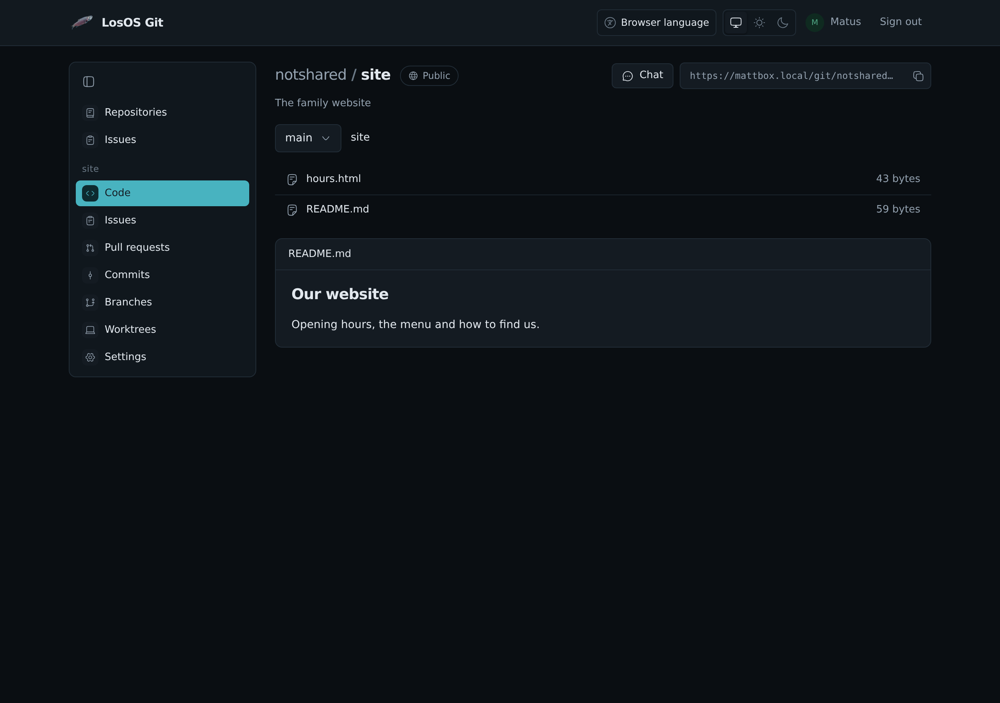
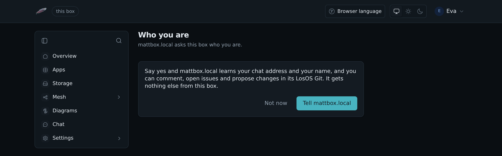
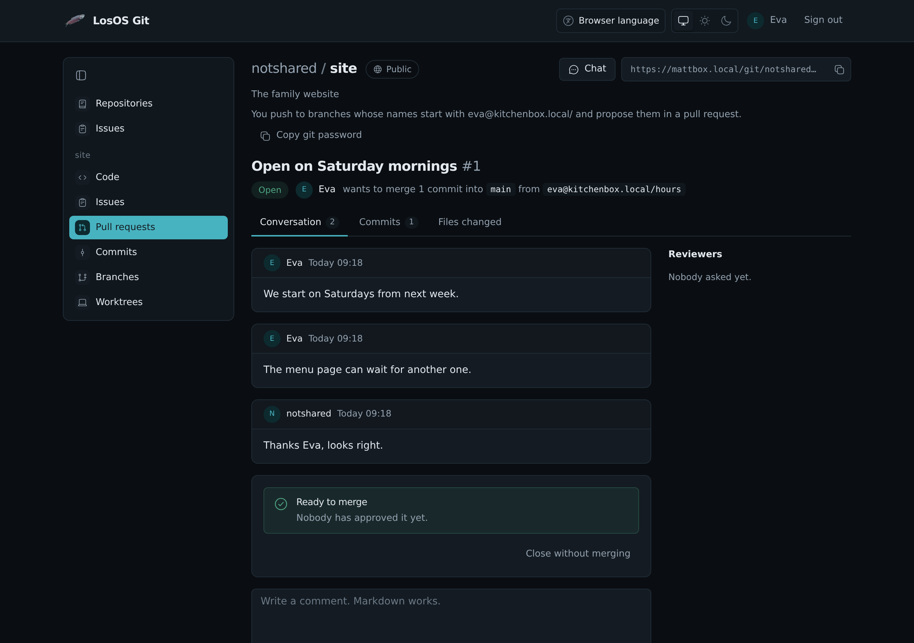
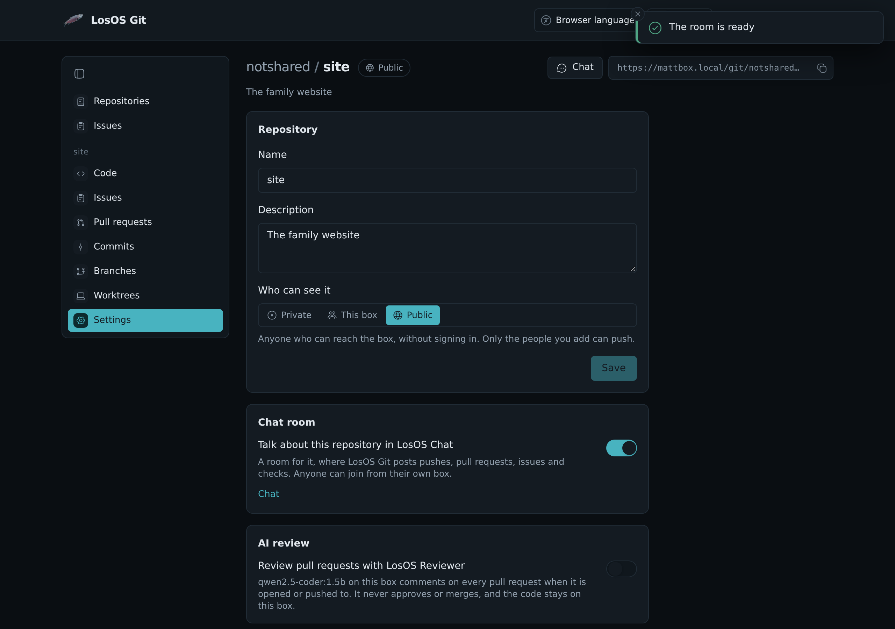

# LosOS Git




LosOS Git is the box's own Git server. It keeps your repositories, takes
pushes and clones over HTTPS, and has pages for reading code, opening pull
requests and reviewing them.

Open it at `https://<name>.local/git/`. `<name>` is the box's name, as on
the box's screen. You sign in with LosOS Login. The person who set up the
box is the owner, and their repositories are under `notshared`.

## Repositories

The first page lists your repositories, the ones shared with you and the
ones everyone on the box can read. **New repository** makes one and asks
who can see it. An empty repository shows the commands that push a first
branch to it.

A repository's pages are in the sidebar:

- **Code** shows the files of a branch, with the README under them. Pick
  another branch at the top, or open a file to read it with line numbers.
  Markdown files are shown as text with formatting.
- **Pull requests** lists the open and the closed ones.
- **Commits** and **Branches** show the history. **Compare** on a branch
  shows what it has that the default branch has not.
- **Worktrees** lists the checkouts that push to the repository (see
  below).
- **Settings** renames the repository, changes its description and who
  can see it. Only the repository's owner and its admins see it.

### Who can see a repository

Every repository has one of three settings, shown as a badge beside its
name:

- **Private**: you and the people you add. This is the default.
- **This box**: everyone with an account on the box, once they have signed
  in.
- **Public**: anyone who can reach the box, without signing in. They can
  read the code, the history and the pull requests, and clone it. Through
  an edge that is anyone on the internet.

Whatever the setting, only you and the people you add can push. Someone
who opens `/git/` without signing in sees the public repositories and a
**Sign in** button.

## Clone and push

The address of a repository is at the top of its pages, with a button that
copies it:

```sh
git clone https://<name>.local/git/notshared/notes.git
```

git asks for a name and a token. `losos git setup`, from
[the terminal client](terminal#use-losos-cloud-and-losos-git-from-this-computer),
makes a token for one computer and hands it to git, so cloning and pushing
then need no password.

## Issues

The issue tracker at **Issues** in the sidebar keeps the bugs, tasks and
ideas of a repository, and of work that is not code. A repository's
**Issues** opens its project there. See [Issues in LosOS Git](issues).

## Pull requests

Push a branch, then press **Open a pull request** on the Code page or
**Compare** on the Branches page. Pick the branch to merge into, give it a
title and a description, and press **Open pull request**.

A pull request has three tabs:

- **Conversation** holds the description, the comments and the reviews in
  order, and the box to merge it.
- **Commits** lists the commits on the branch.
- **Files changed** shows the changes, file by file.

### Review

On **Files changed**, point at a line and press **+** to comment on it.
**Comment now** posts the comment straight away. **Add to review** keeps it
with your review until you send it. When you are done, pick **Comment**,
**Approve** or **Request changes**, write a summary if you like, and press
**Send review**.
The person who opened the pull request can only comment on their own.

A comment on a line starts a thread. Reply under it, and press **Resolve**
when it is settled; a resolved thread folds away and **Open again** brings
it back. A thread whose line has changed since is shown as outdated.

**Reviewers** on the right asks people for a review and shows where each
one stands.

### Checks

When a tool reports on a branch's newest commit, for example a build or a
test run, its result shows on the Conversation tab, above the merge box.

### Merge

The merge box offers three ways:

- **Merge commit** keeps every commit and adds one that joins the branches.
- **Squash** puts all of the branch's changes into one commit.
- **Fast-forward** moves the base branch up to the branch, when the base
  has nothing the branch lacks.

**Delete `<branch>` afterwards** removes the branch once it is merged. The
box refuses a merge that has conflicts; merge the base branch into yours,
push, and try again. **Close without merging** sets a pull request aside, and **Reopen**
brings it back.

## Worktrees

A worktree is one checkout of a repository on one computer, made with
`git worktree add`. Give each one a name and say which computer it is on,
and every push from it carries both:

```sh
git config extensions.worktreeConfig true
git worktree add ../fix-backup -b fix-backup
cd ../fix-backup
git config --worktree push.pushOption "worktree=fix-backup"
git config --worktree --add push.pushOption "computer=laptop"
git push -u origin fix-backup
```

**Worktrees** then lists it with its branch, its last push and the pull
request for that branch, if there is one. A pull request whose branch is
pushed from a named worktree shows that worktree's name in its header.
**Forget** takes a worktree off the list; its next push puts it back.

## People of other boxes

Someone whose account is on another LosOS box on your network can take part
in your public repositories without an account on yours. They sign in with
their chat address, the one LosOS Chat shows under their name, such as
`@eva:kitchenbox.local`.

1. On your box's repository page they press **Use your chat address**, type
   the address and press **Continue on your box**.
2. Their own box opens and asks whether to tell yours who they are. They
   press **Tell `<name>.local`**.
3. They are back on your box, signed in as `@eva:kitchenbox.local`.



Their box tells yours only their chat address and their name. Your box
checks the answer with their box's chat server before it believes it.
People with an account on your box sign in with LosOS Login as before.

Signed in this way, they can comment, review and open pull requests. They
cannot push to your branches. They push to branches whose names start with
their own sign-in name here, for example `eva@kitchenbox.local/hours`, and
ask for the change in a pull request. **Copy git password** on the
repository page copies the password git asks for; any user name works with
it.

```sh
git push https://<name>.local/git/notshared/site.git HEAD:eva@kitchenbox.local/hours
```

Only you and your admins merge. Sign out ends their visit on this computer.



## A chat room for a repository

With LosOS Chat on the box, **Settings** of a repository has **Talk about
this repository in LosOS Chat**. Turn it on, and the box makes a room for
the repository in your chat, with LosOS Git in it. LosOS Git posts every
push, pull request, comment, merge and check result there.



A **Chat** button then sits in the repository's header for everyone who is
signed in. For a public repository anyone can join the room, from their own
box's chat too. For a private one people join when you invite them from
chat.

Turning the switch off stops the posts. The room and what is in it stay in
your chat.

## Settings

`losos.git.enable` turns LosOS Git off. `losos.git.site.requireSignIn`
asks everyone to sign in before LosOS Git shows anything, public
repositories included. Both are on the **Advanced** pane.
