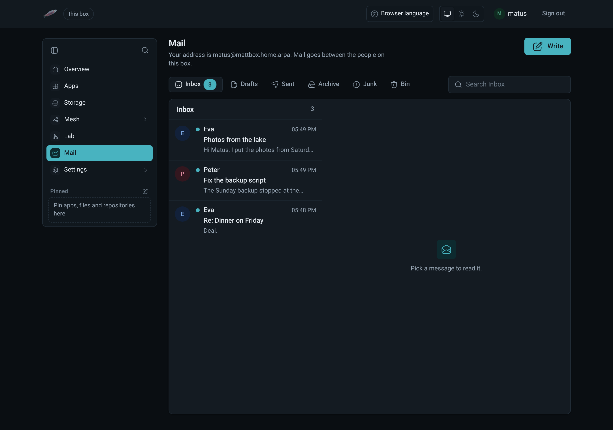
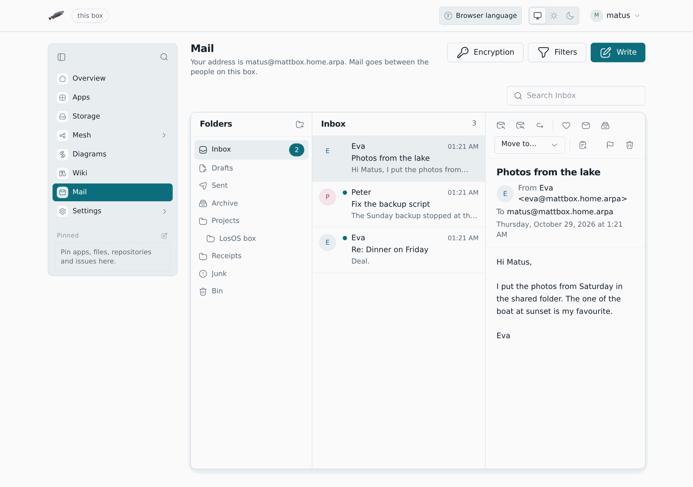
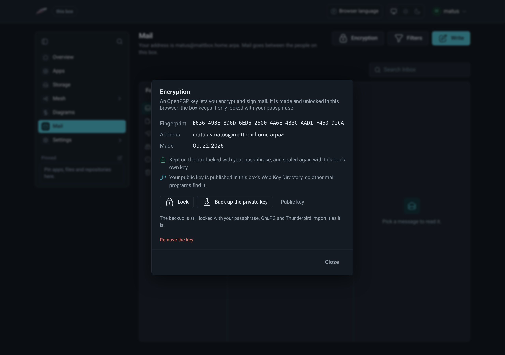
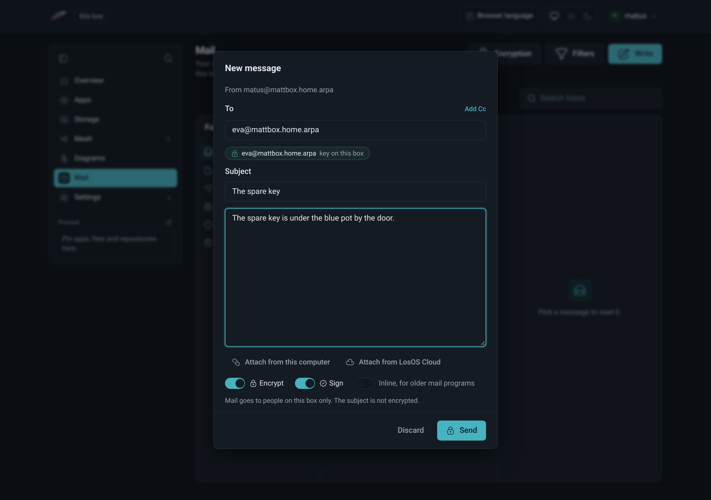
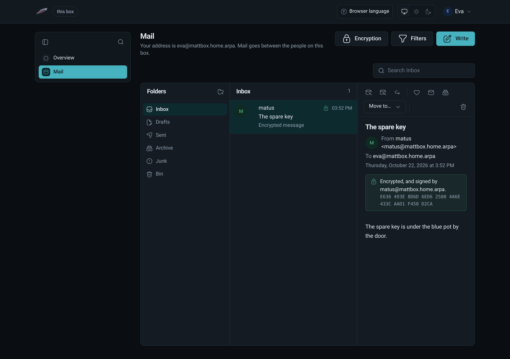

# Mail

LosOS Mail is a mail client for the people on the box. Each person signed in
through LosOS Login has a mailbox, and **Mail** in the sidebar opens it at
`/mail`. The mail server is Stalwart 1.0. It runs on the shared side of the
box, under the `shared` account, keeps the mailboxes in the shared data
directory and answers only on the box itself: nothing on the network can
reach it.

## When Mail is there

Mail exists only while the box shares its storage with a mesh it has
joined (see [storage modes](../types/storage-modes)). With sharing off, or
outside a mesh:

- there is no **Mail** in the sidebar, and `/mail` does not open;
- the mail server is stopped;
- the mailboxes stay on the box's encrypted disk, untouched.

Once the box shares with its mesh again, Mail comes back with the same mail
in it.

## Your address

Your address is your LosOS Login name at the box's mail domain, for
example `matus@mattbox.home.arpa`. The box makes your mailbox the first time
you open Mail. There is no separate mail password: Mail is open while you
are signed in. The spare key opens the admin pages but has no mailbox, so
Mail asks you to sign in with your own account.

## Reading and writing

- **Folders**: Inbox, Drafts, Sent, Archive, Junk and Bin, with your own
  folders beside them and the unread count beside each. On a wide screen
  they are a tree on the left of the list; narrower, a row above it.
- **Search** looks through the open folder: senders, subjects and text.
- **Write** opens a new message. The **To** and **Cc** fields suggest your
  [contacts](contacts) and the other people on the box. **Reply**, **Reply all** and **Forward** quote the message.
- **Flag**, **Mark as unread**, **Archive** and **Move to** work on the open
  message. **Delete** moves it to the bin, and deleting it from the bin
  removes it for good.
- Formatted mail opens as plain text. **Show formatting** draws the
  sender's layout in a sandboxed frame with no scripts, no forms and no
  pictures from outside the box, so the sender cannot tell that you opened
  it. A message with no plain text opens in that frame straight away.
- Attachments download to your computer, and never open inside the page.
  [Files and LosOS Cloud](#files-and-losos-cloud) says what else you can do
  with them.
- When the sender is on this box and the box has Chat, **Chat** and
  **Call** in the message's toolbar start a conversation with them.
- Right-click a message in the list to reply, flag, archive or move it
  without opening it; see
  [the right-click menu](admin-pages#the-right-click-menu).

## Your own folders

Make folders of your own beside Mail's and inside them, as deep as you
like.

- **New folder** (the folder icon at the top of the tree) asks for a name
  and where to put it. A name cannot have a slash in it, and two folders
  in the same place cannot share a name.
- Right-click a folder to open it, make a folder inside it, rename it, move
  it to another folder or to the top level, or delete it. Mail's own
  folders only open and take folders inside them.
- Drag a message onto a folder to move it there. Drag one of your folders
  onto another to put it inside, or onto the empty space under the tree to
  bring it to the top level.
- Deleting a folder moves its messages to the bin first, so nothing is lost
  by a slip. A folder with folders inside it is not deleted until those are
  moved or deleted.

## Filters

Filters sort new mail as it arrives. They are kept and run by the mail
server, so they work while Mail is closed and nobody is signed in.

- **Filters**, next to **Write**, lists them in the order they run. The
  first filter that matches a message decides what happens to it.
- A filter looks at who the message is from, who it is to (To or Cc), or
  its subject, for text it contains. Letter case does not matter. It can
  ask for every condition to match, or any one of them.
- It then moves the message to a folder (the bin included, which is how a
  filter deletes), marks it read, flags it, or any of these together.
- The switch beside a filter turns it off without losing it, and the arrows
  change the order.
- Right-click a message and choose **Filter mail like this…** to start a
  filter for its sender.
- Filters act on mail that arrives after they are saved; mail already in a
  folder stays where it is. Deleting a folder turns off a filter that only
  moved mail into it.

## Files and LosOS Cloud

- **Save to LosOS Cloud** beside an attachment puts it in the **Mail**
  folder of your LosOS Cloud. **Open** then opens it in the app that edits
  it: Notes for Markdown, the shared editor for other text files.
- While writing, **Attach from this computer** and **Attach from LosOS
  Cloud** add files, up to 20 MB in all. **Forward** keeps the message's
  attachments.
- In LosOS Cloud, right-click a file and choose **Send by mail** to start a
  message with it attached.

## Ask the box's AI

**Summarise** in the message's toolbar asks the box's own language model
about the open message. The model runs on the box, so the message and the
answer stay there, and it reads only the message you asked about. It
answers one question at a time; on a small box an answer can take a minute
or two. Text in a message that tells the AI to do something counts as part
of the message, not as your request.

Questions about mail, files and notes go to Gemma 3 1B, a model for text.
**Build with AI** keeps a model for code. The box downloads each model
once, the first time it is online, and keeps only one in memory at a time.
An administrator can pick another model under **Settings**, **Advanced**
(`assistant.model`). Gemma is provided under and subject to the Gemma Terms
of Use found at ai.google.dev/gemma/terms.

## Encryption

Mail can encrypt and sign messages with OpenPGP, the standard GnuPG,
Thunderbird and most mail programs read.

**Your key.** **Encryption**, beside **Write**, makes a key for your address
or imports one you already have. You choose a passphrase for it; it is not
your sign-in password. Your browser makes and unlocks the key. The
box keeps only the private key locked with your passphrase, and seals that
again to its TPM or its own key, as it does its other secrets (see
[credentials](../reference/credentials)), so nobody on the box, an administrator included, can read your encrypted
mail without the passphrase. The same window shows the fingerprint, downloads
a backup (still locked with your passphrase) and the public key, locks the
key again, and removes it. A removed key cannot read mail sent to it until
you import the backup.

**Unlocking.** The key stays unlocked in the tab where you unlocked it, until
you lock it or close the tab. Mail asks for the passphrase when it needs it:
to open an encrypted message or to sign one.

**Writing.** Under the message, **Encrypt** and **Sign** switch each one on
or off. As you type an address, Mail looks for that person's key and shows
where it came from:

- someone on this box: the key they made here;
- your contacts: a key saved on the contact;
- earlier mail: a key the person sent in an Autocrypt header, learned when
  you opened their mail;
- their mail domain: the domain's Web Key Directory (WKD);
- keys.openpgp.org, when their domain has none. An administrator can point
  this at another keyserver, or turn it off, with `losos.mail.keyserver`.

When every recipient has a key, **Encrypt** turns on by itself. If one of
them has none, Mail says who, and the message is not sent until you turn
encryption off or leave them out. Encrypted mail is also encrypted to your
own key, so you can read your copy in Sent. The subject is not encrypted.
Mail is sent as PGP/MIME; **Inline, for older mail programs** puts the
encrypted text in the body instead, which protects the text but not
attachments.

**Reading.** An encrypted message shows a lock in the list. Opening it
decrypts it in your browser, and a line under the headers says how it came:
encrypted, signed and by whom, signed by a key the box does not know, or a
signature that does not match. A message signed by someone other than its
sender says so. Decrypted mail is shown as text, never as the sender's
formatting, and its attachments download like any other.

**Your public key for others.** The box publishes everyone's public key in
its own Web Key Directory at `/.well-known/openpgpkey/`, so mail programs
elsewhere find it from your address. Every message you send also carries it
in an Autocrypt header.

## Moving to Stalwart 1.0

A box that had mail before this version copies it to the new server by
itself, on the first start after the update: every person's folders,
messages, sending addresses and filters. Mail works during the copy, and
mail that arrives meanwhile stays. If the box stops halfway, the copy
carries on at the next start without making doubles. The old mailboxes are
kept beside the new ones, in a folder named `db-0.15`, and nothing in them
is deleted.

## Backups

[Backups](backup-and-erase) include Mail. The mail server pauses for the
few seconds the box takes to copy the mailboxes and then starts again. In
those seconds Mail asks you to try again in a moment.

## What Mail does not do yet

Mail goes between the people on this box only. Mail to another domain is
refused with a message that says so, and nothing arrives from outside.
Receiving mail from the internet needs a public address and port 25, which
a home connection rarely has. The box also offers no IMAP or SMTP for other
mail apps: Mail in the admin pages is the only way in.
