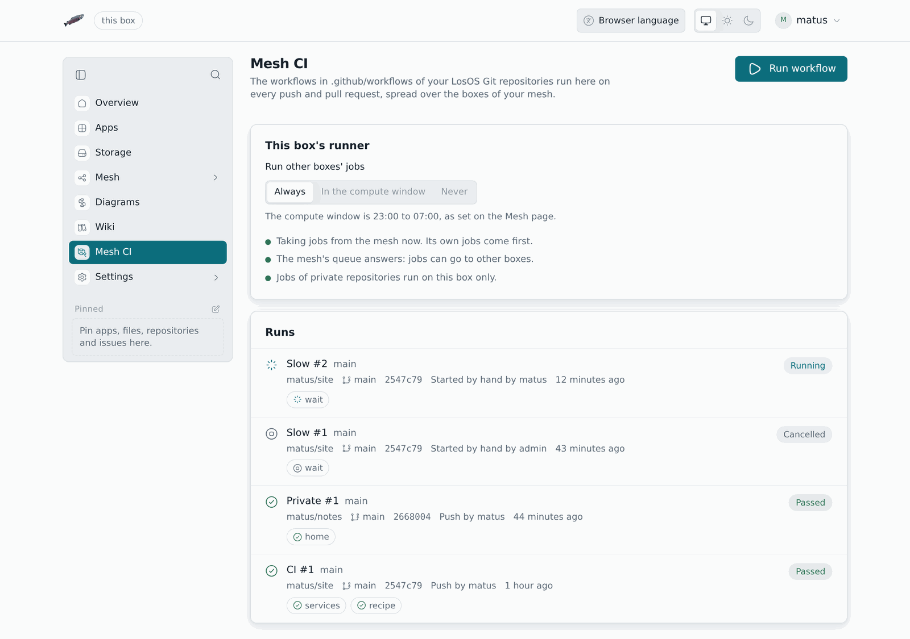
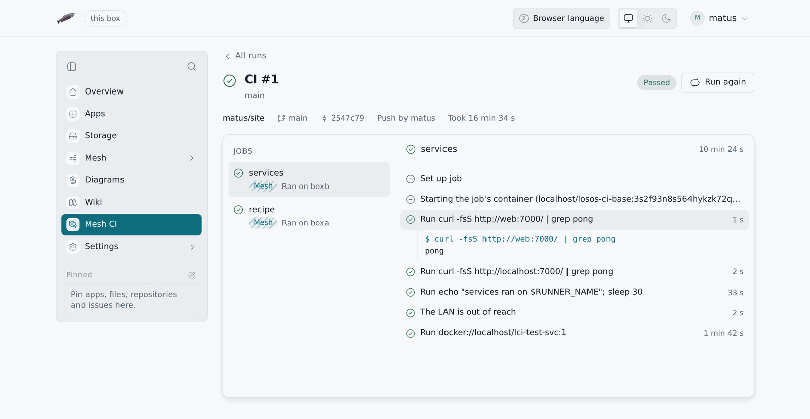

# Mesh CI



Mesh CI runs the GitHub Actions workflows in your
[LosOS Git](losos-git) repositories. A push or a pull request starts the
workflows in the commit's `.github/workflows/` folder, the boxes of your
mesh share out the jobs, and each job's result shows on the commit and in
the pull request's checks. **Mesh CI** in the sidebar opens it at `/ci`.

## When Mesh CI is there

Mesh CI exists only while the box shares its storage with a mesh it has
joined (see [storage modes](../types/storage-modes)). With sharing off, or
outside a mesh, there is no **Mesh CI** in the sidebar and no workflow
runs. The runs already made stay on the disk and come back with it.

## Runs

The page lists the newest runs first: the workflow, its number, what
started it (a push, a pull request, or **Run workflow**), the repository,
the commit and how long it took. Open a run to see its jobs. Each job says
where it ran: **This box**, or **Mesh** with the name of the box that took
it. Pick a job to read its log, step by step, with each step's exit code
and the job's outputs.

**Cancel run** stops a run's jobs and removes their containers.
**Run again** starts the same workflows on the same commit.

**Run workflow** starts a workflow that has `workflow_dispatch` among its
triggers. Give the repository as `owner/name`, a branch (the default branch
if you leave it empty), press **Find workflows** and pick one.



## Where a job runs

A job goes to the mesh, where any box that lends its runner may take it,
except when:

- its `runs-on` names `self-hosted`;
- its repository is private, unless `losos.ci.privateOnMesh` is on. Another
  box would see the code;
- the box has no edge in reach.

Then it runs on this box. A job whose `runs-on` names `losos-desktop` goes
to a company computer instead: see [Company computers](#company-computers).

## Company computers

A LosOS Desktop computer joined to this box (see
[LosOS Desktop computers](../types/company-edge.md#losos-desktop-computers))
takes the jobs whose `runs-on` names `losos-desktop` and the computer's name.
Such a job waits on this box until that computer asks for it, every few
seconds while it is on the office network, and never goes to the mesh.

A company computer runs no shell and no other actions. Its steps are only
these, each with the `with:` shown:

| Step | `with:` | What the computer does |
|---|---|---|
| `losos/desktop-status` | | Says its version, update channel and company accounts |
| `losos/desktop-update` | | Updates itself now |
| `losos/desktop-reboot` | | Restarts a minute after the job ends |
| `losos/desktop-channel` | `channel` | Follows another update channel |
| `losos/desktop-lock` | `user` | Locks a company account |
| `losos/desktop-unlock` | `user` | Unlocks a company account |

Anything else (`run:`, another action, a container, `env:`) fails the job
before it reaches the computer, and the computer checks the list again
before it does anything. `${{ }}` expressions in `with:` are worked out on
this box. A matrix reaches several computers:

```yaml
on: workflow_dispatch
jobs:
  update:
    strategy:
      matrix:
        computer: [reception, laptop-7]
    runs-on: [losos-desktop, '${{ matrix.computer }}']
    steps:
      - uses: losos/desktop-update
      - uses: losos/desktop-reboot
```

A job its computer has not asked for in a day, or whose computer stops
reporting for two minutes, ends as an error.

## Lending this box's runner

**Run other boxes' jobs** under **This box's runner** decides when this box
takes jobs from the rest of the mesh:

- **Always**;
- **In the compute window**, the hours set on the Mesh page (the default);
- **Never**. The box still runs its own jobs.

The box takes one job at a time. A job runs as the `shared` account in a
rootless container with no way into the box's own network or anything else
on the LAN. It gets at most `losos.ci.runner.memory` of memory (2 GB by
default) and `losos.ci.runner.cpus` of processor time (1.5 cores), at a low
priority, so the box's own work comes first.

## What a workflow can use

Workflows are read as GitHub Actions workflows, so most of them run as they
are:

- `on: push`, `pull_request` and `workflow_dispatch`, with branch and tag
  filters;
- jobs with `needs`, `if`, `strategy.matrix`, `outputs`, `env`, `defaults`
  and `timeout-minutes`, and the `${{ }}` expressions;
- steps with `run`, and actions from `uses`: JavaScript, composite and
  Docker actions from GitHub, actions in the repository (`./path`) and
  `docker://` images;
- `container` and `services`. A service is reachable by its name and on
  `localhost`, and its health check passes before the steps start.

A job with no `container` runs in LosOS's own image: bash, the usual
command-line tools, git and curl. `losos.ci.runner.images` maps `runs-on`
labels to other images, such as `ubuntu-latest=docker.io/library/ubuntu:24.04`.

Some parts of GitHub Actions need GitHub's own services, and the log says
so where they come up:

- `actions/checkout` does nothing: the commit's files are already in the
  workspace;
- `actions/cache`, `upload-artifact` and `download-artifact` keep nothing;
- `secrets` is empty, `schedule` never fires, and Mesh CI refuses reusable
  workflows (`jobs.<id>.uses`).

## Containers and pm

The box starts and stops every job's containers with
the [pm](https://github.com/losos-project/pm) package manager,
through Mesh CI's own pm plugin. The plugin is signed, and pm loads no
plugin that is not. It answers only for Mesh CI's containers, whose names
start with `lci-`, and refuses to run anything as root.

A step can also build a pm recipe with the `losos-project/pm` action:

```yaml
- uses: losos-project/pm@v0
  id: pkg
  with:
    recipe: pkg/build.rhai
    trust: 3f0c…   # the hex public key the recipe is signed with
- run: ls -l ${{ steps.pkg.outputs.archive }}
```

pm builds the recipe in its own jail, in the job's workspace, and the `archive`
output is the package it made. A key under `trust` must sign the
recipe. `command: explain` says what the recipe would do without building
it, and `permissive: true` passes pm's `--permissive`.

## Settings

On the **Advanced** pane:

- `losos.ci.enable` turns Mesh CI off;
- `losos.ci.privateOnMesh` lets private repositories' jobs run on other
  boxes;
- `losos.ci.runner.memory`, `losos.ci.runner.cpus` and
  `losos.ci.runner.images` are described above.
