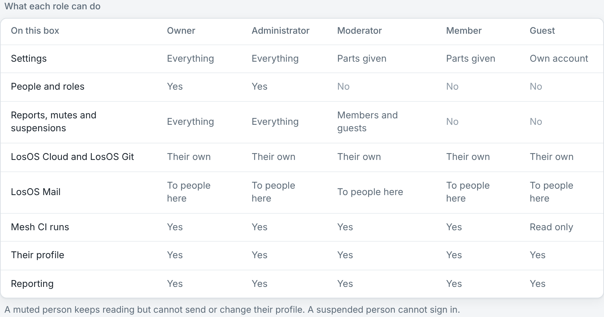
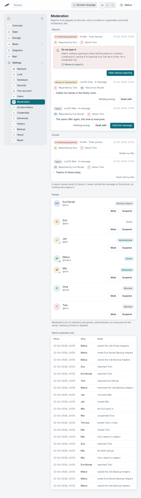

# Roles and moderation

Everyone who signs in to the box has a role. The role decides what they can
change, and whether they can act when someone reports a message, a picture
or a file. Roles and reports work only on a box that signs people in itself
with LosOS Login.

## The roles

| Role | What they can do |
|---|---|
| **Owner** | The person who set the box up. An administrator nobody else can remove, demote or hold. |
| **Administrator** | Everything, including who can sign in, their roles and the Moderation pane. |
| **Moderator** | Handles reports, and mutes or suspends members and guests. Changes the parts they were given, like a member. |
| **Member** | Sees and changes only the parts switched on for them, for example Storage and Backup. |
| **Guest** | Their own account, mail and profile. Changes no part of the box and starts nothing on it. |

A member or moderator can also get **Sees every part**: they can look at
every pane and still change only their own parts. A viewer never sees the
Moderation pane.

People show their role as a small mark on their picture and a badge beside
their name: a crown for the owner, a shield for an administrator and a flag
for a moderator. Members have no mark.

An administrator picks the role in **Settings > Users**, when adding someone
or with **Access** on their row. The **What each role can do** table on the
same pane says, app by app, what the five roles reach.

### Roles of your own

Under **Roles of your own**, an administrator names a set of parts, for
example "Backup helpers" with Storage and Backup, and gives it to several
people at once. Change the role's parts and everyone who has it gets the new
parts at their next click. Remove the role and the people who had it keep
only their own account until an administrator gives them another role. A
box keeps up to 16 roles of its own.

## Reporting something

Anyone signed in, guests too, can report a message, a picture, a profile or
a file from the app it is in. A report names the thing and who it is about.
It never copies the message or the picture, so nothing on the Moderation
pane opens it. Each person can have 20 reports open at a time.

Pick the reason that fits: spam, abuse or harassment, sexual content, a
child being harmed, or something else. A short note helps the moderator,
except for a report about a child, which keeps no note at all.

## The Moderation pane

Moderators and administrators open **Settings > Moderation**. It has three
parts.

**Reports.** Open reports come first, reports about a child before the
rest, newest first. Each report has buttons for what can be done in its
app:

- **Hold the message** moves a reported mail out of the inbox into a folder
  no page lists. The box refuses to open it. **Let it go** puts it back.
- **Hide the message** removes a reported chat message from LosOS Chat on
  every device. The room keeps a note that a message was deleted. It works
  for messages from people on this box.
- **Take it down** removes a reported profile picture or banner.
- **Dealt with** closes a report you handled some other way, for example by
  talking to the person.
- **Nothing wrong** closes a report that needs nothing.

**People.** Moderators can act on members and guests. Administrators can act
on everyone but the owner. Nobody can act on themselves.

- **Mute** stops someone sending mail, writing in LosOS Chat and changing
  their profile. They keep reading everything they could read before.
- **Suspend** stops LosOS Login letting them in, from their next click. Their
  files, mail and accounts stay on the box.

Both ask how long: an hour, a day, a week, 30 days or until lifted. A timed
hold ends by itself. The reason you type goes into the log for the other
moderators. **Unmute** and **Lift suspension** end a hold early.

**What moderators did.** Every report, role change, mute, suspension and
take-down is written to the log with who did it and when. The box writes the
line when a hold ends by itself. Nobody can edit the log from the admin
pages.

## A report about a child

Do not open it, save it or send it to anyone, not even the police. Looking at
it or passing it on can be a crime, for a moderator too.

1. On the report, press **Hide without opening**. Where the app cannot hide
   it from the queue, the button is **Reported to the police** instead.
2. Tell the police, or a hotline that takes these reports, where it is: the
   box, the account and the time of the report. They collect it themselves.
   - In an emergency, call 112 (or 911 in North America).
   - [INHOPE](https://www.inhope.org/EN) lists the hotline for each country.
   - Slovakia: [Stopline.sk](https://www.stopline.sk/).
   - Germany: [internet-beschwerdestelle.de](https://www.internet-beschwerdestelle.de/).
   - United States: [NCMEC CyberTipline](https://report.cybertip.org/).
   - United Kingdom: [Internet Watch Foundation](https://report.iwf.org.uk/).

A report about a child cannot be closed as **Nothing wrong**, and hidden
mail from one cannot be let go from the pane.
