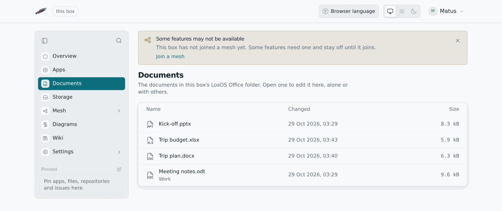
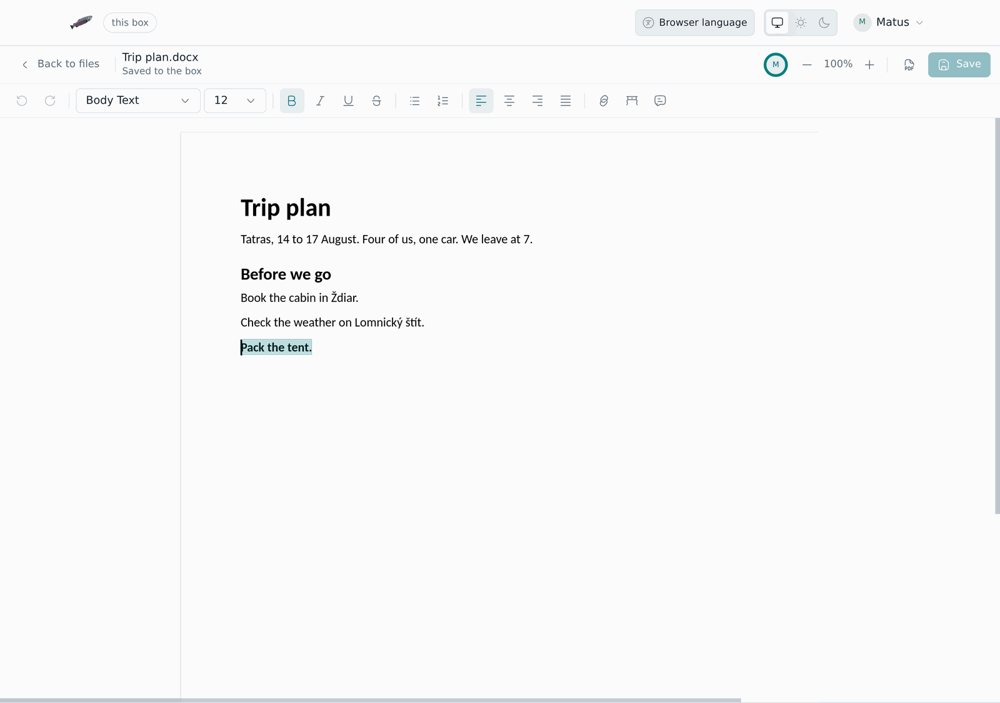

# Office documents

LosOS Office opens text documents, spreadsheets and presentations in the browser
and saves them back on the box. Several people can work in one document at
the same time, and each sees where the others are typing. The editor is
Collabora Online, which runs on the box itself. Documents never leave it.

It opens and saves these types:

| Kind | Types |
|---|---|
| Text | `.odt`, `.docx`, `.docm`, `.dotx`, `.doc`, `.rtf`, `.txt` |
| Spreadsheets | `.ods`, `.xlsx`, `.xlsm`, `.xlsb`, `.xls`, `.csv` |
| Presentations | `.odp`, `.pptx`, `.pptm`, `.ppsx`, `.ppt` |
| Drawings | `.odg` |

It shows PDF files, Visio drawings and Apple's Pages, Numbers and Keynote
files without changing them. Older Microsoft formats open and save, but the
OpenDocument and the newer Microsoft formats keep the most.

Word, Excel and PowerPoint files from Microsoft 365 stay what they are. A
`.docx` goes back to disk as a `.docx` with its styles, and a workbook keeps its
formulas. Macros in `.docm`, `.xlsm` and `.pptm` files never run on the
box.

## Turning it on

LosOS Office is off on a new box, because it needs memory even when nobody has a
document open. Turn it on under **Settings → Advanced** with
`losos.office.enable`, then press **Apply**. Plan for about 550 MB with no
document open. Each open document adds to that: a few dozen MB for a short
one, more for a large one. The box never lets it take more than 2 GB.

## Opening a document

In LosOS Cloud, click a document's name. It opens in LosOS Office across
the whole width of the page, under the box's top bar, at
`/cloud/office/` followed by the file's number, so the address can be
bookmarked or sent to someone who may open the file too.

Two bars sit above the document, drawn like the rest of LosOS. The first
has the way back, the document's name and whether your changes are saved
on the box yet, the people who are in the document with you, the zoom,
**Download as PDF** and **Save**. The second has what you reach for most:
undo and redo, the paragraph style and the font size, bold, italic,
underline, lists, alignment, links, tables and comments. A spreadsheet
gets number formats, sorting and new rows and columns instead, and a
presentation gets new slides and **Present**. Everything else is in the
document's right-click menu.

The bars follow the box's light or dark theme. The pages of a document stay
white in both, as they print. A document you may only read opens with a
**Read only** label and no formatting bar. The editor works on the box's
https address, the same one LosOS Login uses; a page opened over http moves
itself there first.

The editor saves as you work and when you leave, and **Save** writes your
changes at once. In LosOS Cloud each save keeps the earlier contents as a
version of the file, and your computers' sync apps pick up the new one.

## Working together

When a second person opens the same document, both of you are in the same
copy. Each sees the other's cursor and name, and each change shows up on
the other screen as it is made. Nobody waits for anyone to finish, and one
save keeps everyone's changes.

## Markdown documents and presentations

**New document** and **New presentation** in LosOS Cloud's files bar make
a Markdown file in the folder you are in, named *Untitled document* or
*Untitled presentation*, and open it in LosOS Office. Click the name at the
top to change it. Markdown files are LosOS's own, so they open whether
Collabora is on or not, and any `.md` file offers **Open in LosOS Office**
in its right-click menu.

The bar above the text has a button for everything Markdown can write, in
the form GitHub and Obsidian both read: headings, bold, italic,
strikethrough, highlight, code, subscript and superscript, keys, hidden
comments, bulleted, numbered and task lists, quotes, code blocks, formulas
in a line or on their own, tables, folded sections, lines across, callouts,
links, pictures, links to notes and embeds, tags, block link targets,
footnotes and properties. Select some text first and the button marks it;
press it again and the mark comes off. **Ctrl B**, **Ctrl I**, **Ctrl K**
and **Ctrl E** work too.
Selected text also gets a small bar above it with the marks used most,
links, mentions and **Ask AI**; see
[the bar over a selection](admin-pages#the-bar-over-a-selection).

A document is written on the left and read on the right, drawn as Notes
draws it. **Write** and **Read** give either side the whole width. Links to
other notes and pictures are found in the same folder, or in the Obsidian
vault the file is in. Typing is shared like any LosOS Cloud text file:
everyone in the file types together and the box saves a moment after the
typing stops.

A presentation is a Markdown file with `slides: true` in its properties.
Each line of `---` starts a new slide. Every slide is laid out the same
way: the text in the middle, centred, and the pictures on the right. The
slides are listed on the left, and the slide the cursor is in is shown on
the right as it will look. **Present** plays it full screen; the arrow
keys, Space and Page Down move through it and Escape ends it. The PDF
button prints a document as pages, or a presentation one slide a page.

## What stays private

The editor runs on the box and reads the document straight from the box's
disk. Nothing is sent to Collabora or to anyone else: no update checks, no
spelling or translation services, no fonts from the internet.

Opening a document gives your browser a key for that one document, which
runs out after ten hours. The editor takes nothing else, so only people who
may open the document themselves get into it.

## A folder of documents

`losos.office.folder` names a folder on the box whose documents LosOS
Office edits on its own, instead of LosOS Cloud's. **Documents** then appears in
the sidebar, after **Apps**, for everyone who signs in. It lists the
documents in the folder and in the folders inside it, and opens each one in
the editor. Like the rest of the admin pages it answers on the box's own
network only. It is meant for a box that keeps one folder of documents for
the people on its network. Leave it empty otherwise.
