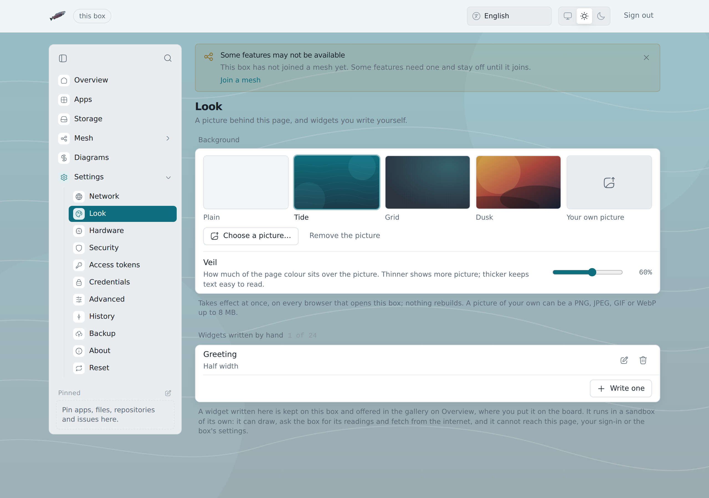

# Pictures and reporting

Pictures that other people send you in [Chat](chat) and [Mail](mail) are
hidden until you press them. You decide which senders get past that, and
you can turn on a nudity warning that runs on your own device. Card and
ID numbers in messages are blacked out. This page
also covers what to do when someone sends you something that has to be
reported.

## Hidden pictures

A picture from someone else arrives as a blurred patch with the sender's
name on it. Press it to see the picture. Until you do, your browser does
not download it. In Chat the patch shows the picture's colours, which the
sender's page worked out and sent inside the encrypted message. In Mail
the message's own layout stays, and a bar above it says the pictures are
hidden, with **Show pictures** next to it. Your own pictures are never
hidden from you.

**Always show pictures from** a person, on the patch or on the bar, adds
them to your trusted senders. Their pictures show at once from then on.
You can take someone off the list under **Settings > Your account > Pictures and
private details**.

## Which pictures are hidden

The same section has three choices under **Hide pictures from**:

- **Everyone**: every picture is hidden except those from your trusted
  senders. This is how a new account starts.
- **Strangers**: pictures from people on this box and from people in your
  [contacts](contacts) show at once. The rest stay hidden.
- **No one**: every picture shows at once. Only an account marked as an
  adult can choose this.

## The adult mark

An account gets the adult mark in one of two ways:

- You finish a Binance purchase under **Settings > Market**. Binance checks
  the buyer's age before it takes the payment, so the purchase marks the
  account that started it as an adult. The box keeps only the mark, never
  anything Binance knows about you.
- An administrator marks you under **Settings > Users > Age for
  pictures**.

An administrator can also mark an account as a child's. A child's account
keeps the nudity warning on and cannot choose **No one**, and a Binance
purchase does not change that. The mark affects pictures in Chat and Mail
and nothing else on the box.

## The nudity warning

**Warn me about nudity** turns on a small picture classifier that runs in
your browser. It checks each Chat picture before it is shown. If the
classifier thinks a picture may show nudity, the picture stays heavily
blurred and **Show anyway** reveals it. The same check runs on a picture
you are about to send, and asks **Send anyway?** first.

The check runs on your device. The picture and the result never go to the
box or to anyone else, whatever you choose. The classifier can be wrong in
both directions, so treat it as a warning and not a filter. Pictures inside
Mail messages are not checked. They stay hidden until you show them.

## Card and ID numbers

Card numbers, IBANs, passport and ID card numbers, Slovak and Czech birth
numbers and US Social Security numbers show as black bars in Chat messages
and in plain-text Mail. Press a bar to see the number and press it again to
hide it. Before you send a Chat message or a mail with one of these in its
text, LosOS asks **Send anyway?** and names each one by its last four
characters. **Don't send** keeps what you wrote.

Each number is recognised by its own check digits, so a phone number or an
order number rarely sets it off. The check runs in your browser, like the
nudity warning, and nothing about it goes to the box. It reads the words
of a message, not pictures or attachments, and formatted (HTML) mail is
not blacked out. **Black out private details**, in the same section of
your account, turns both off. A child's account keeps them on.

## Reporting a message

**Report**, in a Chat message's menu or on the Mail reader's toolbar,
opens two things.

The first explains how to reach the police or a hotline. The second sends a
report to the box's moderators. Moderators get a reference to the message,
never its text or pictures, and can hide it or stop the sender.

LosOS never reports anything by itself. Nothing on the box looks inside
your messages or your pictures.

## If you are sent a sexual picture of a child

- **Do not forward it, screenshot it, download it or save it** to LosOS
  Cloud. Keeping a copy can be a crime even when you mean well. Write down
  who sent it, when, and in which conversation.
- **If a child is in danger now**, call the police: 112 anywhere in the EU,
  158 in Slovakia, 110 in Germany.
- **Report it** to the police or to your country's hotline:
  - Slovakia: [Stopline.sk](https://www.stopline.sk/)
  - Germany: [internet-beschwerdestelle.de](https://www.internet-beschwerdestelle.de/)
    or [jugendschutz.net](https://www.jugendschutz.net/verstoss-melden)
  - United Kingdom: [Internet Watch Foundation](https://report.iwf.org.uk/)
  - United States: [NCMEC CyberTipline](https://report.cybertip.org/)
  - Elsewhere: [INHOPE](https://www.inhope.org/) lists the hotline for
    each country.
- **Children and teenagers** can talk to someone for free at 116 111, the
  child helpline in every EU country.

Then report the message to the box's moderators so they can hide it for
everyone and stop the sender. See
[what moderators do with it](moderation.md#a-report-about-a-child).
