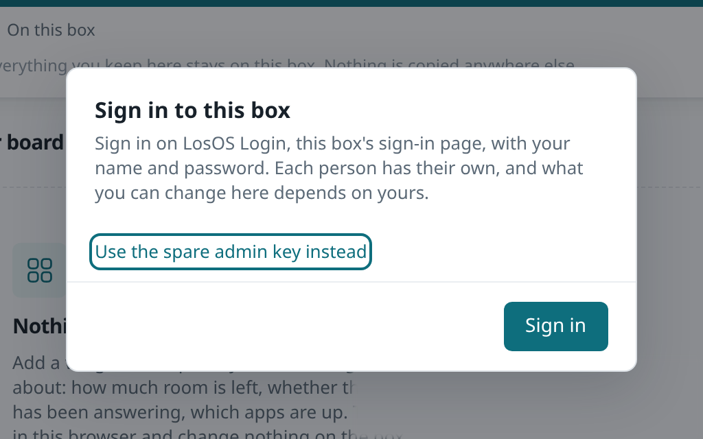
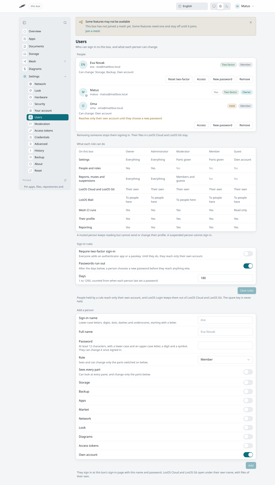
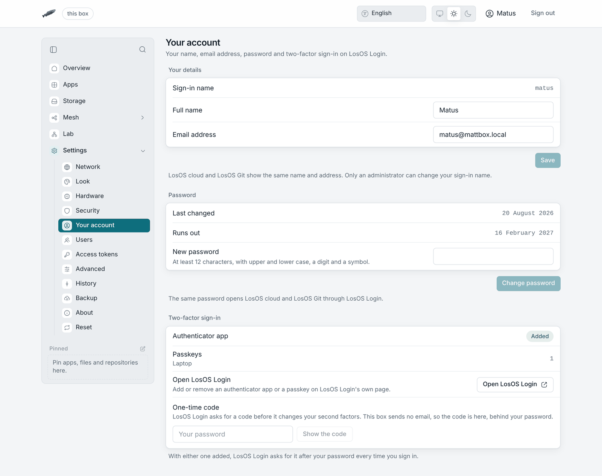
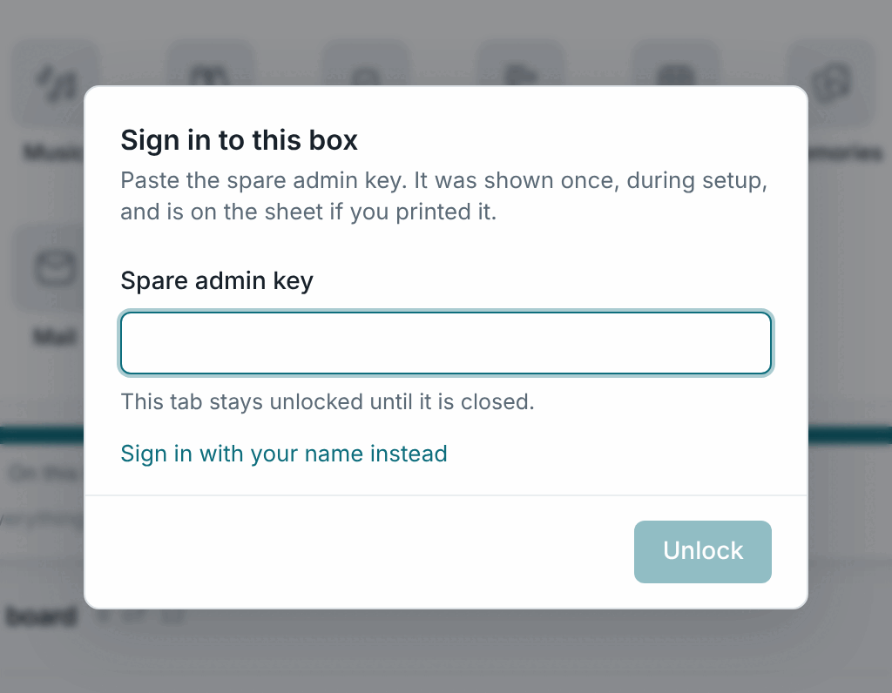
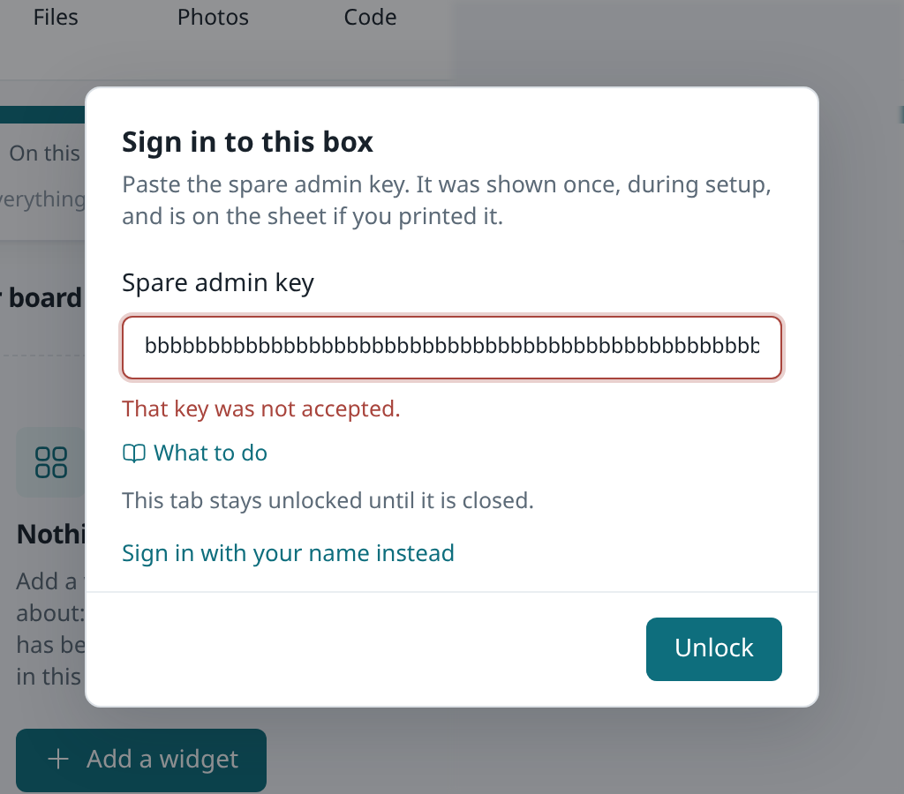

# Sign-in and the spare key

Each person signs in to the admin pages on LosOS Login, the box's sign-in
page, with their own sign-in name and password. The box also has one spare
admin key, shown once during setup.

## Your sign-in name and password

The wizard's password step asks for a sign-in name and a password. The
person who finishes it becomes the box's first administrator. The same
password also becomes the owner's password for LosOS cloud, so one password
opens both.

A sign-in name is lower case. It starts with a letter, then letters, digits,
`.`, `_` or `-`, at most 32 characters. A new password needs at least 12
characters, a lower-case letter, an upper-case letter, a digit and a symbol.

The box keeps each password only as a hash. There is no reset link, because
the box sends no mail. If you lose yours, see
[Forgot the password](../troubleshooting/forgot-password).

## LosOS Login

LosOS Login is the box's sign-in page at `https://<box>/auth/`, in the LosOS
colours. When you open the admin pages signed out, a dialog titled **Sign in
to this box** has a **Sign in** button. It takes you to LosOS Login and
brings you back once you are in. While LosOS Login is still starting, right
after a boot, the admin pages say "LosOS Login is starting" with a spinner
and a few facts about LosOS, then go on by themselves.

LosOS Login works over HTTPS only. A plain `http://` address for it is
sent on to `https://`. Until the box's certificate is installed, the browser
warns first; see [Certificate warning](../troubleshooting/certificate-warning).

If you added an authenticator app or a passkey to your account, LosOS Login
asks for it after your password. See [Your account](#your-account).

A sign-in lasts 12 hours, and ends sooner after 2 hours with nothing done.
Tick **Remember me** on LosOS Login to stay signed in on that computer for a
month. **Sign out** in the admin pages ends it at once.

:::note[Wrong attempts]
After a few wrong passwords in a row, LosOS Login refuses that name for
a few minutes. Wait, then try again.
:::

## LosOS cloud and LosOS Git

LosOS cloud and LosOS Git sign you in with LosOS Login too, on the box's own
network and through the internet alike. Open either one signed out and you
land on LosOS Login; sign in there once and both apps let you in, with no
second password. Neither app shows a sign-in page of its own.

The person who set up the box arrives in both apps as the owner's account,
the one that holds the files and repositories from before. Anyone else gets
an account of their own in each app the first time they open it, named
after their sign-in name. Both apps show the full name and email address
from LosOS Login, and follow when you change them under
[Your account](#your-account).

Through the internet, LosOS Login answers at the box's public address: its
name on the edge, or a domain of your own once it is routed to the box.
Right after a boot, while LosOS Login is still starting, the apps show a
page saying so and try again every few seconds by themselves.

Desktop and phone apps and `git` keep using app passwords and tokens.
LosOS cloud's network folder takes your LosOS Login name and password on
the box's network, and an app password through the internet; see
[Files on your computer](files-on-your-computer).

**Log out** in LosOS cloud also signs you out of LosOS Login. LosOS Git's
**Sign out** does not: while you are signed in to LosOS Login, LosOS Git
signs you straight back in. Sign out of LosOS Login (in the admin pages or
in LosOS cloud) to leave both. An app tab that is already open stays signed
in until you sign out of that app too.

## Who sees what

The admin pages are split into sections: storage, backup, apps, market
(with virtual machines), network (custom domains), look, Diagrams and access
tokens. An administrator can use all of them, and only an administrator can
apply settings or use Mesh, Hardware, Security, Users, Advanced, History,
About and Reset, erase or restore the box, or see the recovery code. A person who is
not an administrator gets the sections they were given, or reads every
section without changing anything. Anyone signed in sees the overview. The
admin pages hide the panes a person cannot use.

One more part, **Own account**, opens the **Your account** pane, where a
person keeps their own name, email address, password and second factors.
New people get it by default. Without it, a person cannot add an
authenticator app or a passkey, and an administrator changes their password
for them.

## Adding people

The first person on a box is always an administrator. An administrator adds
everyone else under **Settings > Users**. The pane is there when the box signs
people in itself with LosOS Login. A box whose sign-in runs somewhere else has
no Users pane.

To add someone, fill in **Add a person**: a sign-in name, their full name, a
password that follows the same rules as yours, and their access.

- **Chosen parts**: they see and change only the parts switched on, for
  example Storage and Backup.
- **Sees everything**: they see every pane and change only the parts
  switched on.
- **Administrator**: they can change everything, including who can sign in.

A new person starts with **Own account** switched on. Give them the name and
password yourself. They sign in on LosOS Login.
LosOS cloud and LosOS Git each make them an account of their own the first
time they open the app.

A person with an authenticator app or a passkey has a **Two-factor** badge.
One a sign-in rule holds has a **Held** badge, with the reason below their
name.

Each person in the list has these buttons:

- **Access** changes what they can do. It applies from their next click,
  with no new sign-in.
- **New password** is for someone who lost theirs. The old one stops working
  at once.
- **Reset two-factor** removes their authenticator app and passkeys, for
  someone who lost a phone or a key. They sign in with their password
  alone until they add new ones. It shows only for someone who has one.
- **Remove picture** and **Remove banner** take down a picture someone
  else should not see. They show only for someone who has one.
- **Remove** stops them signing in, to the admin pages and to both apps, at
  once, and deletes their profile. Their accounts and files in LosOS cloud
  and LosOS Git stay on the box.

Your own row has no buttons. The owner's row has only **Reset two-factor**,
for another administrator to use. Nobody can remove the owner, change the
owner's access or set the owner's password here; for a lost owner password,
see [Forgot the password](../troubleshooting/forgot-password). The box always
keeps at least one administrator.

## Your account

**Settings > Your account** is each person's own page. It is there for
anyone with the Own account part, administrators included, and never for
the spare key, which has no account.

- **Profile**: a picture, a banner, a colour, your pronouns and a line
  about you. Everyone signed in to the box sees them next to your name: in
  the top bar, on the Users pane and in the box's apps. Choose a picture or
  banner, drag and zoom to the part you want, and choose **Use this**. The
  box crops the picture again and saves it as a new file, so the place and
  camera a photo was taken with stay on your device. Your sign-in name is
  always shown beside the profile, so a picture cannot pass you off as
  someone else.
- **Your details**: your full name and email address. LosOS cloud and LosOS
  Git show the same ones. Only an administrator can change your sign-in
  name.
- **Password**: when you last changed it and when it runs out, if the box
  has that rule. A new password follows the same rules as the first one, and
  opens LosOS cloud and LosOS Git too.
- **Two-factor sign-in**: whether you have an authenticator app and how many
  passkeys. **Open LosOS Login** opens LosOS Login's own page in a new tab,
  where you add or remove them. With either one, LosOS Login asks for it
  after your password every time you sign in.
- **One-time code**: LosOS Login asks for a code before it changes your
  second factors, and normally sends it by email. The box sends no email, so
  ask LosOS Login for the code on its page, then come back here, type your
  password and choose **Show the code**.

## Sign-in rules

An administrator sets two rules for everyone under **Settings > Users >
Sign-in rules**:

- **Require two-factor sign-in**: everyone adds an authenticator app or a
  passkey.
- **Passwords run out**: a password lasts the number of days you set, from 1
  to 1200, counted from when each person last set it.

Someone a rule catches is held. They still sign in, but the admin pages
show them only **Your account**, with a note saying what to do, and LosOS
Login keeps them out of LosOS cloud and LosOS Git. Once they choose a new password or
add a second factor, the rest opens again. After a new second factor, LosOS
Login asks for it once before the next page. A held person who opens LosOS cloud or LosOS Git sees a page that
sends them to their account, which opens on the box's own network.

Before you require two-factor sign-in, add an authenticator app or a passkey
to your own account. The box refuses the rule until you have one, so it
cannot hold you as well. The spare admin key is never held.

## The spare admin key

The box made a 64-character key on its first start. The wizard showed it to
you once, after you set the password, with **Copy** and **Print** buttons.
The key opens every pane, as an administrator, without LosOS Login. So it
still works on a day LosOS Login does not.

On the **Sign in to this box** dialog, choose **Use the spare admin key
instead** and paste the key. The tab stays unlocked until you close it.

After ten wrong keys from one computer, the box locks that computer out. The
lockout starts at one second and doubles, up to five minutes.

:::warning[Keep the spare key away from the box]
Keep the printed sheet away from the box. Anyone with the key can change
every setting, which amounts to root. The box cannot show the key again or
rotate it, because it has no shell. If you lose the password *and* the spare
key, you have to reinstall from the stick, which wipes the disk.
:::

## A box set up earlier

A box set up before people had their own sign-in names has nobody to sign in
as. Its dialog says **Make your sign-in** and asks for a sign-in name, a
password and the spare admin key. The key proves the box is yours, and you
become its first administrator. From then on, sign in with that name and
password.

## Passkeys

LosOS Login takes passkeys. Add one on LosOS Login's page from
[Your account](#your-account), over HTTPS once the box's certificate is
installed. On the sign-in page, a phone or laptop then signs you in with
its own unlock instead of your name and password, for the admin pages,
LosOS cloud and LosOS Git alike. A passkey is not a second spare key: it
opens only your own account.

## The claim window

A fresh box has no owner. The first browser on the LAN to finish the wizard
becomes the owner and its first administrator, and the window closes. So run
the wizard soon after the install, on a network you trust. Nothing outside
the LAN can claim a box, and only a reinstall lets anyone claim it again.
