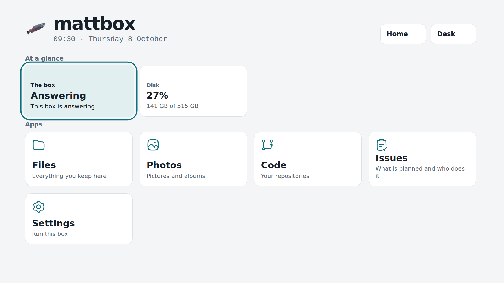

# The television

Open the box's address in a television's own browser and the page is the
TV view: the whole screen, large type, and a ring around whatever the
remote is on. A computer still gets the desk, the admin pages with the
sidebar. The box's own screen, when it has one, keeps the address banner
on tty1. The television is a browser pointed at the box, not that banner.

## What you see

The home screen names the box and shows the time. Two tiles sit under
that. **The box** says whether it is answering. **Disk** says how full
it is, once you are signed in. Under those are the apps that are
actually there: Files, Photos, Code, Issues. Settings is there too. It
does not open the settings forms. It opens **Desk**, which says those
forms are for a computer up close.

Files, Photos, Code and Issues open their own pages. The set's Back
control returns to the TV view.

The margins stay inside the strip a television may crop, at 1080p and
at 4K. The type grows with the screen, so a 4K set is readable from the
sofa as well.

## The remote

You do not need a mouse.

- **Arrows** move the ring to the next tile. It does not wrap around
  the edge of the screen.
- **OK** or Enter opens whatever the ring is on.
- **Back** (Escape on a keyboard) returns to the previous screen. On
  the home screen it stays there. While you are typing, Backspace
  deletes a character first.
- **Home** returns to the home screen from anywhere in the TV view.
- **Desk** leaves the TV view and opens the admin pages as on a
  computer.

The ring is drawn whenever something is focused, including from a
remote that never moves a pointer.

## When it opens

It opens by itself when the browser looks like a television: Android
TV, Apple TV, Fire TV, Chromecast, webOS, Tizen, and the other sets the
box recognises. On a computer, open the person menu, then **TV layout**,
then **On**, and you get the same view. **Auto** is the usual choice: a
television gets the view, a computer does not. **Off** keeps the desk
even on a television. The choice is remembered in that browser.

A box that has never been set up still shows the first-run wizard. The
TV view starts once that wizard is finished.

The home screen works before anyone signs in. The disk reading, and the
desk, need a sign-in. **Sign in** is a large form on the same screen.
Back leaves it.
