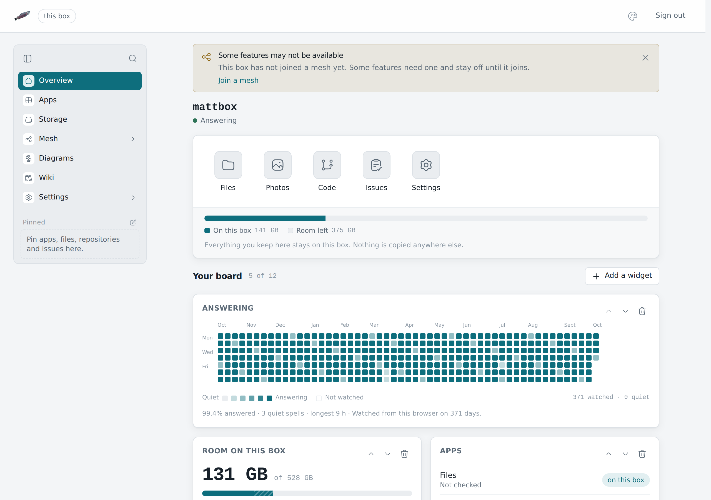

# The terminal client



`losos` is a terminal program that manages a box from another computer.
It shows the same panes as the admin pages, in the same words and colours,
and needs no SSH, because the box has none.

It signs in with LosOS Login, the box's own sign-in, the same way the admin
pages, LosOS Cloud and LosOS Git do. You approve it in the browser. From
then on the terminal acts as you: your role, and the parts of the box you
were given. There is no separate terminal password, and no access token to
copy off the Access tokens pane.

It runs on 64-bit x86 Linux.

## Install the client

```sh
curl -fsSLO https://nightly.link/dasmatus/losos/workflows/ci/main/losos-pages-updates.zip
unzip -o losos-pages-updates.zip -d losos-pages-updates
node losos-pages-updates/install.mjs
```

The zip is the newest build of the client from LosOS's GitHub, with the
program, its checksum and the script. The script checks the program against
the checksum and puts `losos` in `~/.local/bin`, or in `/usr/local/bin` when
you run it as root. It never asks for a password. Read it first if you like.
It is short and says what it does at the top.

`losos` keeps the sign-in in the desktop's keychain (GNOME Keyring, KWallet
or KeePassXC) through `secret-tool`. On Debian and Ubuntu that is the
`libsecret-tools` package, on Fedora and Arch `libsecret`. It never writes
the tokens to a plain file.

## Sign in

```sh
losos login https://mattbox.local
losos
```

`login` takes the box's address from its screen. Use `https://`. LosOS Login
does not answer on plain `http://`; the box sends that address on to
`https://`.

The first time, if the box's certificate is its own, `losos` shows the
certificate's SHA-256 fingerprint. Compare it with the one your browser
shows for the box, and say yes if they match. From then on `losos` talks
only to a box with that certificate. If the box later shows a different
certificate, `losos` stops and says so. Run `login` again once you know why
it changed.

Then `losos` signs in with LosOS Login. It prints a link and a code:

```text
losos signs in to https://mattbox.local with LosOS Login. Open this link in a browser, sign in and approve the terminal:
  https://mattbox.local/auth/consent/openid/device-authorization?user_code=WDJBMJHT
The page shows the code WDJBMJHT. Waiting for the approval…
```

Open the link, sign in to LosOS Login as you always do, with your second
step if you have one, check that the page shows the same code, and choose
**Accept**. The terminal carries on by itself.

You never type your password into the terminal. LosOS Login gives it two
tokens: one that opens the box for an hour, and one that gets a new pair
when that runs out. If the terminal goes 30 days without being used, it has
to sign in again. Both stay in the keychain. A second `losos` on this
computer renews them together, so one cannot sign the other out by mistake.

The terminal acts as you. An administrator sees every pane it has. Anyone
else sees the parts they were given, the same ones the admin pages show
them, and a change they cannot make is refused. A person LosOS Login is
holding to their own account cannot use the terminal until that is done, in
**Your account** on the admin pages.

```sh
losos logout https://mattbox.local
```

`logout` hands both tokens back to LosOS Login and forgets them. The box
stops taking them at once.

`losos` on its own opens the full-screen view: the sidebar on the left, the
pane on the right, the keys at the bottom. The header names who is signed
in. Arrows or `j` and `k` move, Enter changes a setting, Tab moves between
the sidebar and the pane, `/` searches the panes, `?` lists the rest and
`q` quits. A change stays a draft until you press `a` to apply it, and the
box asks before it rebuilds, as the admin pages do.

:::note[What stays in the admin pages]
Access tokens, the market, Diagrams and anything that wipes data stay in
the admin pages.
:::

## An old sign-in

A computer that signed in before, with an access token and a GPG key, still
has that sign-in in the keychain. `losos` does not use it. It says the
sign-in is the old access token, and that `losos login` signs in with LosOS
Login instead. `losos logout` removes the old sign-in. There is one way in.

## On the box's own network

The terminal's calls stay on the box's own network, the same as the admin
pages. LosOS Login, LosOS Cloud and LosOS Git answer through the internet.
The terminal does not send its calls out that way, because those calls
carry the sign-in.

## Use LosOS Cloud and LosOS Git from this computer

```sh
losos cloud setup
losos git setup
```

Each asks for your LosOS password, the one you sign in to LosOS Login
with, and sets up the computer you run it on. The **This computer** pane
of the full-screen view does the same with one key. An administrator is who
can run them.

`cloud setup` asks the box for an app password for this computer alone
and keeps it in the keychain where the file manager looks for it. LosOS
Cloud then appears in the file manager's sidebar (GNOME Files and other
file managers that read GTK bookmarks), and opening it shows your files
without asking for a password. The file manager asks once to accept the
box's own certificate when it first connects.

`git setup` asks the box for a LosOS Git token for this computer alone
and keeps it in the keychain. git then gets it from `losos` whenever it
talks to the box, so cloning and pushing need no password:

```sh
git clone https://mattbox.local/git/notshared/notes.git
```

When the box has its own certificate, the client tells git to accept exactly
that certificate's key, the same check `losos` makes.

Both are named after the computer, as in "LosOS on laptop". `--device`
picks another name. To take a computer's access away, delete its entry
under **Security** in LosOS Cloud's settings, or under **Applications** in
LosOS Git's. Running a setup again replaces that computer's password or
token.

## In a script

`losos call` sends one request and prints the answer:

```sh
losos call GET /api/state
```

It exits 1 when the box answers with an error, so a script can check it.
`losos --help` lists every command.

`login` in a script prints the same link and waits. When the certificate is
the box's own, pass its SHA-256 as `--fingerprint`, the one your browser
shows, so the script does not have to ask.
