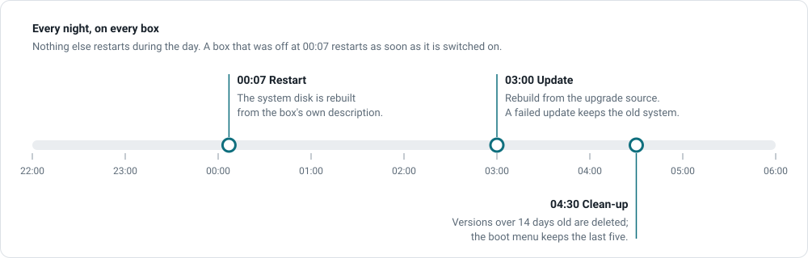
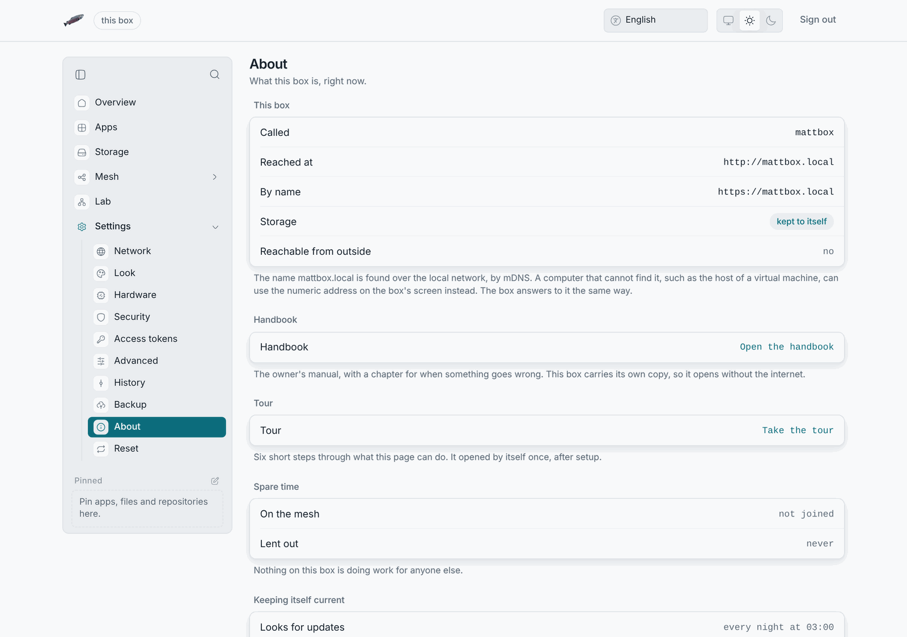

# Updates and reboots

Two timers run on every box. The About pane shows both.

| Time      | What                                                                                                                                     |
| --------- | ---------------------------------------------------------------------------------------------------------------------------------------- |
| **00:07** | **Restart.** Unconditional. The system disk starts blank and the box builds it again from its description, so this restart is how the box repairs itself. A box that was off at 00:07 restarts as soon as it is on. |
| **03:00** | **Update.** The box fetches the newest version of LosOS from GitHub, keeps its own settings, and rebuilds itself on top. |
| **04:30** | **Clean-up.** The box deletes system versions older than 14 days, and the boot menu keeps the last five. That stops the disk and the boot partition from filling up. |

## What survives

Only what is on a short list: your files and LosOS Git's data, the system's
own store, the settings you chose, the box's keys and identity, the mesh
membership. Everything else is gone at 00:07. The
[reference page](../reference/what-survives-a-reboot) has the list.

## While it works

A box stays reachable while it applies an update or a change. The apps keep
answering until the box switches to the new system, which takes seconds. If
an update fails, the previous system keeps running and the box tries again
the next night.

## Where new versions come from

The box keeps its description in its own repository, the one LosOS Git
shows on the History pane. Before the 03:00 rebuild, it fetches the newest
commit of the `main` branch at `https://github.com/dasmatus/losos.git` and
makes it the box's next version, as one commit named `Update to
dasmatus/losos main` and the commit's short id. Two files stay as the box
has them: `modules/overrides.nix`, which holds your settings, and
`modules/install-target.nix`, which holds the disk list, the firmware mode
and the unlock mode. The rebuild then builds that commit, and so does every
Apply after it.

:::note[Your own changes stop updates]
If you changed any other file in the box's repository, for example by
pushing a commit to LosOS Git from a clone, the box keeps your change and
does not update. The History pane says so. Put those files back to follow
the project again.
:::

Three Nix settings control this, and the Advanced pane shows them:

| Option                                | Default                                 |
| ------------------------------------- | --------------------------------------- |
| `losos.configRepo.upstream.enable`    | on                                      |
| `losos.configRepo.upstream.url`       | `https://github.com/dasmatus/losos.git` |
| `losos.configRepo.upstream.branch`    | `main`                                  |

A company can point the address at its own fork. The repository must be
readable without a password. Turn the first one off and the box rebuilds
only from the version it has.

:::note[No internet at 03:00]
A box with no internet at 03:00 rebuilds the version it has and tries
again the next night.
:::

## Downloads stay on the box

Every download a rebuild makes goes through a local copy on the box, kept on
the encrypted disk under `/var/cache/losos-nix-cache`. The clean-up at 04:30
deletes the build tools the last rebuild fetched, and the next rebuild finds
them in the copy instead of downloading them again. The copy also survives
the 00:07 restart, so a box with no internet at 03:00 can still rebuild from
what it already fetched once.

Nothing in the copy is trusted for being there. Every piece of software in
it carries the signature of the cache it came from, and the box checks that
signature each time it installs it.

| Option                          | Default | What                                            |
| ------------------------------- | ------- | ----------------------------------------------- |
| `losos.cache.local.enable`      | on      | Keep the copy                                   |
| `losos.cache.local.maxSize`     | `8g`    | Most space it takes; the oldest unused go first |
| `losos.cache.local.minFree`     | `4g`    | Free space it always leaves for your files      |
| `losos.cache.local.shareOnLan`  | off     | Let other boxes on your network use it          |
| `losos.cache.local.peers`       | none    | Other boxes' copies to ask first                |

With several boxes at home, turn on `shareOnLan` on one and list it in
`peers` on the others, as `http://<name>.local:8790`. They then download
each update from the internet once between them. Only addresses on your own
network are let in.

## When the box is off

Nothing happens, and nothing is lost. Switch it on and it boots, restarts
if it missed a midnight, and updates at the next 03:00.
