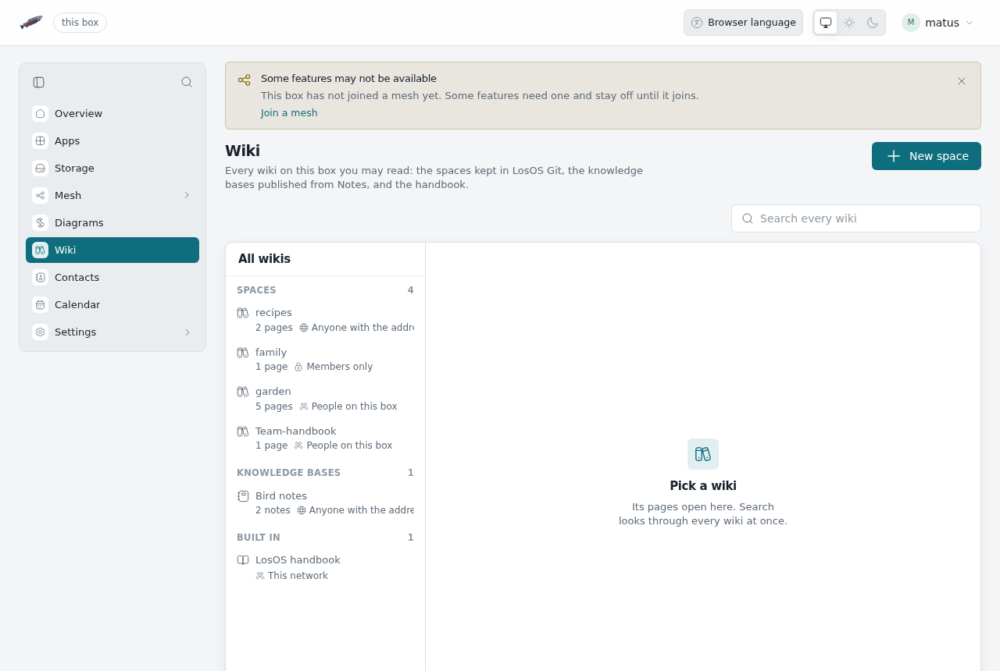
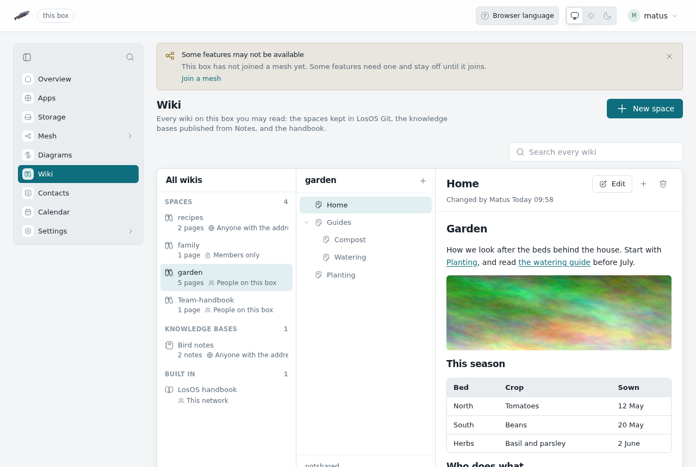
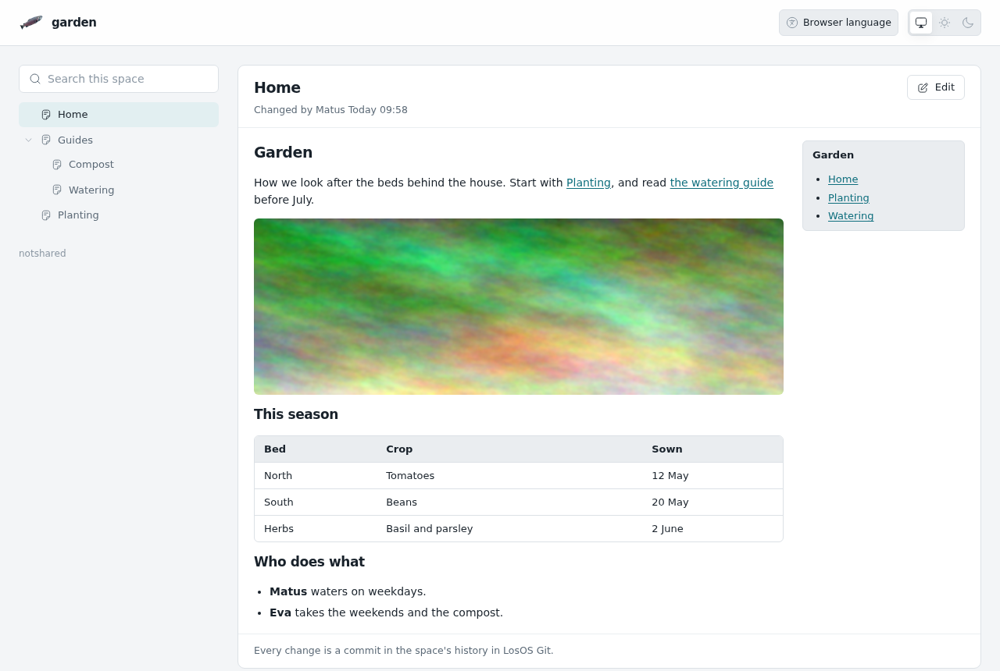

# LosOS Wiki

LosOS Wiki keeps documentation the way a team wiki does: spaces of pages
in a tree, written in the browser, and each space also published as a site
of its own. **Wiki** in the sidebar opens it at `/wikis`.

It is also the box's directory of wikis. One list shows every wiki on the
box that you may read:

- **Spaces**: the wikis of LosOS Git repositories, written here.
- **Knowledge bases**: folders of notes published from
  [Notes in LosOS Cloud](notes-and-knowledge-bases). They are written in
  Notes; the directory links their sites.
- **Built in**: this handbook.

The search above the list looks through the pages of every space and every
knowledge base at once, and offers the same words to the handbook's own
search.



## Spaces

A space is the wiki of a repository in [LosOS Git](losos-git). Its pages
are Markdown files in a Git repository of their own beside the code,
`<repository>.wiki.git`, the same layout Forgejo and GitHub use. A box that
moved from Forgejo already has its wikis there, and they show up as spaces
without any import.

Who may do what follows the repository:

| The repository is | Who reads the space | Who writes it |
| --- | --- | --- |
| Public | Anyone with the address | People who may push to it |
| For people on the box | Everyone signed in to the box | People who may push to it |
| Private | Its owner and collaborators | People who may push to it |

**New space** makes a repository with that name, at the visibility you
pick, and writes its first page. To give an existing repository a wiki,
open it in LosOS Git and choose **Wiki** in its menu.

## Pages



- Each page is one file. "Getting started" is `Getting-started.md`.
- A page below another is a file in a folder: **New page below this one**
  on `Guides` makes `Guides/<title>.md`. The tree on the left follows the
  folders.
- `Home` opens first. Without one, the first page does.
- `_Sidebar.md` and `_Footer.md` frame every page beside them and below
  them. A folder can have its own.
- `[[Page]]` and `[[Page|text]]` link to a page of the same space, and so
  does a plain link to `Page` or `Page.md`. Inside a folder, links start
  from that folder.
- Pictures kept in the space (PNG, JPEG, GIF, WebP or AVIF) show on the
  page: ``. Pictures from other sites stay links.

**Edit** opens the page in a Markdown editor with a preview. Every save is a
commit in the space's history, with your name on it and an optional note
of what changed; **Changes** under the page lists them. If someone else
saved the page while you were writing, the save is refused and your text
stays in the editor, so you can reopen the page and add it again.
**Delete page** removes the file in a commit too, so the text stays in the
history.

## With Git

Every space is a Git repository. Clone it with the address shown below its
page tree:

```sh
git clone https://<box>/git/<owner>/<repository>.wiki.git
```

Pushing needs the same rights and the same token as pushing to the
repository itself (see [LosOS Git](losos-git)). The first push to a
repository's wiki address makes the space. Pages written in the browser and
pages pushed with Git are the same files.

## The published site



Each space is also a site at `https://<box>/wiki/<owner>/<repository>/`,
like a project's pages on GitHub Pages: the page tree, the page, and a
search of the space, with nothing to change it. It is open to whoever may
read the space, so a public space reads without signing in, also through
an edge. People who may write see **Edit**, which opens the page in
LosOS Wiki. `https://<box>/wiki/` lists every space you may read.

When LosOS Git keeps its pages behind LosOS Login
(`losos.git.site.requireSignIn`), the published sites are behind it too.
