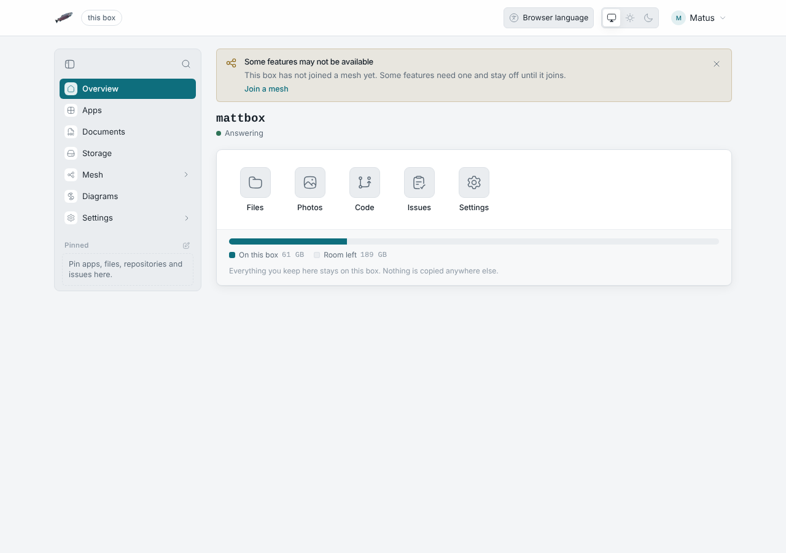

# Without JavaScript

The admin pages work in a browser with JavaScript turned off. Open the box
at its usual address and the box sends the browser to the same page under
`/basic/`: `https://<address>/settings/network` becomes
`https://<address>/basic/settings/network`. The box draws these pages itself
and sends them as finished HTML, with the same sidebar, top bar, colours and
fonts as the usual pages.

This helps when a browser blocks scripts, for example with NoScript or a
company policy, or when the usual pages will not load.

## Signing in

Sign in with your name and password, as on LosOS Login. If your account asks
for a code from an authenticator app, the next page asks for it. A passkey
needs JavaScript, so an account that signs in with one cannot sign in here.
Use the spare admin key instead. The browser keeps that key until you close
it.

These pages are https only, like LosOS Login. The box sends an `http://`
address on to `https://`.

## What works

- **Overview.** The box's name, whether it is answering, the tiles and how
  full the disk is.
- **Storage.** How much room is used and left, and using the reserve, which
  asks first.
- **Network.** The box's name, being reachable from outside your home, and
  your own domains: add one, see its two records and remove it.
- **Hardware** and **Security.** Every switch on those panes.
- **Search.** Finds a page of the box by its name.
- **Look.** Your own background, plain or a picture the box ships, and the
  veil over it. A picture of your own is uploaded with JavaScript on.
- **Theme, language and the sidebar.** Light, dark or the browser's choice
  and the language, in your menu at the top right, and the sidebar folded
  to icons. The browser keeps these.

A change you make shows in the Apply bar at the foot of the pane, which
counts the changes. **Apply** rebuilds the box as it does on the usual
pages, and the page reloads itself every few seconds until the rebuild is
done, then says whether it worked. **Discard** puts the pane back.

Pages not here yet, such as Apps, Mesh or LosOS Cloud, say they need
JavaScript and change nothing.

## What does not work

- The widget board on the overview. Its widgets live in the browser and
  need a script.
- Anything that updates as you watch, other than the rebuild. Reload the
  page to see what changed.

## Why the page looks the same

The pages without JavaScript use the stylesheet and the words of the usual
pages. Menus, folding the sidebar and the dialog that asks before using the
reserve open and close in CSS alone. Notices slide in and leave by
themselves, also in CSS, and stay put if your system asks for less motion.

## This handbook

The handbook reads without JavaScript too, on the box and on the web. On a
phone the menu button opens the chapters as a sheet. A chapter in the
sidebar opens its own page, and **On this page**, the language menu and
Light, Dark or the browser's choice all work. A theme you pick holds only
for the page you picked it on. Search needs JavaScript, so the search box
opens a list of every page instead, and your browser's Find searches it.
