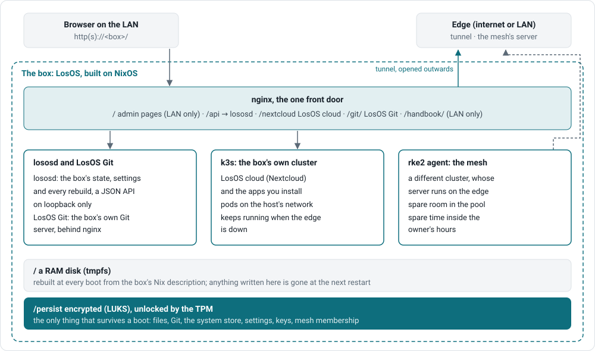
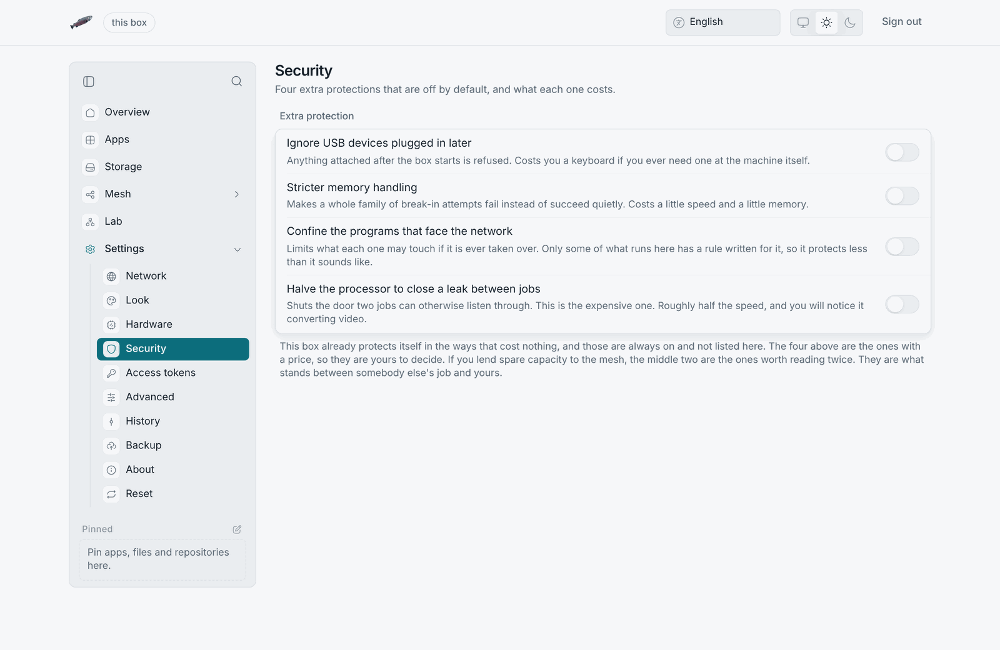

# Security model

This page is a summary for owners. The full document is
[`docs/security-model.md`](https://github.com/dasmatus/losos/blob/main/docs/security-model.md)
in the repository. It is versioned with the code, and it is written so you
can argue with it.

## Trust boundaries

1. **Internet → edge.** Only the edge is internet-facing. A box opens a
   tunnel outwards and listens on nothing from outside.
2. **Edge → box.** TLS 1.3 encrypts the tunnel end to end, over QUIC or,
   where UDP is blocked, over TCP. The box pins the edge's certificate on
   first contact and refuses a changed one. Inside the tunnel, visitors'
   connections stay encrypted to the box's own certificate: the edge routes
   them by name and cannot read them. It still sees which name was asked
   for, when, how much data passed, and the box's home address. See
   [The edge cannot read the traffic](../in-depth/master-proxy.md#the-edge-cannot-read-the-traffic).
3. **LAN → box.** The box serves HTTPS with its own certificate, which you
   trust once per computer. Until you do, someone on the same Wi-Fi who can
   intercept traffic could intercept first use.
4. **Your files ↔ the mesh's copies.** The box has two accounts with
   separate groups and mode-700 homes. The mesh's directory is encrypted
   with its own key, which the box loads only while sharing is on. That key
   is on the box that lends the space, so to keep data of your own on the
   mesh, back it up to storage you bought there: your box encrypts it with
   your recovery code before it leaves, and the lenders and the edge hold
   only ciphertext.
5. **An official edge ↔ any edge.** The box checks each edge for itself
   before it trades through it: the owner's OpenPGP passport, a TPM that
   shows a published LosOS gateway image booted untouched, and settings that
   pay LosOS's share to the addresses the box ships. Trading needs an edge
   that passes, and everything else works with any edge. No LosOS key
   makes an edge official, so there is no private key to steal. An edge caught
   tampered with is never used again by the box that caught it.

## What the admin key is

The 64-character spare key can do anything root can. It can write any
setting and rebuild the box. The box creates it and shows it once, on a wizard
page. After that the box hands it only to a browser that proves the owner's
password. The control API listens on the box's loopback only, behind the
LAN-only guard. Ten failed attempts throttle an address. The box keeps an
audit log of settings changes, password resets and resets.

## Hardening

On by default: kernel hardening parameters and sysctls, a kernel-module
blacklist, a tmpfs `/tmp`, systemd sandboxing of the web server, mDNS and the
control daemon. Four protections that can break something are opt-in on the
Security pane: AppArmor, a hardened memory allocator, no SMT, USBGuard.
[Hardening](/in-depth/hardening.md) covers each flag and what it costs.

## Known limitations, stated plainly

- **The installer medium is signed; the installed system is not.** A
  firmware with the LosOS certificate enrolled verifies the stick's loader,
  one signed image holding the kernel, the initrd and the command line. That
  loader checks the system image's hash before mounting it, so an altered
  stick does not start. The box's own loader and nightly kernels are
  unsigned. The box therefore runs with Secure Boot off, and only physical
  possession protects its boot chain. [Secure Boot and signed
  media](../start/secure-boot) has the details.

- **One origin.** The admin pages, LosOS Cloud and LosOS Git share one
  address. A cross-site scripting hole in either app could read the admin
  key from a tab that has it. The defences are the strict content-security
  policy on the admin pages, the LAN-only guard, and keeping the apps
  patched. The project weighed a separate name for the admin pages and kept
  one address.
- **Theft of the whole box.** The TPM releases the disk key to any software
  booted on that machine, so a thief with the box can read it. The
  encryption protects only a disk taken out on its own. On a box without a
  TPM, even the disk alone is readable. A box installed with `--tang` opens
  only with a key server on its own network as well, and asks for the
  recovery code anywhere else. One installed with `--tang-edge` needs its
  edge to answer, and the owner can tell the edge to stop answering for a
  stolen box. [TPM and the disk key](tpm) explains the difference.
- **The audit log** does not rotate, and root can rewrite it.
- **Throttling is per address**, so an attacker on the LAN who spoofs
  addresses gets a fresh budget each time.
- **A hand-written widget** runs in every browser that opens the box. It is
  sandboxed away from the admin key and the API, but it can show whatever its
  author wrote and fetch anything from the internet.
