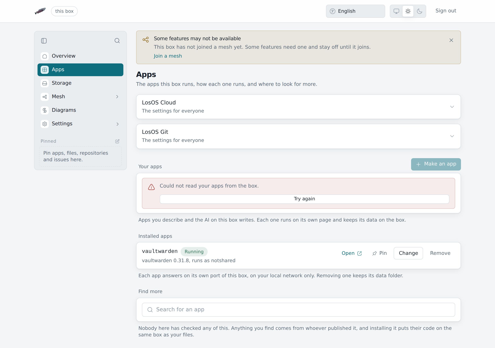

# An app tile gives 404

**What you see:** clicking **Files**, **Photos** or **Code** on the
Overview, or an old bookmark, opens a "Not Found" page.

## "Not Found" from an app tile

- **The app is off.** **Files** and **Photos** open LosOS Cloud, which
  `losos.cloud.enable` on the **Advanced** pane turns on and off. **Code**
  opens LosOS Git, which the **Apps** pane turns on and off.
- **The box has just started.** LosOS Cloud opens a few seconds after
  the box is up. On the first start after an update from Nextcloud it
  first moves your files over, which takes longer
  ([A box that ran Nextcloud](../manual/losos-cloud#a-box-that-ran-nextcloud)).
  Wait and reload.

## "Not Found" from an old bookmark

Bookmarks into Nextcloud's own pages, such as
`/nextcloud/index.php/apps/calendar/`, lead nowhere now: the box has no
Nextcloud. Open `https://<name>.local/cloud/` instead. The desktop and
phone apps are not affected, since LosOS Cloud still answers them at the
`/nextcloud` address they were set up with.

## LosOS Git links show the wrong name

LosOS Git prints clone URLs with the box's `.local` name even when you reached
it by address. The pages work either way. For `git clone`, put the address in
place of the name, or add the name to your hosts file as
[The name does not resolve](name-does-not-resolve) describes.
