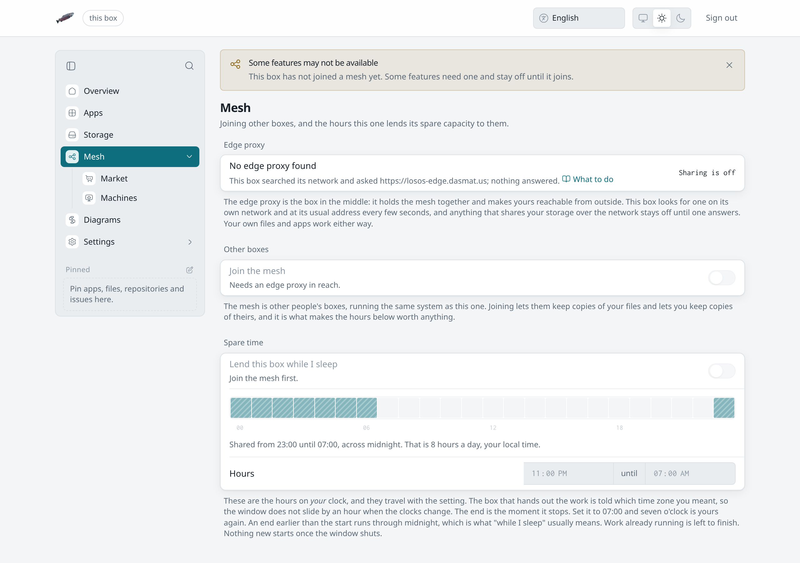

# Sharing is refused

**What you see:** the switch for sharing your disk, joining the mesh or
lending spare time cannot be turned on, is greyed out, or Apply refuses the
change with a reason.

## The reasons, and which one you have

| What you see                                           | Reason                                                                                      | What to do                                                                 |
| ------------------------------------------------------ | ------------------------------------------------------------------------------------------- | -------------------------------------------------------------------------- |
| Switch greyed, "Needs an edge proxy in reach."; the Mesh pane says **No edge proxy found** | The box found no edge. Storage and compute sharing need somewhere to share *to*. | [No edge found](edge-not-found).                                            |
| Apply refused: "no edge proxy is reachable from this box, so `losos.sharingMyStorage` cannot be turned on …" | The edge answered when you flipped the switch and had gone by the time you applied. The box refuses to promise room to a pool it cannot reach. | Wait for the Mesh pane to show the edge again, which it rechecks every 20 seconds, and apply again. Nothing changed. |
| "Share with this network's gateways" greyed, "Needs a local gateway in reach. An official edge is not enough." | Sharing with this network needs an edge the box reaches on its own network. An official edge, or one the box only reaches over the internet, does not count. | Put the box on the same network as its gateway; the Mesh pane lists the local gateways it sees. See [storage modes](../types/storage-modes#shared-with-this-network-only). |
| Apply refused: "no local gateway is reachable from this box, so `losos.sharingLocally` cannot be turned on …" | The local gateway went away between the switch and the apply. | Wait for it to show under **Local gateways** on the Mesh pane and apply again. Nothing changed. |
| The edge's row wears a warning sign; Market says "The edge proxy this box found did not pass the gateway checks" | The edge shows no gateway passport (a company's own edge, usually), or its checks failed, or the gateway image and LosOS's payout addresses are not published yet. Sharing through it works. The box refuses trading through it by design. | Use a checked gateway for trading; the edge's tooltip says which check failed. See [official or not](../types/official-edge#official-or-not). |
| "Join the mesh first."                                 | Lending spare time needs the box in the edge's cluster.                                      | Turn **Join the mesh** on, then set the hours; both go out in one apply.     |
| Hours set, nothing is ever lent                        | The window starts and ends at the same minute, or the box is never idle inside it.           | Set a real window. The caption under the hours says how long it is.          |
| Apply fails on a mesh change                           | The rebuild itself failed, after the box accepted the change.                                 | [Apply fails](apply-fails), then try again with the edge up.                 |

:::note[Only turning on is refused]
The box only ever refuses *turning on*. A box whose edge went away keeps the
sharing it already had, can still change every other setting, and can turn
sharing off at any time.
:::

## What sharing never does

It never shares your own files. Shared room belongs to a separate account on
the box with its own encrypted directory. Your files and the mesh's copies
cannot read each other. Turning sharing off makes that directory unreadable again,
even to the box.
