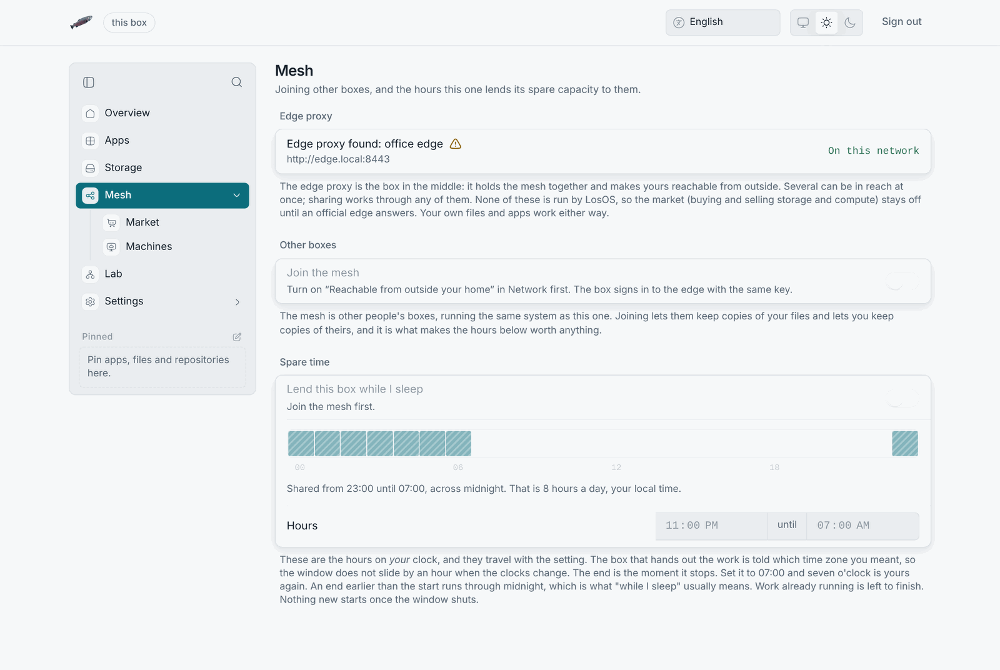
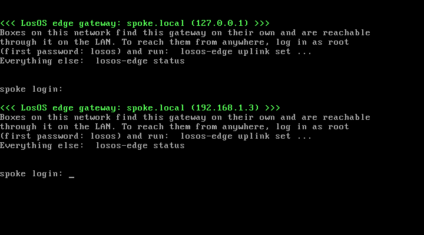
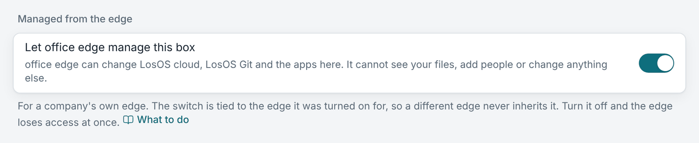

# A company with its own edge

A company runs several boxes on one network and an edge server of its own,
either on that network or on a server it rents. Everything stays inside the
company. The boxes find the edge on the LAN, share disk and CPU among
themselves, and answer under the company's domain through the company's
edge. On a network with no internet at all, this is how you pool storage.
One always-on machine on the LAN runs the edge, and the boxes find it on
their own.

## What is the same as the LosOS edge

- Remote access under the edge's domain, with no ports opened on the boxes.
- The mesh, with a shared, replicated disk pool and spare compute across the
  company's boxes, scheduled inside each box's own hours.
- Discovery on the LAN. A box on the same network finds the edge within one
  20-second scan without being told its address, and the Mesh pane shows it
  as **On this network**.
- The admin pages of every box stay LAN-only.

## What is different

- **No market, unless it is a checked gateway.** A company's edge usually
  shows no gateway passport, so every box treats it as unofficial;
  [official or not](official-edge#official-or-not) explains the check. Its
  row on the Mesh pane wears the warning sign, and the Market pane says "The
  edge proxy this box found did not pass the gateway checks. Sharing storage
  through it works; trading needs a checked LosOS gateway in reach." The
  company's own boxes share storage and compute among themselves for free,
  which is the point. A company that wants the market through its own edge
  runs the published gateway image on a machine with a TPM and signs a
  passport for it; it then pays LosOS's share like any other gateway.
- **The company holds the keys.** The tunnel key pair, the cluster token and
  the allow-list of boxes live on the company's edge. Nothing about the
  company's data or traffic touches the LosOS project.
- **Updates still come from the project.** A company can point its boxes at
  a fork instead, because the upgrade source is a setting.

## Setting it up

The edge is a NixOS module that ships with LosOS, `nixosModules.edge`. You
install the edge server the same way a box is configured, with a short Nix
file. It names the public domain, the boxes allowed to connect, whether to
run the mesh control plane, and whether to announce itself on the LAN. The
operator's walkthrough is in [Master proxy](/in-depth/master-proxy.md)
and [Mesh](/in-depth/mesh.md). The
repository also carries a demonstration of exactly this setup under
`nix/demo/edge-lan/`: two boxes and an edge on one virtual network. `run.sh`
boots it, and `CHECKLIST.md` is the order it walks through.

In short:

1. Install NixOS on the edge server and import the module.
2. Set `losos.edge.publicDomain`, list each box under `losos.edge.tenants`
   with a token file, and turn `losos.edge.cluster.enable` on for the mesh.
3. For an edge on the company's own network, set `losos.edge.lan.advertise`
   to `true`. The edge then announces itself over mDNS, by default as
   `http://<edge>.local:8443`, and opens its API to the LAN. Every box on
   that network finds it with no configuration.
4. On each box, give the box a name of its own and turn **Reachable from
   outside your home** on, both under Network, then turn **Join the mesh**
   on. The box signs in to the edge with its tunnel key, and every box
   starts with the same name, which the edge accepts only once. If the edge
   is *not* on the same network, first enter its address under Settings →
   Advanced, in `losos.proxy.registrarUrl`. mDNS announcements do not cross
   routers.

## Managing the boxes from the edge

The people who run the company's edge can change LosOS Cloud, LosOS Git and
the apps on its boxes from one page on the edge. Each box's owner decides
whether that edge may.

1. On the box, open Settings, then Mesh, and turn on **Let the company edge
   manage this box**. The switch shows the edge's name when the box knows
   it. It is off until the owner turns it on, and it belongs to the edge the
   box uses at that moment. A different edge never inherits it.

   

2. On the edge, set `losos.edge.manage.enable` (an edge gateway machine has
   it on). The edge makes a manage key on its first start and keeps it in
   `/var/lib/losos-registrar/manage-key`. An edge gateway machine shows it on
   its screen with the page's address.
3. Open `/manage/` at the edge's address, for example
   `http://<edge>.local:8443/manage/`, and sign in with the key. The page
   lists the boxes the edge routes and opens the ones whose owner turned the
   switch on.
4. A box's page has the LosOS Cloud and LosOS Git settings from the box's
   Apps pane, its installed apps and the app search. A change rebuilds the
   box like a change made on the box.

The edge cannot see anyone's files, add people, change passwords, or touch
storage, backups, the network or the switch itself. The box checks each call
on its own, so a changed page on the edge gets no further. Only an edge on
the box's own network can manage it, and never the LosOS edge. LosOS does not
manage anyone's box. When the owner turns the switch off, the edge's next
call is refused.

[Edge web page](../in-depth/edge-web-ui.md) goes through the page in full.

## Who this is for

Small companies that want the "one box per team, one pool for all" setup
with nothing leaving the building. They need someone who can run one NixOS
server. LosOS is meant to be sold in this shape.
