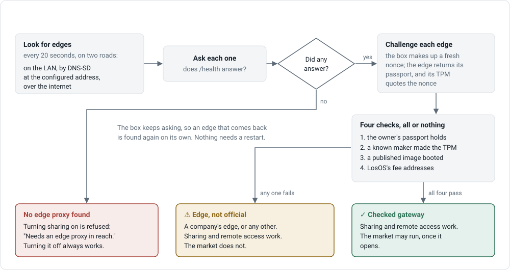
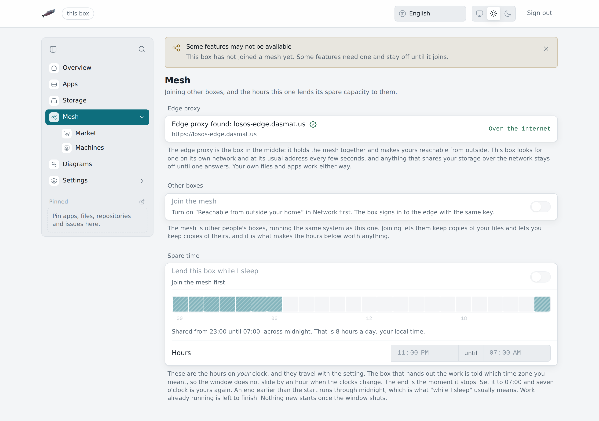
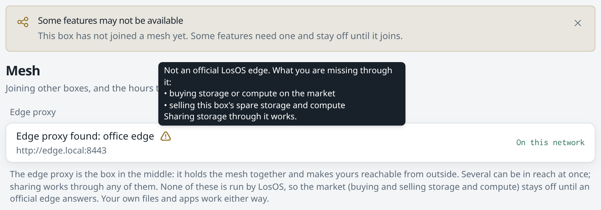
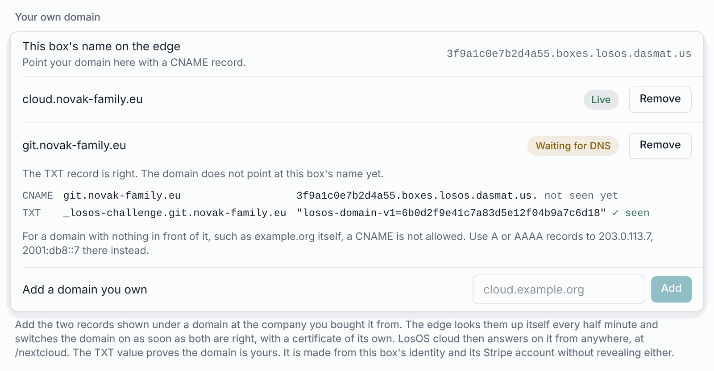

# A box with the LosOS edge

An **edge** is a server on the internet that a box keeps a tunnel open to.
Through it, the box gets a public address without opening a port at home,
and joins the mesh of other boxes. The box can trade on the edge's market
too. The project runs the **LosOS edge**, and only that edge's market
pays out.

## What the edge does for a box

| Feature                | How                                                                                                        |
| ---------------------- | ---------------------------------------------------------------------------------------------------------- |
| **Remote access**      | `https://<your-name>.<edge domain>` reaches LosOS Cloud and LosOS Git through an encrypted tunnel the box opens outwards. The box never publishes the admin pages; they stay LAN-only, even through the tunnel. |
| **The mesh**           | The box joins a Kubernetes cluster the edge runs. Its spare disk becomes part of a shared, replicated pool; its spare CPU runs other people's work inside the hours you allow, only while the box is idle. |
| **The market**         | You get paid for the disk and CPU you share, and you can buy some from others. Buyers pay in USDC, Bitcoin or Monero, or by card through Stripe where the edge takes cards, and the edge keeps a 4 % fee. An edge can take coins only, without card payments, so no business account with a card processor is needed to run the market. The Market pane is under Mesh in the sidebar. |
| **Find my box**        | The edge hosts the page that finds a box on your LAN from a browser.                                        |

## How a box finds its edge

Every 20 seconds the box looks for an edge in two places:

- **On the local network**, by DNS-SD. An edge set up to announce itself
  publishes `_losos-edge._tcp` over mDNS with the address of its API. The box
  finds it the same way it finds its own `.local` name.
- **At the configured address**. This is the LosOS edge's control plane
  unless the owner changed it under Settings → Advanced, in
  `losos.proxy.registrarUrl`. The box asks it whether or not **Reachable from
  outside your home** is on.

An edge counts as found once its `/health` answers. Several can be in reach
at once, for example a company's edge on the LAN and the LosOS edge over the
internet. The Mesh pane shows one row per edge, marked **On this network** or
**Over the internet**, with a sign saying whether the edge is official. The
next section explains that sign. If nothing answers, the pane shows **No edge
proxy found** and what the box tried: "This box searched its
network and asked `<address>`; nothing answered."

While nothing answers, the box refuses to turn network-dependent sharing
on. Switching storage to mesh mode, **Join the mesh** and **Share this
box's disk with the mesh** are greyed with "Needs an edge proxy in reach.",
and the box refuses any apply that turns one of them on anyway, with the same
reason. The box leaves settings that are already on alone. A box whose edge
went away keeps its configuration, can still change everything else, and can
always turn sharing *off*. Your own files and apps never depend on the edge.
The tunnel switch is not gated either. It reconnects when the edge answers
again.

## Official or not

Any edge that answers opens sharing. Only the LosOS edge may run the market,
so a box has to tell it apart from any other edge. Finding an edge and
trusting it with money are separate questions. Every box carries a LosOS root
public key. An official edge proves itself on every scan. It presents a
certificate signed with the matching private key, which only the project
holds, offline. It also signs a fresh challenge the box just made up, using
the certificate's own key. The box makes four checks, and the edge counts as
official only if all four pass.

The Mesh pane shows the result as a sign beside each edge's name. An
official edge gets a check. Any other edge gets a warning, with a tooltip
listing what that edge cannot do for this box: buy on the market, or sell
this box's spare storage and compute. A box that cannot verify the signature
treats the edge as a [company edge](company-edge). Discovery, remote access
and sharing work, trading does not, and the Market pane says "The edge proxy
this box found is not run by LosOS." Nothing a company configures can make
its own edge official. That is deliberate.

:::note[Until the key is published]
Every box ships with an empty root key file until the project publishes the
public key. Until then no edge is official, every edge wears the warning sign
and the market is off on every box. That is the safe direction to fail in.
:::

The project owner keeps the root key offline, never on a box or an edge.
Each official edge has a key of its own, which never leaves the edge, and a
certificate the root signed for it.

Enrolment at the edge, which decides which box may tunnel through it, is a
separate matter. The edge keeps an allow-list of boxes, each with a token,
and whoever runs the edge adds a box to it.

## Your own domain

A box behind the LosOS edge can also answer on a domain its owner already
has, such as `cloud.novak-family.eu`. The edge does the work that needs the
internet. It runs a small DNS server for its own zone, gives the box a name
there, checks the owner's records, and gets the certificate.

Only an official edge hands out domains, and only to a box whose Stripe
account Stripe has fully checked. That is the account the market pays out to.
It ties the box to a person Stripe has verified, and a stranger cannot borrow
the edge's certificates without one. Until the box has such an account, the
section on the Network pane says what is missing and offers nothing to fill
in.

Once the account is ready, the Network pane shows **This box's name on the
edge**, something like `3f9a1c0e7b2d4a55.boxes.losos.dasmat.us`. The name is
made from the box's identity but does not reveal it. To add a domain:

1. Type the domain under **Add a domain you own** and press **Add**.
2. At the company you bought the domain from, add the two records the pane
   shows under it. One is a **CNAME** from your domain to the box's name on
   the edge. The other is a **TXT** record at
   `_losos-challenge.<your domain>` with the value shown. That value proves
   the domain is yours. It is made from the domain, the box's identity and
   its Stripe account, and gives away none of them.
3. Wait. The edge looks the records up itself every half minute and marks
   each one **✓ seen** as it finds it. When both are right the domain turns
   **Live**, the edge fetches a certificate for it, and LosOS Cloud answers at
   `https://<your domain>/cloud/`.

:::note[Domains with nothing in front of them]
A domain with nothing in front of it, such as `novak-family.eu` itself,
cannot carry a CNAME. Use the A and AAAA addresses the pane lists instead.
:::

A box can have up to five domains, and a domain belongs to one box at a time.
Removing it in the pane stops the edge serving it at the next pass. The edge
rechecks a live domain every hour. If the records disappear, it stops serving
the domain after three failed checks in a row, so one DNS hiccup does not
take a site down. If the Stripe account stops being ready, it stops at once.
Either way the pane says why.

If your box sits behind your own edge at home, your domains still work, as
long as the box has joined the mesh. The LosOS edge sends the traffic to
your edge and your edge passes it to the box. Your box tells the LosOS edge
which home edge it is behind, so nobody else's edge can claim your domain.
There is nothing to set up for this.

## Paid by name

A box that has a name on the LosOS edge can take payments at that name.
Someone with MetaMask, Rainbow or any wallet that sends to ENS names types
`mattbox.boxes.losos.dasmat.us` where an address would go, and the money
lands in the box's wallet. The name gives one address, the box's wallet,
which is the same on Ethereum, Base, Arbitrum and OP.

The section **Paid by name** on the Network pane lists the box's names on
the edge. **Bind wallet** asks the wallet to sign one short message: the
wallet made on this box asks for its password, otherwise the browser's wallet
extension asks. The edge checks the signature and then publishes the
wallet's address at each name. It publishes only an address whose wallet
signed for this box, and only the box can ask, for an administrator signed in
to it. The edge holds the zone, so the name is as trustworthy as the edge
itself. **Unbind** takes the address off again.

The address is public once it is bound, like any address you hand out. The
edge's zone is signed with DNSSEC, which is what lets ENS trust the record.

Beside each name the pane says whether wallets find it yet. A wallet asks
ENS, and ENS asks public DNS, which trusts the edge's zone only once the
domain above it points to the edge and vouches for its signatures. Until
then the name reads **Wallets do not find this name yet** or **Wallets do
not trust this name yet**. That is the edge operator's to set up, not
something the box can change. Once it reads **Wallets find this name**,
payments arrive.

The wallet on the Market pane pays names the same way: under **Send USDC**,
type a box's name, or any name a wallet would take, as the **Address or ENS
name**.

A domain of your own can carry the same record. Under each domain the pane
shows a **TXT** record that starts with `ENS1`; add it at the domain itself.
Two conditions apply. Your DNS provider has to sign the domain with DNSSEC,
and the name cannot be a CNAME, because a CNAME carries no other record. A
domain with A and AAAA records, such as `novak-family.eu` itself, works.
The pane says which of these the edge found.

## Settings that matter

| Pane     | Setting                                | What it does                                                            |
| -------- | -------------------------------------- | ----------------------------------------------------------------------- |
| Network  | Reachable from outside your home       | opens the tunnel to the edge                                            |
| Network  | Your own domain                        | adds a domain you own; needs an official edge and a Stripe account Stripe has checked |
| Advanced | `losos.proxy.registrarUrl`             | the edge address asked over the internet, besides the local network     |
| Mesh     | Join the mesh                          | enrols this box in the edge's cluster; needs an edge in reach, the tunnel on and a name of its own |
| Mesh     | Lend this box while I sleep            | lends CPU inside the hours below, while idle; needs the mesh joined     |
| Mesh     | Hours                                  | the daily window, in this box's own time zone                           |
| Market   | Share this box's disk with the mesh    | lends spare room to the pool; needs an edge in reach                    |

## What the edge sees

The edge sees the box's name, its heartbeat, which features it has on, and
the traffic it tunnels. That traffic is encrypted end to end with a key the
box pins on first contact. The edge does not see the admin pages, the owner's password or the disk key. The
[security model](../reference/security-model) lists the trust boundaries.

:::note[The demo edge]
For presentations, the edge's control plane also runs on Vercel at
`losos-edge.dasmat.us`, with its registry in a small database. That host can
register boxes and show them on a status page, but it cannot carry a tunnel,
run the mesh or take payments; those need the real edge server.
:::
